# 6. Runtime View

Sequence diagrams get added here one at a time, as each flow actually
lands — not speculatively up front.

## 6.1 Vault selection + file listing (milestone 2)

Two related flows: picking a vault, and loading (or reloading) its file
tree. Both go through the same `VaultService` → `contextBridge` →
`VaultManager` path described in
[05_building_block_view.md](05_building_block_view.md).

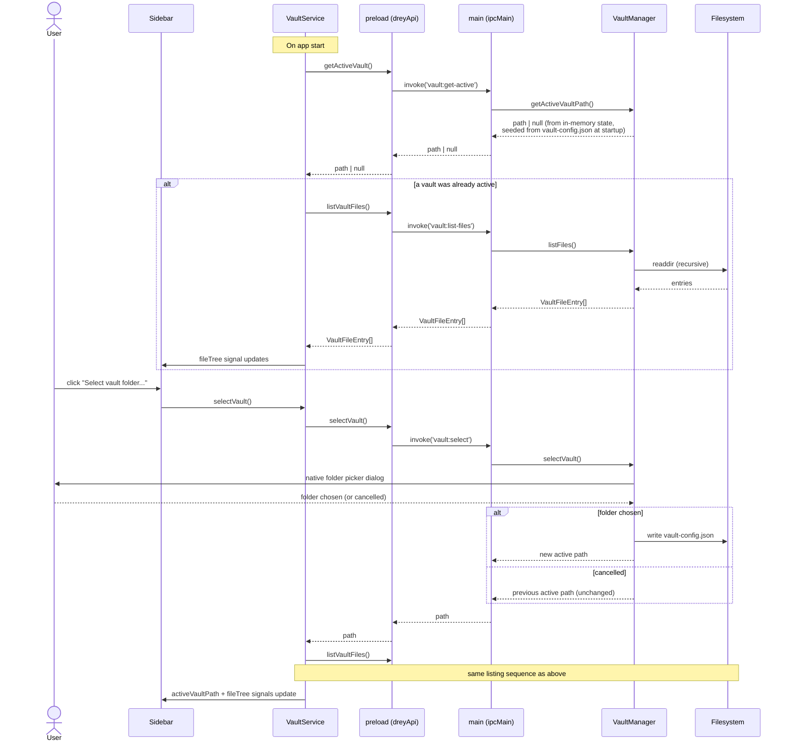

Deliberately out of scope for this milestone: reacting to _external_
changes to the vault folder while the app is running (chokidar file
watching, frontmatter-change vs. body-change vs. untracked-new-file
detection per CLAUDE.md's `FileWatcher` component). This flow is a
one-shot read, re-triggered manually by picking a vault or restarting the
app. Live watching becomes necessary once there's editor autosave to
conflict with it — deferred to whichever milestone builds that (see
[11_risks_and_technical_debt.md](11_risks_and_technical_debt.md),
"Autosave-vs-watcher conflict").

## 6.2 Open file → edit → save (milestone 3)

Clicking a file in the sidebar loads it into the editor; typing marks the
buffer dirty; Ctrl+S (or the Save button) writes it back. All document
state lives in `EditorService` signals — `Editor` owns only the
CodeMirror instance (source) and the markdown-it render (preview).

Since milestone 32, opening **replaces the view**: if the focused pane's
active tab is *clean*, it closes once the new file is open, so clicking
through the tree follows documents instead of accumulating tabs. A dirty
tab stays and the new file opens alongside; a registered plugin doc kind
(browser tab) is never the victim — its state is not behind the file.
Switching itself never prompts (the milestone-3 `confirm()` is long gone).

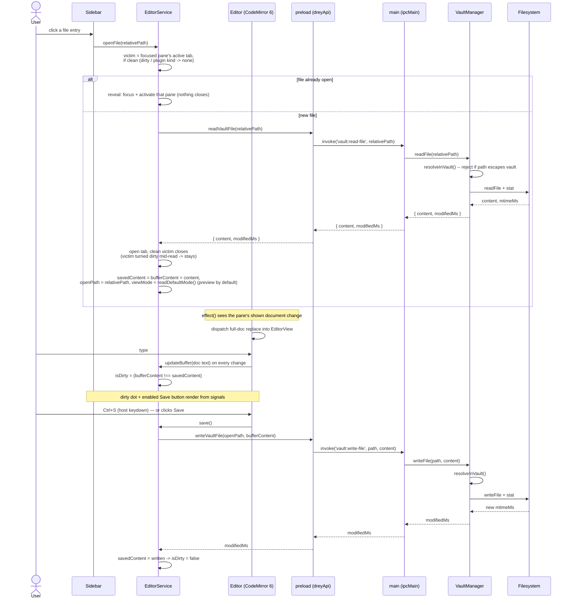

Deliberately out of scope for this milestone (unchanged from 6.1): no
reaction to _external_ changes while a file is open (file watcher), no
autosave, and no `updated:` frontmatter bump on save (deferred to
milestone 5 — needs YAML frontmatter handling; see
[05_building_block_view.md](05_building_block_view.md) §5.5).

## 6.3 Quick-capture → daily note (milestone 4)

The global hotkey raises the main window and opens today's daily note in
the editor, creating it from `templates/daily.md` if needed, then starting
a fresh `## HH:mm` entry. The note lives under the configured daily folder
(`AppConfig.daily.dir`, default `daily/`; `dailyPathFor` in
`shared/daily.ts`) — below, `<daily.dir>` stands for it. No popup — see
[05_building_block_view.md](05_building_block_view.md) §5.6 and
[ADR-0002](09_architecture_decisions/0002-quick-capture-opens-daily-note.md).

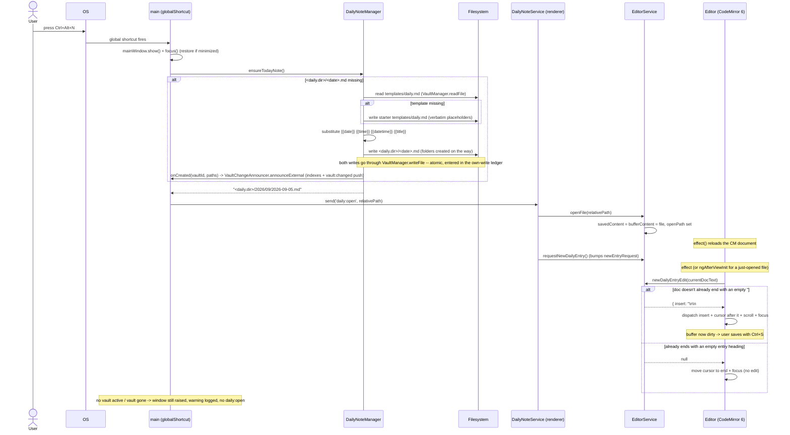

Out of scope for this milestone: inline `#tag` autocomplete and
deterministic routing (milestone 5), task/note classification (milestone
6), `updated:` frontmatter bump on save (milestone 5), and any reaction to
a daily note being changed on disk while open (file watcher, deferred).
Placeholder substitution is a fixed small set; template errors aren't
validated.

## 6.4 Mode switch + click-to-edit ([ADR-0008](09_architecture_decisions/0008-editor-mode-menu-and-rendered-preview.md), supersedes ADR-0004)

There is no auto-switch and no caret sync. `source` is CodeMirror; `preview`
is a read-only markdown-it render. The `⋯` menu flips `EditorService.viewMode`
(a per-tab field; `setViewMode` also persists `{ defaultMode }` to
`localStorage` as the landing mode for new notes). The one `EditorView` stays
mounted (`display:none` in preview) so undo history survives the switch.

A click anywhere in the preview drops to source at the clicked block's line:

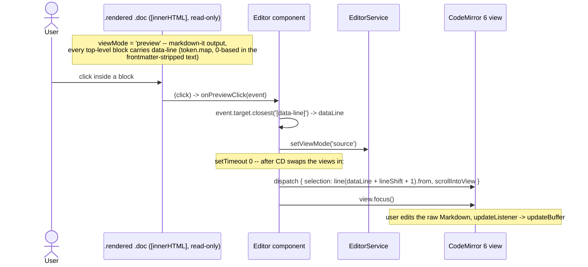

Line granularity only -- the caret lands at the start of the block's line,
not the exact character (the per-character `source-map.ts` mapping from
ADR-0004 is gone). A click that misses every `[data-line]` block still
switches to source, leaving the caret where it was.

> The read-only `preview` mode above is largely superseded by **Live
> Preview** ([ADR-0009](09_architecture_decisions/0009-live-preview-decorations.md)):
> one editable `EditorView` where a rendered table / diagram / image / HTML
> block is a `Decoration.replace` widget only while the selection is
> *outside* it. Reveal for edit = get the selection to touch the node:
> clicking the widget's corner **`</>` View source** button
> (`clickToReveal` → `view.dispatch({ selection: posAtDOM(widget) })`), or
> arrowing in. On reveal the raw lines gain a `.lp-reveal` rounded
> container, and an image additionally keeps a read-only `ImagePreviewWidget`
> rendered below its `` markup (Req-1). The widget/atomic layer
> and this reveal layer are one `StateField` value `{ atoms, reveal }`;
> only `atoms` feeds `EditorView.atomicRanges`.

## 6.5 Save → tag merge + `updated:` bump → route entries to master History (milestone 6)

> **Superseded by §6.11
> ([ADR-0017](09_architecture_decisions/0017-tags-as-labels-and-section-index.md)).**
> `note:save` no longer merges `#tag`s into the frontmatter and no longer
> routes entries into a master document. It bumps `updated:` on a fenced
> file, writes, and re-indexes that one file into `TagIndex`. The diagram
> below is kept for the record.

Saving a `.md` note no longer writes the buffer verbatim. `Ctrl+S` goes
through the main-process `note:save` pipeline (`NoteManager`), which:

1. parses the frontmatter, merges inline body `#tag`s into `tags`, bumps
   `updated:`, and writes the file **in place** (milestone 6a);
2. **routes** (milestone 6b): for every dated entry (`## HH:mm` block) that
   carries a known tag, appends a `### <date> <time>` copy of that entry to
   the tag's master-document `## History` — the source note keeps its copy,
   nothing moves. An HTML-comment marker
   (`<!-- drey:src <path>@<date> <time> -->`) on the heading line makes
   re-saves idempotent.

It returns the rewritten note text (the editor adopts it so the merged
frontmatter shows and the tab is clean) plus `appendedTo` — master paths
that gained a History entry; a clean open tab for one of those is reloaded
from disk. All decision logic is pure `shared/` code
([ADR-0007](09_architecture_decisions/0007-on-save-tag-pipeline.md)).

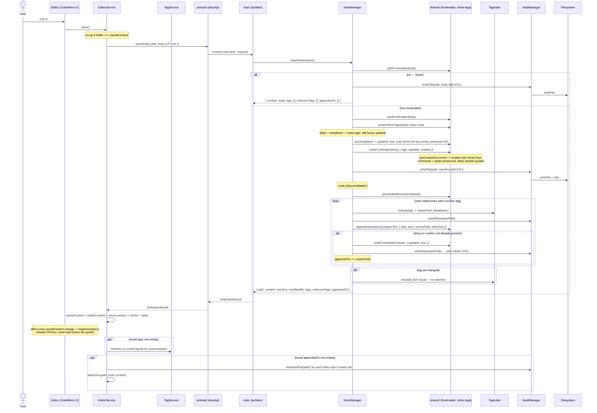

Not routed: files under `templates/`, entries with no known-tag / no
master, and an entry whose target master is the note being saved. A dirty
open master tab is **not** auto-reloaded (that conflict is the file
watcher's job, later).

## 6.6 Run an Action → shared confirmation → apply (Settings / Actions)

A manual Action from the editor `⋯` menu (or an `on-save` trigger from the
`note:save` pipeline) produces a proposed rewrite that goes through the one
confirmation dialog before it touches the document
([ADR-0011](09_architecture_decisions/0011-unified-confirmation-flow.md)).
The example is the (historical) built-in **Autotagging** action; user
templates follow the same shape, differing only in how `after` is
computed inside `ActionRunner`. _(Update — ADR-0017: "Autotagging" as a
document-rewriting Action is gone; tag suggestion is now the drawer's
`autotag` button, which only pre-fills a field — see §6.13. "Update
summary" is gone with master documents. The confirmation flow itself is
unchanged and still used by user templates and Ask edits.)_

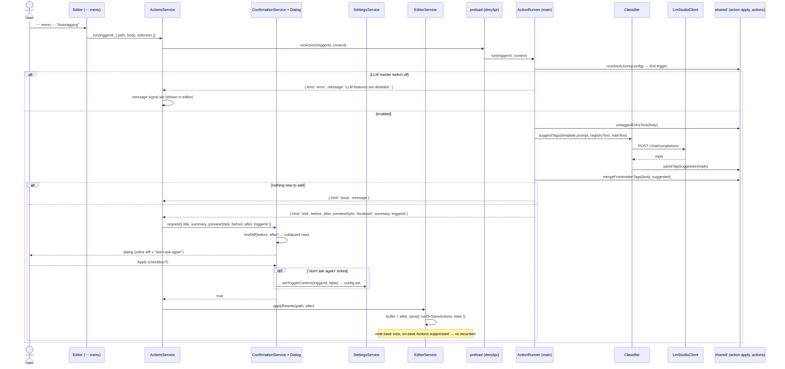

For an `on-save` trigger the entry point differs: `NoteManager` runs the
trigger after writing the file. A `confirm` trigger's `'edit'` outcome
rides back on `NoteSaveResult.pendingActions`; `EditorService` stores it
in a signal, and an `effect` in `ActionsService` drains the queue through
the exact `ConfirmationService` path above. A non-`confirm` trigger is
applied in the main process before the save result returns.

## 6.7 Assistant panel Ask (chat note + full-history replay, ADR-0048)

Milestone 25: the conversation lives in a **chat note** under `chats/`
(the source of truth), the panel went chat-first, and a follow-up
**replays the whole persisted history** — or resumes a provider session
(claude-code `--resume`) when the capability, the `session:` frontmatter
and an unchanged provider all line up. Tool calls/results and applied
edits persist as `drey-tool` entries inside the turn, which is what lets
the replay rebuild the provider loop exactly (the bug-10(b) resolution;
the old ~12-message cap and the `history` IPC field are gone). The
context chips still work as before: the open note rides along by default
with its live buffer, extra files are read at send time, and the note
chip off means an answer-only standalone chat.

Since ADR-0044 stage 7 the whole flow lives in the assistant plugin; the
renderer reaches the plugin main through the fixed `plugin:invoke` channel.

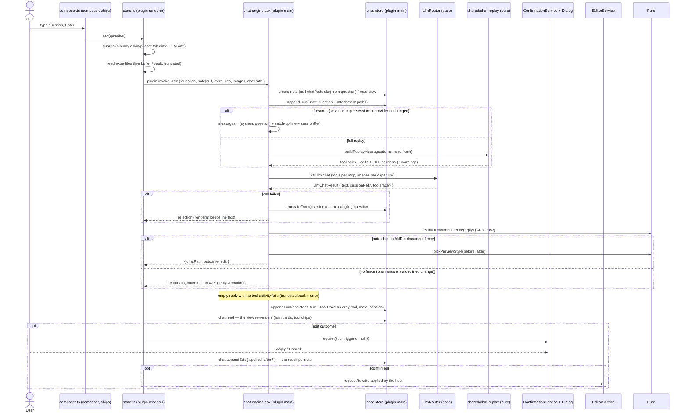

## 6.8 Opening a note: the automatic summary (Feature A)

> **Removed.** The automatic summary is gone — no summary generation on
> open, no sidecar reads/writes, no `thread:*`/`summarize` IPC
> ([ADR-0012](09_architecture_decisions/0012-note-assistant-sidecar-thread.md)
> superseded). The diagram below is kept only as history; today opening a
> tab touches nothing but the editor.

Opening a tab loads that note's sidecar thread and, under one specific
condition, generates its summary. The condition is deliberately narrow so
that re-opening a note never re-bills an LLM call:
[ADR-0012](09_architecture_decisions/0012-note-assistant-sidecar-thread.md).

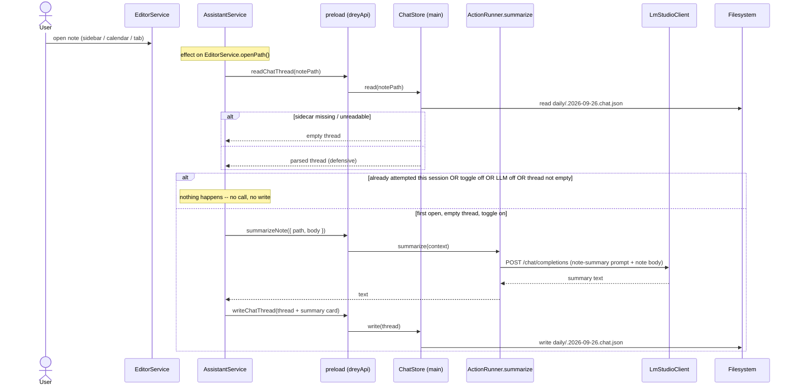

The panel's "Automatic summary" switch decides the `toggle on`
branch. It starts from `assistant.autoSummaryDefault` (Settings →
Assistant) and overrides it **for that note only** — switching it on
after the fact re-runs the same rule once; switching it off never writes
back to the global default.

## 6.9 Adding an entry from the drawer (Feature B)

"Add to document" composes the entry from pure shared code,
dispatches it into CodeMirror as an ordinary edit, and saves.

> **Update — ADR-0017.** `EntryDraft` is `{ topic, text, tags }` (no
> People/Meetings), the meta line is `#tag`-only, TOPIC is optional so
> there is no `'needs-topic-confirmation'` branch or `force` argument any
> more (`submit()` is now `'appended' | 'empty'`), and the save that
> follows just re-indexes the file (§6.11) — it does not route anything.
> The diagram's shape is otherwise current.

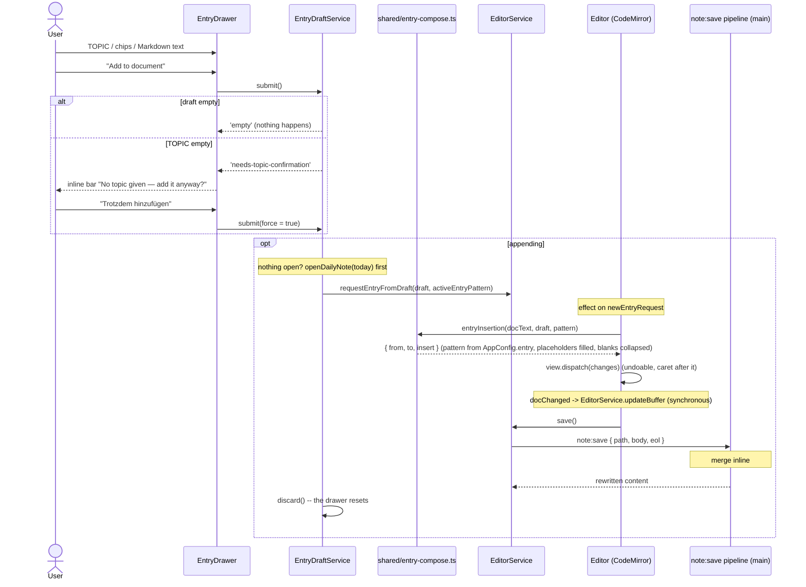

## 6.10 Inline spellcheck (Feature B)

Typing in either editing surface — the drawer body or the document —
triggers a debounced check whose answer arrives asynchronously. The
interesting part is the version guard that discards a reply the document
has already moved past
([ADR-0013](09_architecture_decisions/0013-inline-spellcheck.md)).
Since [ADR-0056](09_architecture_decisions/0056-spellcheck-language-autodetect.md)
the words are grouped by their paragraph's detected language and each
group is judged by its own dictionary; a block too short to detect, or in
a language without an installed dictionary, falls back to the configured
one.

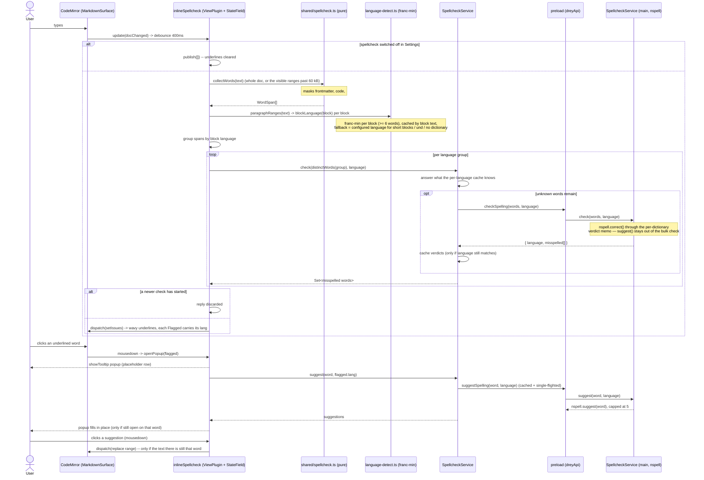

## 6.11 Save → `updated:` bump → incremental re-index (milestone 11, supersedes §6.5)

`Ctrl+S` on a `.md` note goes through `note:save` (`NoteManager`). On a
file with a `---` fence: bump `updated:`, fill `created:` if missing,
rewrite (the pure `shared/` `yaml` round-trip, EOL restored). No fence:
write the bytes verbatim. Either way, the just-written file is re-indexed
into `TagIndex`, and the `on-save` Actions run (§6.6). No `#tag`
frontmatter merge, no routing, no `appendedTo`.

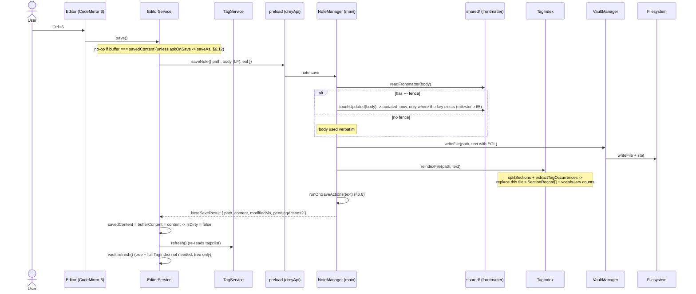

## 6.12 Tag search → hits → open-at-line / Export → Save-as (milestone 11)

The sidebar search panel (or a `Ctrl`/`Cmd`-click on a `#tag` pill, or
`Ctrl+Shift+F`) runs a fast, LLM-free query over `TagIndex`'s tagged
sections. A hit opens the file at its line; **Export** dumps the hits
into an unsaved `search-results.md` tab that `Ctrl+S` then routes through
Save-as.

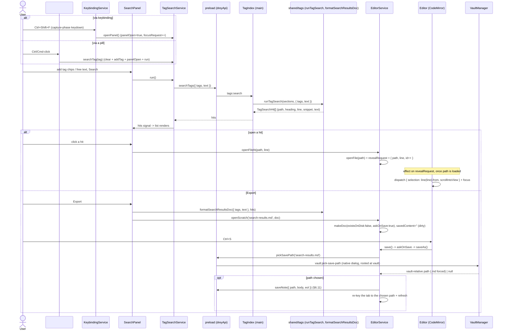

## 6.13 Autotag button → suggestTags → chips (milestone 11)

> _(Historical: the drawer and its Autotag button are gone since
> [ADR-0044](09_architecture_decisions/0044-runtime-plugin-system.md) /
> [ADR-0057](09_architecture_decisions/0057-ui-refinement-icon-chrome-anthrazit-and-slash-capture.md).
> Since milestone 45 (req-36) the flow lives in the editor `⋯` menu's
> **Suggest tags** row: the same `tags:suggest` call (`TagSuggester`), but
> the payload is the heading section under the caret
> (`shared/note-sections.ts`) and the reply is appended into that section
> directly — deduplicated, one undo step, saved — instead of pre-filling
> chips. The diagram below is the pre-plugin shape.)_

The drawer's **Autotag** button sends the current entry text plus the tag
vocabulary to the model; the reply pre-fills the tag chip row. Nothing is
saved — the user still confirms by adding the entry.

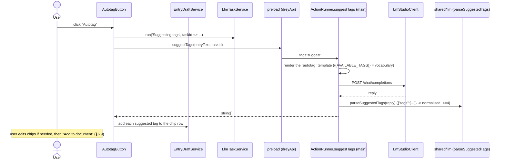

## 6.14 Drag a panel between docks → drop → persist (milestone 14)

`mousedown` on a panel header opens a *press* gesture in `DockService`. A
release before the pointer moves ~4px is a click → `toggleCollapse` (the
whole header is the collapse target; there is no separate chevron button).
Moving past the threshold promotes it to a drag: a `window` `mousemove`
recomputes the drop target/index every frame (the header reorders under the
pointer, so the listeners can't live on the element) and a small title chip
follows the cursor; `mouseup` applies the move and writes the layout.

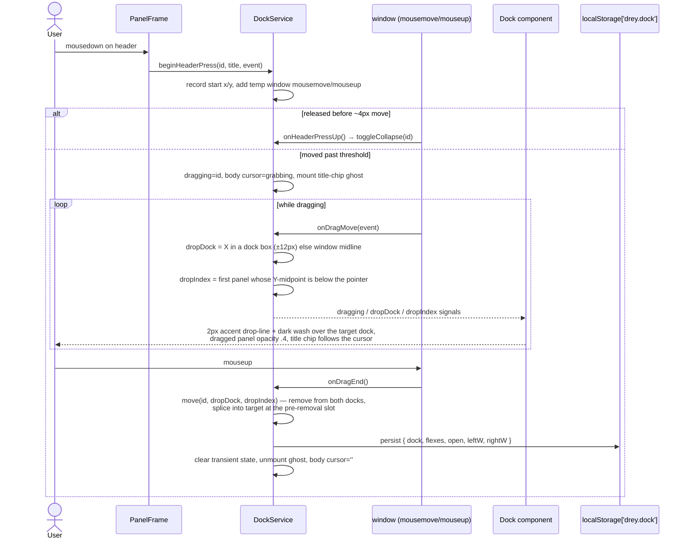

Splitters (`startSplit`, keeps the summed height of the two open
neighbours constant, min 40px each) and the dock-edge resizers
(`startDockResize`, clamp 180–560px) use pointer capture instead and
write the same `drey.dock` blob. `View → Reset layout` is
`DockService.reset()`.

### View menu → hide / show a whole widget (ADR-0034)

The View menu rows are generated from `WIDGETS.filter(w => w.removable)`.
A row's check mark tracks `!DockService.isHidden(id)`; clicking it calls
`hide(id)` or `show(id)` — distinct from collapsing to the header.

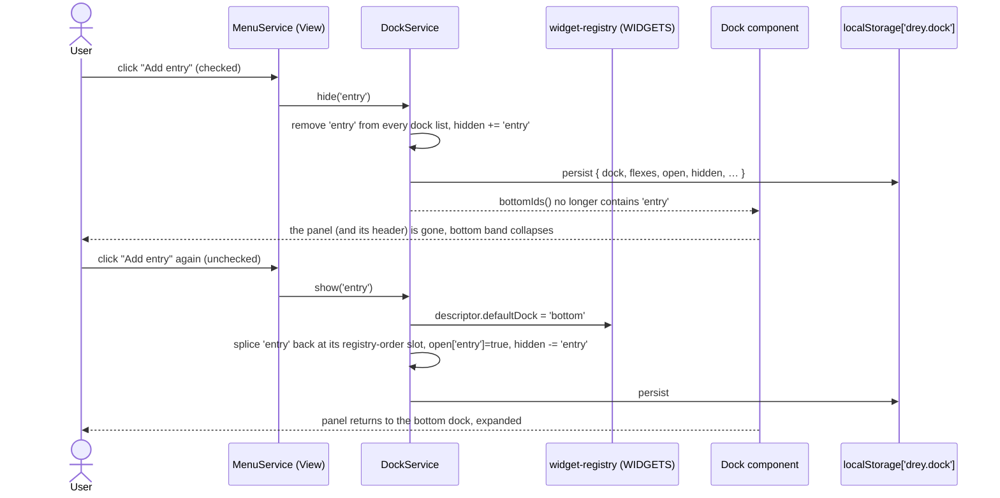

`DockService.move()` (drag) and `openAndExpand()` (a command that reveals a
widget, e.g. `search.open`) also drop the id from `hidden`, so dragging a
hidden widget back or invoking its command un-hides it. `reset()` clears
`hidden` entirely.

## 6.15 Titlebar menu action → command (milestone 14)

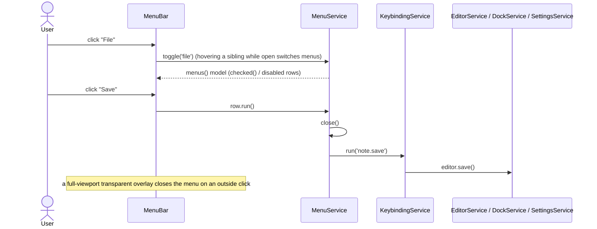

Wired rows: File → New note (`note.new`), Switch vault … (`vault.selectVault`

- `dock.openAndExpand('files')`), Save / Save all (`note.save` /
  `note.saveAll`), Settings (`settings.openScreen`); Edit → Search all notes
  (`search.open` + `dock.openAndExpand('search')`); View → Line numbers
  (`editor.toggleLineNumbers`), one collapse toggle per panel
  (`dock.toggleCollapse`), Reset layout (`dock.reset`). Everything else is a
  disabled placeholder.

## 6.16 MCP client `vault_write` → confirm diff → apply (ADR-0021)

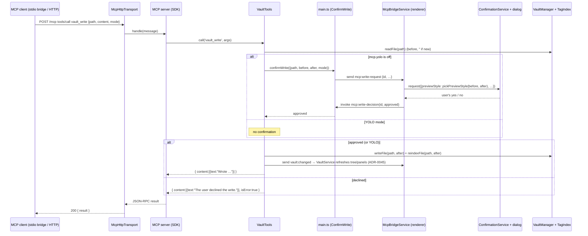

The built-in assistant takes the in-process path instead:
`ActionRunner.ask` passes `VaultTools.openAiToolSpec()` +
`runVaultTool` into `LmStudioClient.chat`, whose tool-calling loop invokes
`VaultTools.call` directly (same `ConfirmWrite` gate) between model
rounds; since ADR-0053 the final message is plain prose, or a
`document` fence when the note was changed.

## 6.17 Paste / drop an image → save into `attachments/` → render ([ADR-0024](09_architecture_decisions/0024-binary-vault-asset-write.md))

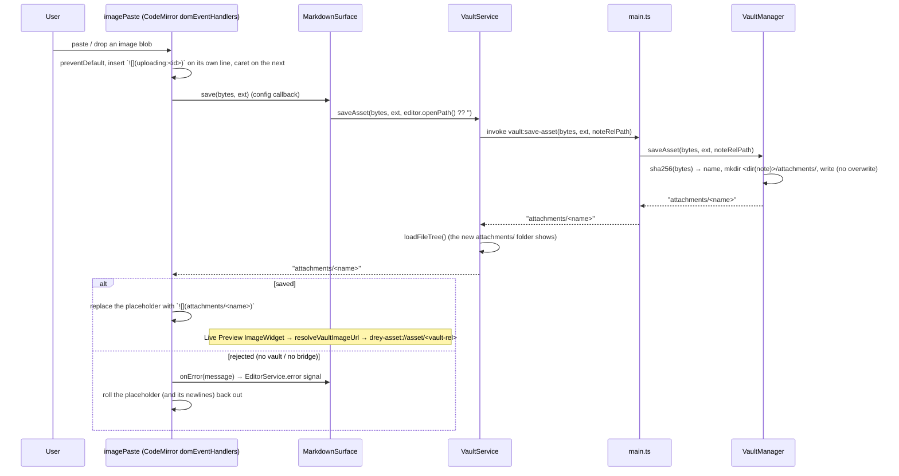

## 6.18 Startup → open today's daily note (ADR-0029)

`App`'s one-shot effect opens today's note as an unsaved draft once the
vault path and the persisted config are both known. Reuses the §6.3
`openDailyNote` path (draft tab, no disk write).

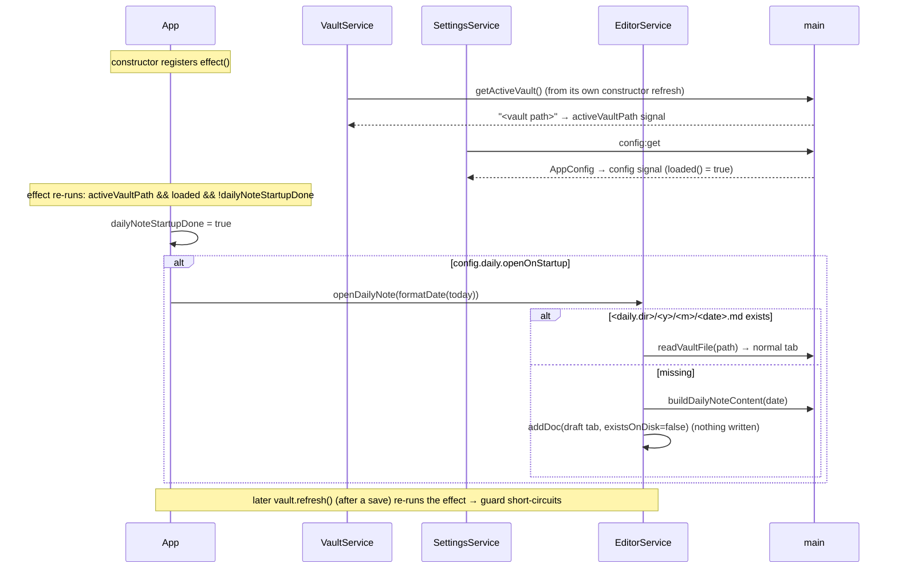

## 6.19 Insert a template (ADR-0029)

Panel click / `Mod+T` picker / editor context menu / drag all funnel to
`TemplateLibraryService.insert()`. The drag path keeps the drop coordinate;
the others insert at the caret.

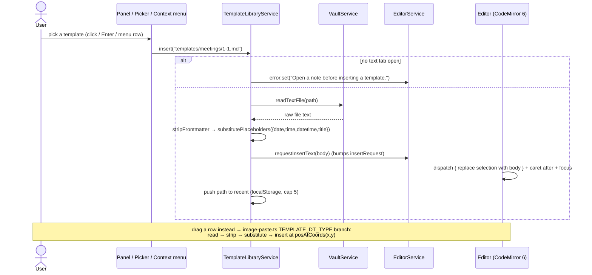

## 6.20 Files panel: copy / paste / duplicate / rename / delete (ADR-0018 refresh model; delete → recycle bin since milestone 52)

Context-menu rows on the file tree. "Copy" only stashes a `{ path, name }`
on `VaultService.clipboard`; the fs work happens on "Paste" / "Duplicate" /
"Rename". Each mutating IPC handler rebuilds the tag index (same reason as
`vault:delete` — a `.md` file can move in or out of scope), and the
renderer reloads the tree. A rename also re-points open tabs.

**Delete goes to the OS recycle bin (milestone 52).** After the confirm
dialog, `vault:delete(-many)` moves the target — and a `.md` note's
`.{name}.chat.json` sidecar — via `shell.trashItem`
(`electron/trash-delete.ts`, injected IO). A volume without a recycle bin
(network share, some removable drives) falls back to the permanent
`fsp.rm`; the IPC then resolves to the fallback paths and the Files panel
messages the user. `{ trash: false }` keeps move-semantics callers
permanent (Save-as out of `.drafts/`), and the cross-vault move's delete
leg inside `renameEntry` keeps its plain `rm` — the content already lives
at the target, a bin copy would only litter.

```mermaid
sequenceDiagram
    actor User
    participant Panel as FilesPanel
    participant VaultService
    participant EditorService
    participant IPC as main.ts handler
    participant VM as VaultManager
    participant Idx as TagIndex

    User->>Panel: right-click entry → Copy
    Panel->>VaultService: clipboard.set({ path, name })
    User->>Panel: right-click folder → Paste
    Panel->>VaultService: copyEntry(src, destDir)
    VaultService->>IPC: vault:copy-entry
    IPC->>VM: copyEntry(src, destDir)
    VM->>VM: resolveInVault(both) · fsp.cp(recursive) · uniqueCopyName on clash · copy .md sidecar
    IPC->>Idx: rebuild()
    VaultService->>VaultService: loadFileTree()

    Note over User,Idx: Rename: prompt-less inline input → renameEntry(from,to)<br/>→ VM.fsp.rename (+ sidecar) → Idx.rebuild → loadFileTree<br/>→ EditorService.retargetTabs(from,to) keeps unsaved buffers
```

**Drag & drop within the tree (req-23, ADR-0039 later change):** the same
`renameEntry` round, triggered by an HTML5 drag inside the panel instead
of the context menu. Folder rows are draggable too; a folder carries no
`application/x-drey-vault-path` (a pane must not open a folder), so the
dragged entry rides a component signal the row handlers read.
`dragover` on a row prevents default only when the move is valid (not a
same-folder no-op, not a folder into its own subtree — the main process
guards the latter as well), which drives the native no-drop cursor; drop
destinations are the folder row (into it), a file row (its parent) and
the tree background (vault root). The commit is exactly the rename
sequence above: `renameEntry` → `retargetTabs` → clipboard remap → expand
destination → tree reload.

## 6.21 Tasks panel: list + tick a task ([ADR-0033](09_architecture_decisions/0033-tasks-panel-and-index.md))

> _(Since [ADR-0044](09_architecture_decisions/0044-runtime-plugin-system.md)
> stage 6 this flow runs in `plugins/tasks/` — panel widget + main-side
> index over the plugin bridge — instead of `TaskService` /
> `EditorService.setTaskDone`; the shape below is unchanged.)_

The panel shows `TaskService.visible()`. In **document** scope that is
`scanTasks` over the live editor buffer, so it tracks unsaved edits with no
IPC. In **vault** scope it is `listTasks()` from the main-process
`TaskIndex`, refreshed on construct / after each save / on
`vault:changed` (ADR-0045). Ticking a row toggles the source line and saves;
the line is re-resolved against the *current* content at tick time, and
when duplicate task texts make that resolution ambiguous the toggle is
skipped — a safe no-op, never a guess at the wrong twin
(ADR-0033, "considered and rejected").

```mermaid
sequenceDiagram
    actor User
    participant Panel as TasksPanel
    participant Svc as TaskService
    participant Ed as EditorService
    participant IPC as main.ts handler
    participant NM as NoteManager
    participant TI as TaskIndex

    Note over Panel,Svc: document scope — no IPC
    User->>Panel: open panel / edit a "- [ ]" line in the editor
    Panel->>Svc: visible() = scanTasks(openPath, bufferContent())

    Note over Panel,TI: vault scope
    Svc->>IPC: tasks:list
    IPC->>TI: all()
    TI-->>Svc: TaskRecord[]

    User->>Panel: tick a row's checkbox
    Panel->>Svc: toggle(task)
    Svc->>Ed: setTaskDone(path, line, !done)
    alt file is an open text tab
        Ed->>Ed: setDoneOnLine(buffer) · patchDoc · save()
    else not open
        Ed->>IPC: vault:read-file → setDoneOnLine → note:save
    end
    IPC->>NM: saveNote(...)
    NM->>TI: reindexFile(path, written)
    Svc->>Svc: refresh() → tasks:list
    User->>Panel: click a row body
    Panel->>Ed: openFileAt(path, line)
```

## 6.22 Open a web tab, navigate, and yield to an overlay (ADR-0042)

> _(Since [ADR-0044](09_architecture_decisions/0044-runtime-plugin-system.md)
> stage 8B the browser is the `plugins/browser/` plugin: the
> `WebContentsView` lives in the plugin's main entry, the chrome is a
> plugin-contributed `browser` doc kind, and the view↔chrome traffic runs
> over the generic plugin bridge (`backend.invoke` / `backend.on`) instead
> of the old dedicated `browser:*` channels. The flow below is unchanged
> in shape; §6.26 shows the transport it now rides.)_

`File -> New browser tab` / `Ctrl+Shift+B` opens a `browser://<n>` tab. The
page is a main-process `WebContentsView`; the renderer holds only the
chrome and streams the placeholder rect as the view's bounds. While any
Angular overlay is open the view is hidden so it cannot paint over it.

```mermaid
sequenceDiagram
    actor User
    participant Menu as MenuService / keybinding
    participant BVS as BrowserViewService
    participant Ed as EditorService
    participant Tab as BrowserTab
    participant IPC as browser-handlers
    participant Mgr as BrowserViewManager
    participant WCV as WebContentsView
    participant Guard as OverlayGuardService

    User->>Menu: New browser tab
    Menu->>BVS: openTab()
    BVS->>Ed: addBrowserDoc("browser://1", "New tab")
    Ed-->>Tab: PaneLeaf renders <app-browser-tab> for kind:'browser'
    BVS->>IPC: browser:create { tabId, url: "about:blank" }
    IPC->>Mgr: create()
    Mgr->>WCV: new WebContentsView(persist:webtab) · addChildView · loadURL

    Tab->>BVS: setBounds(rect)  (ResizeObserver + rAF)
    BVS->>IPC: browser:set-bounds
    IPC->>Mgr: setBounds() → rect × getZoomFactor(), clamp
    Mgr->>WCV: setBounds(...)

    User->>Tab: type "example.com" ↵
    Tab->>BVS: navigate(tabId, "example.com")
    BVS->>IPC: browser:navigate { url: "https://example.com" }
    IPC->>Mgr: navigate() → WCV.loadURL
    WCV-->>Mgr: did-navigate / page-title-updated / page-favicon-updated
    Mgr-->>BVS: browser:event (push)
    BVS->>BVS: reduce() → BrowserTabState
    BVS->>Ed: setBrowserMeta(tabId, { name, favicon, url })
    Ed-->>Tab: TabBar shows favicon + title StatusBar shows URL

    User->>Guard: opens a dialog / Settings / a menu ([appOverlayGuard])
    Guard->>BVS: suppressed() = true
    BVS->>IPC: browser:set-visible { visible: false } (every tab)
    IPC->>Mgr: setVisible(false) → WCV.setVisible(false)
    User->>Guard: closes it
    Guard->>Tab: suppressed() = false → effect re-runs
    Tab->>BVS: setVisible(true) + measure()

    User->>Tab: close the tab (X)
    Tab->>Ed: closeTab("browser://1")
    Ed-->>BVS: openDocs() effect: key gone
    BVS->>IPC: browser:destroy
    IPC->>Mgr: destroy() → removeChildView + webContents.close()
```


## 6.23 Restore the previous session on launch (ADR-0043)

```mermaid
sequenceDiagram
    actor User
    participant App as App (startup effect)
    participant Sess as SessionService
    participant LS as localStorage['drey.session']
    participant IPC as session-handlers
    participant Store as SessionBackupStore
    participant Ed as EditorService
    participant BVS as BrowserViewService
    participant Panes as PaneService

    App->>Sess: restore()  (vault + config ready)
    Sess->>LS: getItem -> SessionSnapshot
    alt no session / other vault / corrupt
        Sess-->>App: false  -> App opens today's daily note
    else
        loop each tab
            alt browser
                Sess->>BVS: restoreTab("browser://n", url)
            else text with backupId
                Sess->>IPC: session:read-backup(id)
                IPC->>Store: read(id)
                Store-->>Sess: buffer text
                alt onDisk
                    Sess->>Ed: openFile(path) then updateBuffer(backup)
                else scratch
                    Sess->>Ed: openScratch(path, backup)
                end
            else clean disk file / image
                Sess->>Ed: openFile(path)
            end
        end
        Sess->>Panes: restore(layout, keepPath = restored)
        Panes-->>Sess: prune dropped tabs + empty panes
        Sess-->>App: true  -> daily-note fallback skipped
        Sess->>IPC: session:list-backups -> delete orphans
    end

    Note over Sess: thereafter, one debounced effect writes<br/>drey.session (400ms) + backups (700ms),<br/>beforeunload / visibilitychange flush
```

## 6.24 Drag an `.ics` / `.msg` onto the editor → meeting section ([ADR-0041](09_architecture_decisions/0041-calendar-file-drop-meeting-section.md))

```mermaid
sequenceDiagram
    participant User
    participant CM as imagePaste (CodeMirror domEventHandlers)
    participant MS as MeetingService
    participant Main as meeting:decode handler
    participant Imp as MeetingImporter
    participant Dec as ics-decode / msg-decode
    participant Tpl as templates/meeting.md
    participant Render as renderMeetingSection (shared/meeting)

    User->>CM: drop invite.ics / invite.msg on .cm-content
    CM->>CM: meetingFile(dataTransfer) matches → preventDefault, set caret to drop coord
    CM->>MS: decodeMeeting(new Uint8Array(await file.arrayBuffer()), file.name)
    MS->>Main: invoke meeting:decode(bytes, filename)
    Main->>Imp: decode(bytes, filename)
    Imp->>Dec: sniff (ext → BEGIN:VCALENDAR → OLE2 magic) → parse
    Dec->>Dec: ical.js: register embedded VTIMEZONE → DTSTART/DTEND .toJSDate() local
    Dec-->>Imp: ParsedMeeting  (or throw "not a calendar invite" / "no event")
    Imp->>Tpl: read templates/meeting.md (scaffold STARTER_MEETING_TEMPLATE on first use)
    Imp->>Render: renderMeetingSection(meeting, template)
    Render->>Render: slugifyMeetingTitle, meetingWhen, renderTemplate ({{#if}}/{{#each}})
    Render-->>Imp: "## 📅 <title>\n#mtg/<slug>\n…"
    Imp-->>Main: section markdown
    Main-->>MS: section markdown
    MS-->>CM: section markdown
    alt decoded
        CM->>CM: sectionInsert() at the drop coord (blank line padded), tab goes dirty
        Note over User: user saves with Ctrl+S, save → re-index picks up #mtg/<slug>
    else rejected
        CM->>CM: config.onError(message) → EditorService.error signal
    end
```

The **File → Import meeting …** menu row runs the same decode via
`meeting:import` (native picker in main) and inserts through
`EditorService.requestInsertText` — the fallback for an Outlook calendar
drag that delivers no real `File`.

## 6.25 Plugin discovery + activation ([ADR-0044](09_architecture_decisions/0044-runtime-plugin-system.md))

Before the window and long before Angular bootstraps, the main process
scans the plugin roots; the renderer activates inside
`provideAppInitializer`, so every registry is complete before the shell,
menus or session restore read them. Since milestone 31, plugin
**activation itself is fast**: the tags/tasks indexes no longer await a
full-vault scan inside `activate` — the registry-level refresh round
that follows activation triggers one background build per index, and
each finished sweep pushes `index-updated` over the plugin bridge so the
panels re-pull (SDK minor 7 added `ctx.vault.listMarkdownFiles` for the
walk).

```mermaid
sequenceDiagram
    participant Main as main.ts
    participant Disc as plugin-discovery
    participant HostM as plugin-host (main)
    participant HostR as PluginHostService
    participant Mod as plugin renderer module

    Main->>Disc: discover(roots, pluginsConfig)
    Note over Disc: roots: dist-electron/plugins/<id> (built-ins),<br/><userData>/plugins/*, DREY_EXTRA_PLUGIN_DIR
    Disc->>Disc: read plugin.json -> validateManifest<br/>(id ^[a-z][a-z0-9-]{1,63}$, apiVersion)
    Note over Disc: invalid manifest -> skip + log,<br/>built-in wins an id collision
    Disc->>Disc: disabled id -> status 'disabled',<br/>apiVersion major mismatch -> 'incompatible'
    Disc-->>Main: DiscoveredPlugin[]
    loop each active plugin with a main entry
        Main->>HostM: activate(plugin)
        HostM->>HostM: await import(pathToFileURL(entry)) -> mod.default
        HostM->>HostM: activate(ctx) -- ctx.app/vault/llm/ipc/save/search...
        alt activate throws
            Note over HostM: status 'failed', logged, app continues
        end
    end
    Main->>HostM: rendererRootFor(id) -- for the plugin:// scheme
    Note over Main: window created -> notifyMainWindowCreated<br/>(plugins bind BrowserWindows / views now)
    HostR->>HostR: provideAppInitializer -> loadAll() -- gates bootstrap
    HostR->>Main: pluginList()
    Main-->>HostR: PluginDescriptorForRenderer[]
    HostR->>HostR: plugins.set(descriptors) -- Settings reads these
    loop each descriptor with status 'active' + rendererUrl
        HostR->>Mod: import('plugin://<id>/renderer/index.js')
        HostR->>Mod: activate(api) -- registers widgets/pages/kinds/extensions
        alt activate throws
            Note over HostR: quarantine: run disposables,<br/>status 'failed' + error (Settings shows it)
        end
        HostR->>HostR: injectStyles(descriptor) -- css list over plugin://
    end
    Note over HostR: loaded.set(true)
    Note over Main: Angular bootstraps NOW -- DockService.defaultState(),<br/>the View menu and session restore see complete registries
```

## 6.26 Plugin IPC: `backend.invoke` roundtrip + `backend.on` push ([ADR-0044](09_architecture_decisions/0044-runtime-plugin-system.md))

Two **fixed** channels serve every plugin — the hand-written preload can
only expose those, so per-plugin traffic is namespaced in the payload,
not in the channel name.

```mermaid
sequenceDiagram
    participant PR as plugin renderer code
    participant API as api.backend
    participant Pre as preload (dreyApi)
    participant R as ipcMain 'plugin:invoke'
    participant PM as plugin main handler

    PR->>API: invoke('tasks:list', { scope: 'vault' })
    API->>Pre: pluginInvoke({ pluginId, method, payload })
    Pre->>R: ipcRenderer.invoke('plugin:invoke', payload)
    R->>R: pluginId matches the id pattern?<br/>method registered by THAT plugin?
    alt unknown plugin or method
        R-->>API: rejection (stringified error)
    else registered
        R->>PM: fn(payload)
        PM-->>R: result
        R-->>Pre: result (structured clone)
        Pre-->>API: resolves
        API-->>PR: Promise<TaskEntry[]>
    end

    note over PM,PR: Main -> renderer push (one channel, fanned out per plugin):
    PM->>R: ctx.ipc.emit('event', browserEvent)
    R->>Pre: webContents.send('plugin:event', { pluginId, event, data })
    Pre->>API: pluginOnEvent listener
    API->>API: PluginHostService: single subscription -><br/>that plugin's backendListeners.get(event) fan-out
    API-->>PR: listener(data)
```

Errors cross the bridge as **strings** (a structured clone cannot carry
an `Error`), and every plugin callback the host invokes is wrapped in
try/catch so a throwing plugin quarantines instead of breaking the app.

## 6.27 Editor extension registration + reconfigure ([ADR-0044](09_architecture_decisions/0044-runtime-plugin-system.md))

Plugins never build CodeMirror extensions from their own `@codemirror`
copies — they compose from the **host's** module instances
(`api.editor.cm`) and register factories; the surface reconfigures a
Compartment when the registry changes.

```mermaid
sequenceDiagram
    participant TP as plugins/tags renderer
    participant Reg as EditorExtensionRegistry
    participant MS as MarkdownSurface
    participant CM as CodeMirror EditorView

    TP->>TP: const { state, view, ... } = api.editor.cm (host instances)
    TP->>Reg: registerExtension('document', (ctx) => tagExtensions(ctx))
    Reg-->>TP: Unsubscribe
    Note over Reg: revision bump
    MS->>Reg: extensions signal re-reads on revision
    MS->>MS: pluginCompartment.reconfigure([factory(ctx), ...])
    MS->>CM: dispatch effects -- tag pills + completion live on the surface
    Note over MS,CM: A factory runs per reconfigure with the host's CM module<br/>instances -- a plugin's own copy would break facets silently,<br/>so plugins/ is lint-banned from runtime @codemirror imports.
    TP->>Reg: unsubscribe() -- registry bumps, surface reconfigures clean
```

The same pattern drives the other editor seams: a drop decoder is
consulted by the base paste/drop pipeline *before* the base file/image
branches, and context-menu items / menu rows append to their menus.

## 6.28 Save → save-hook chain → pending Actions (plugin era, extends §6.11)

`NoteManager` keeps the frontmatter bump + write; every feature indexes
(or acts) through the async **save-hook registry**. The `applyingAction`
short-circuit keeps a rewrite-applying save from re-firing hooks.

```mermaid
sequenceDiagram
    participant Ed as EditorService
    participant NM as NoteManager
    participant HK as plugin-host (main) saveHooks
    participant TP as tags plugin hook
    participant TK as tasks plugin hook
    participant AP as assistant plugin hook
    participant HR as PluginHostService (renderer)

    Ed->>NM: note:save { path, body, eol }
    NM->>NM: frontmatter bump (updated:) + write
    NM->>HK: emitNoteSaved({ path, content, ... })
    Note over HK: event.applyingAction? -> return [] (no recursion)
    par tags
        HK->>TP: await hook(event)
        TP-->>HK: TagIndex.reindexFile(path)
    and tasks
        HK->>TK: await hook(event)
        TK-->>HK: TaskIndex.reindexFile(path)
    and on-save Actions
        HK->>AP: await hook(event)
        AP->>AP: LLM edit (if configured) -> confirmed rewrite
        AP-->>HK: { content, pendingActions } (or void)
    end
    HK-->>NM: SaveHookResult[]
    NM-->>Ed: NoteSaveResult { content, modifiedMs, pendingActions? }
    Ed->>Ed: adopt returned content, queue pendingActions
    Ed->>HR: emitDocumentEvent('pending-actions')
    HR->>HR: handlePluginEvent -> drains into the owner plugin
    Note over AP,Ed: each pending Action -> documents.requestRewrite -><br/>ConfirmationDialog -> applyRewrite -> save(applyingAction)
```

A throwing hook is logged and skipped — one plugin's failure must not
lose the user's save.

## 6.29 Session restore with a plugin doc kind ([ADR-0044](09_architecture_decisions/0044-runtime-plugin-system.md), ADR-0043)

A plugin tab persists as the generic `{ path, kind, data }` session
member; the kind's owner recreates it from the payload. Because plugin
activation gates bootstrap (§6.25), every kind is registered *before*
`App` runs `SessionService.restore()`.

```mermaid
sequenceDiagram
    participant App as App (startup effect)
    participant SS as SessionService
    participant DK as DocKindRegistry
    participant BP as plugins/browser renderer
    participant Ed as EditorService

    App->>SS: restore() -- after plugins loaded, once vault + config known
    SS->>Main: session:read-backup
    Main-->>SS: SessionState { vaultPath, tabs: SessionTab[] }
    loop each tab
        alt kind 'image'
            SS->>Ed: openFile(path)
        else kind 'text'
            SS->>Ed: openFile(path) (+ line/pane placement)
        else plugin kind (e.g. 'browser')
            SS->>DK: get('browser')
            alt not registered (plugin disabled since)
                Note over SS: tab dropped silently
            else registered
                DK-->>SS: contrib.restore
                SS->>BP: restore(path, data) -- data = { url }
                BP->>BP: store.restoreTab(path, url) -> new browser://<n> key
                BP->>Ed: documents.addDoc('browser', key, 'New tab')
                Note over SS: legacy snapshots carried the payload at the<br/>top level -- handed to the kind as-is
            end
        end
    end
    SS-->>App: restoredAny -- false lets the daily-note fallback run
```

## 6.30 Close/quit with dirty documents — the exit confirm bridge (bug-5)

Every close path funnels into one `BrowserWindow 'close'` interception.
Main holds the window and asks the renderer — which owns the dirty-document
registry — over `exit:confirm-request` / `exit:decision` (`ExitBridge`, no
timeout: a hung renderer keeps the window open, and the ADR-0043 backups
have the buffer text regardless). An app-level quit (`before-quit`: taskbar
"Quit", Cmd+Q) is routed through the same prompt via the `quitIntent` flag;
the `!mainWindow` clause keeps the post-approved quit cascade from
re-intercepting. An untitled scratch tab saves into the hidden
`.drafts/` (§5.3 `draft:save`) instead of a Save-As dialog, and on-save
Actions are suppressed on this path — no LLM round trips during shutdown.

The request is **readiness-gated** (`exit:listener-ready`): `wc.send` is
fire-and-forget, so a close racing the renderer's bootstrap — the window is
closable within the first second, before the app UI registered its exit
listener — would lose the request and leave the window permanently
unclosable. The preload reports readiness exactly when the listener exists
(`ExitConfirmService.start()` → `onExitConfirmRequest` registration), and
requests raised before that are held by the bridge and delivered on
readiness.

```mermaid
sequenceDiagram
    participant User
    participant Main as main (BrowserWindow 'close')
    participant EB as ExitBridge
    participant XC as ExitConfirmService
    participant Ed as EditorService
    participant SS as SessionService

    Note over XC: at app bootstrap:<br/>onExitConfirmRequest registration fires<br/>exit:listener-ready -> EB.rendererReady = true
    User->>Main: close intent (X / Alt+F4 / taskbar Quit)
    Main->>Main: exitApproved? no -> event.preventDefault()
    Main->>EB: requestDecision()
    alt renderer not ready yet (close raced bootstrap)
        Note over EB: request held, delivered on exit:listener-ready
    end
    EB->>XC: exit:confirm-request { id }
    alt no dirty text documents
        XC->>EB: exit:decision 'discard' (no dialog)
    else dirty documents
        XC->>User: dialog (Save all / Exit without saving / Cancel)
        alt Save all
            XC->>Ed: saveAll({ drafts: true, runOnSaveActions: false })
            Note over Ed: real files via note:save,<br/>scratch tabs via draft:save -> .drafts/unnamed-N.md
            alt still dirty afterwards (a save failed)
                XC->>EB: 'cancel' -- the app stays open
            else clean
                XC->>SS: flushNow() (layout + backup writes, awaited)
                XC->>EB: 'save'
            end
        else Exit without saving
            XC->>SS: flushNow()
            XC->>EB: 'discard'
        else Cancel
            XC->>EB: 'cancel'
        end
    end
    EB-->>Main: decision
    alt cancel
        Main->>User: window stays open (quitIntent reset)
    else save / discard
        Main->>Main: exitApproved = true, window.close()
        Note over Main: non-darwin quits via window-all-closed,<br/>darwin finishes an app-level quit via quitIntent
    end
```

## 6.31 External vault change → watcher round → clean-tab reload ([ADR-0045](09_architecture_decisions/0045-optional-vault-file-watcher.md))

The watcher is off by default (Settings → Vault). When on, chokidar
events flow through the own-write ledger (so the app's own saves never
echo) into one debounced round: per-file plugin index events for `.md`
changes, then the `vault:changed` push — the same push the manual
refresh button (`vault:refresh`) and an MCP `vault_write` produce. The
renderer's half: `VaultService` reloads the tree, the plugin panels
re-pull on their `api.vault.onChanged`, and `EditorService` re-reads
every **clean** open tab among the changed paths (a dirty tab is never
touched; a vanished file flips its tab to draft semantics).

```mermaid
sequenceDiagram
    participant OS as Filesystem (OneDrive / other editor)
    participant CW as chokidar (VaultWatcher)
    participant L as OwnWriteLedger
    participant A as VaultChangeAnnouncer
    participant P as PluginHost (tags/tasks indexes)
    participant R as Renderer (VaultService / EditorService / panels)

    OS->>CW: add / change / unlink (after awaitWriteFinish)
    CW->>L: isOwnEvent(path, kind, mtimeMs)?
    alt own echo (mtime match / structural TTL)
        L-->>CW: drop
    else external
        CW->>CW: accumulate, (re)arm 300 ms debounce
    end
    Note over CW: on debounce fire: one round per burst
    CW->>A: announceExternal({ changedPaths, deletedPaths })
    A->>P: emitVaultChange({ kind:'write'|'delete', path }) per .md
    A->>R: push vault:changed { paths }
    R->>R: VaultService reloads file tree, panels re-pull
    R->>R: EditorService re-reads clean tabs in paths<br/>(read failure -> existsOnDisk=false, draft semantics)
```

The manual refresh button runs the same round without the watcher
(`vault:refresh` → `announceFullRefresh()`: a whole-vault `refresh`
plugin event + a payload-less push).

## 6.32 Ctrl+click a `[[wikilink]]` → resolve → open at heading / create ([ADR-0046](09_architecture_decisions/0046-wikilinks.md))

Everything below the decoration layer happens in the renderer: the
`WikilinkService` keeps a note index derived from `vault.fileTree()`, so
resolution needs no vault-side index and no IPC unless the target must
be created or the `#heading` anchor's line has to be read from disk.

```mermaid
sequenceDiagram
    participant U as User
    participant CM as Editor (wikilinks ViewPlugin)
    participant W as WikilinkService
    participant V as VaultService / dreyApi
    participant E as EditorService

    Note over CM: marks carry data-wikilink / data-anchor
    U->>CM: Ctrl/Cmd-mousedown on .cm-wikilink
    CM->>W: open(target, anchor, fromPath)
    W->>W: resolve(target, fromPath)<br/>(fileTree-derived index)
    alt resolved
        W->>W: headingLine(path, anchor)?<br/>open buffer, else vault.read-file
        W->>E: openFileAt(path, line ?? 1)
        E->>E: revealRequest -> caret + scroll
    else unresolved (editor only)
        W->>V: createVaultFile("<target>.md")<br/>(parents auto-created)
        V-->>W: ok / "Already exists" (race -> just open)
        W->>V: loadFileTree (tree shows the note)
        W->>E: openFile(path)
    end
```

The entry drawer binds `openResolvedOnly` instead: an unresolved target
is inert (no file creation from text that may be discarded).

## 6.33 Dock an editor pane, drag it back, restore it (milestone 20,
[ADR-0038](09_architecture_decisions/0038-editor-panes-in-docks.md))

Sibling of §6.14 (a panel dragged between docks) — same drag chrome,
different payload. The tab context menu or the band header starts the
move; `PaneService` owns the region state; the session effect persists
it like any layout change.

```mermaid
sequenceDiagram
    participant U as User
    participant TB as TabBar (context menu)
    participant P as PaneService
    participant D as Dock (band)
    participant S as SessionService

    U->>TB: right-click tab -> "Move to right dock"
    TB->>P: detachToDock(paneId, 'right')
    note over P: occupied dock -> reattachToCenter(occupant) first
    P->>P: removeLeaf(centre tree)<br/>(sole leaf -> fresh empty placeholder)
    P-->>D: dockPanes.right = paneId (focus follows)
    D->>D: render .editor-band above the widget stack<br/>(title = active tab name, splitter below)

    U->>D: drag band header over the centre column
    D->>D: dropDock = 'center' (main-pane shows the drop wash)
    D->>P: mouseup -> reattachToCenter(paneId)
    note over P: replaces a tabless placeholder / wraps in a row split<br/>/ appends to a split root

    U->>U: later, quits and relaunches
    S->>P: restore(layout, keepPath)
    note over P: layout.dock.right = {paneId, height} — an entry whose<br/>tabs no longer resolve drops the region
    P-->>D: band re-rendered with its tabs and band height
```

Sibling flow (SDK 1.35, req-65): a plugin calls `documents.open(path, …,
{ split: 'right' | 'down' })` or `documents.addDoc(kind, key, name, …)`
with the option. `DocOpenService.splitLanding` splits the focused pane
first (`'right'` = a row split, `'down'` = a column split) — the fresh
sibling becomes the focused pane, and the tab the call then registers
opens there (`OpenDocsStore.add` always opens into the focused pane). An
already-open tab just reveals, a focused dock band cannot split (plain
open there), and the focused pane's clean tab is never replaced — the
call asked to open alongside. The resulting tree persists like any pane
layout.

## 6.34 One chat completion through the provider router ([ADR-0047](09_architecture_decisions/0047-llm-provider-abstraction.md))

The assistant plugin's Ask is the worked example; every other consumer
(Autotag, on-save Actions, `drey.llm.chat`) rides the same router. What
changed with the provider abstraction is only the middle: the router
picks the backend per call, and the provider owns its dialect — message
adapters, tool wire format, SSE framing.

```mermaid
sequenceDiagram
    participant AR as Assistant renderer (state.ask)
    participant AM as Assistant main (ActionEngine)
    participant PH as PluginHost (ctx.llm.chat)
    participant TR as LlmTaskRegistry
    participant R as LlmRouter
    participant P as Provider (openai-compat / anthropic-messages)
    participant S as Model endpoint

    AR->>AM: backend.invoke('ask', { context, question, taskId, history })
    AM->>PH: ctx.llm.chat(messages, { taskId, vaultTools?, onDelta? })
    PH->>TR: run(taskId, work)
    TR->>R: chat(messages, options) with AbortSignal
    R->>R: pick() = config.llm.provider (per call, hot-swap)
    R->>P: chat(messages, options)
    P->>P: adapt: ToolSpec -> wire format, system lift-out (anthropic)
    loop tool rounds (max 5, tools only)
        P->>S: POST /chat/completions | /v1/messages
        S-->>P: tool_calls / tool_use blocks
        P-->>PH: onToolCall(name, args)
        PH-->>P: tool result text (vault_write still confirm-gated)
    end
    P->>S: final request (stream: true when onDelta && no tools)
    loop SSE frames
        P-->>PH: onDelta(delta)  (non-streamers: exactly once)
        PH-->>AR: llm:delta push { taskId, text }
    end
    P-->>R: LlmChatResult { text, usage? }
    R-->>TR: resolve
    TR-->>PH: resolve
    PH-->>AM: LlmChatResult (engine's ChatFn unwraps .text)
    AM-->>AR: AskOutcome
```

Cancellation cuts across the diagram: the renderer's Cancel aborts the
`AbortController` the registry holds under the renderer-minted
`taskId`; the provider's fetch (or the CLI's process-tree kill, from
milestone 23) rejects with an `AbortError`, which the engine converts to
a `noop` outcome. No provider applies a generation timeout (ADR-0014).

## 6.35 One chat completion through a CLI provider (Claude Code, milestone 23,
[ADR-0047](09_architecture_decisions/0047-llm-provider-abstraction.md))

Same consumers as §6.34; the difference is the provider's back end: no
HTTP, a process. The router picks `claude-code`; the CLI base spawns,
feeds stdin, kills the tree on Cancel, and the provider only describes
its argv and its event dialect.

```mermaid
sequenceDiagram
    participant AM as Assistant main (ActionEngine)
    participant PH as PluginHost (ctx.llm.chat)
    participant R as LlmRouter
    participant CC as ClaudeCodeCliProvider
    participant CB as CliProviderBase
    participant CLI as claude -p (child process)

    AM->>PH: ctx.llm.chat(messages, { taskId, sessionRef? })
    PH->>R: chat(messages, options)
    R->>CC: chat(messages, options)
    CC->>CC: buildArgs: -p --output-format stream-json --verbose<br/>[--include-partial-messages] [--model id] [--resume sessionRef]
    note over CC: model id + session ref are strict-token validated,<br/>the flattened prompt (shared/llm flattenMessages) rides stdin, never argv
    CC->>CB: spawn + stdin + line loop
    CB->>CLI: spawn (shell:true on win32, windowsHide)
    CLI-->>CB: {"type":"system","subtype":"init","session_id":"..."}
    CB-->>AM: (sessionRef captured for the next call)
    CLI-->>CB: stream_event content_block_delta frames
    CB-->>AM: onDelta(delta) -> llm:delta push
    CLI-->>CB: {"type":"assistant"...} then {"type":"result","result":"...","usage":{...}}
    CB->>CLI: stdin end / process exit 0
    CB-->>R: LlmChatResult { text, sessionRef, usage }
    R-->>PH: resolve
    PH-->>AM: resolve
```

Cancellation: the renderer's Cancel aborts the signal; `CliProviderBase`
kills the process tree (`taskkill /pid <pid> /T /F` on Windows) and
rejects with `name: 'AbortError'` -- the exact shape `isAbortError`
already matches, so the engine's noop path is unchanged. No timeout
(ADR-0014). There is no Drey-side tool loop (`capabilities().tools` is
false -- `-p` runs Claude Code's own agent loop with write-class tools
auto-denied), and no model listing (`modelListing` false -- the id is
typed by hand). A nonzero exit or a missing executable surfaces as
`LlmError('spawn')` on the error card.

## 6.36 One live-edit ask turn (ADR-0049)

> Since milestone 78 the `doc_*` tools, the `LiveEditSession` and the
> `chat:liveEdit` push below are gone: a live turn uses the vault tools
> on the open tab — see 6.61. The lock, the undo step per change and the
> outcome are unchanged.

The composer's "Live edit" chip is on: the ask targets the open note,
the model edits it through the `doc_*` tools over the provider loop, and
every mutating call appears in the editor while the model keeps working.
A per-turn opt-in exception to ADR-0011 — nothing is confirmed; each
push is one Ctrl+Z step, Ctrl+S saves.

```mermaid
sequenceDiagram
    participant P as Assistant panel (renderer)
    participant ES as EditorService / surface
    participant M as ChatEngine (plugin main)
    participant PR as Provider tool loop

    P->>ES: setEditLock(path, true) — input blocked, "Assistant is editing…"
    P->>M: ask { question, note (live buffer), liveEdit: true, chatPath }
    M->>M: guard capabilities().tools (visible error when false)
    M->>M: append user turn, create LiveEditSession(note.body)
    M->>PR: chat(messages, tools: doc_* (+ vault set), maxToolRounds: 16)
    loop per mutating tool call
        PR->>M: onToolCall("doc_apply_diff", hunks)
        M->>M: validate ALL hunks atomically, apply to session.work
        M->>P: chat:liveEdit { path, content }
        P->>ES: documents.setBuffer — one undo step, caret kept
        M-->>PR: tool result text (touched lines / hunk error)
    end
    PR-->>M: LlmChatResult { text (summary), toolTrace }
    M->>M: append assistant turn + edit fence entry { applied: true, after }
    M-->>P: outcome { kind: liveEdit, applied, text }
    P->>ES: setEditLock(path, false) — always (success, error, cancel)
    P->>P: notice "Applied N edit(s) to <path>."
```

Cancellation mid-loop aborts the signal (ADR-0014); the engine truncates
back the dangling user turn, but already-applied edits stay in the
buffer (undo walks them back one push each). The lock is advisory — the
model's own pushes keep flowing, which is exactly why the lock uses the
`editable` facet, not `EditorState.readOnly`.

## 6.37 Recognize text (OCR) via the vision provider ([ADR-0050](09_architecture_decisions/0050-ocr-via-vision-llm.md))

Right-click an image — embedded in a note or opened as its own tab — and
the `ocr` plugin's "Recognize text" row runs the transcription through
the connected vision-capable LLM. The row exists only while the active
provider declares the `imageAttachments` capability; a Settings save
re-pushes capabilities, so the row flips without a restart.

```mermaid
sequenceDiagram
    participant U as Right-click (editor / image tab)
    participant CM as EditorContextMenuService
    participant R as ocr plugin (renderer)
    participant M as ocr plugin (main)
    participant VM as VaultManager
    participant PR as Provider (LlmRouter)

    U->>CM: contextmenu (capture)
    CM->>CM: buildMenuTarget → EditorContextMenuTarget<br/>(data-drey-doc + findFromDOM/posAtDOM, or data-drey-image)
    CM->>R: registry.items(target) — row gated on llm.enabled() && vision cache
    R->>R: resolve image (img src reverse map, else  line regex)
    R->>M: backend.invoke('ocr', { imageVaultPath, taskId })
    M->>VM: resolveAssetPath(path)
    VM-->>M: absolute path
    M->>M: readFile → base64 ChatAttachment
    M->>PR: chat([system, user], { attachments, taskId, maxOutputTokens, onDelta })
    loop streaming
        M-->>R: ctx.ipc.emit('ocr:delta', { taskId, text })
        R->>R: progress modal appends partial text
    end
    PR-->>M: LlmChatResult { text }
    M-->>R: { kind: 'ok', text } (fence stripped)
    alt embedded image
        R->>R: composeInsertedBelow(buffer, lineNumber, text)
        R->>R: documents.requestRewrite → ADR-0011 dialog → applyRewrite saves
    else image tab
        R->>R: documents.openScratch('<basename>.md', text)
    end
```

Cancel rides the base registry: the modal's Cancel calls
`api.llm.cancelTask(taskId)` → `llm:cancel` → the provider rejects with
an AbortError → main resolves `{ kind: 'cancelled' }` → the modal closes
quietly, nothing is inserted (ADR-0014: no timeout, the user decides).
A real error (e.g. a non-vision model behind a vision-capable provider)
renders in the same modal with a Close button.

## 6.38 Add a vault / switch the active vault ([ADR-0051](09_architecture_decisions/0051-multi-vault-registry.md))

```mermaid
sequenceDiagram
    participant User
    participant FP as FilesPanel
    participant VS as VaultService (renderer)
    participant VH as vault-handlers (main)
    participant VM as VaultManager
    participant Ann as VaultChangeAnnouncer

    User->>FP: vault row context menu → "Add vault …" / "Set active"
    FP->>VS: addVault() / setActiveVault(id)
    VS->>VH: vault:add / vault:set-active (id)
    VH->>VM: addVault() [native picker, mint id, dup check] / setActiveVault(id)
    VM->>VM: persist vault-config.json v2
    VH->>VH: syncVaultWatcher()
    VH->>Ann: announceFullRefresh() — the ALL-vaults round
    Ann->>Ann: pluginHost.emitVaultChange({ kind:'refresh' }) — every plugin index rebuilds
    Ann-->>VS: vault:changed push (no vaultId ⇒ registry-level)
    VS->>VS: loadRegistry() + re-pull every vault's tree
    VS-->>FP: vaults() / trees() signals update (active dot moves, new root row appears)
```

A watcher batch or an MCP write is the same round **scoped**: the push
carries `vaultId` + `paths`, so only that vault's tree reloads, only its
clean open tabs auto-reload, and the tags/tasks indexes touch only that
vault (per-vault indexes land with the M-B scopes). Open tabs carry the
composite key `vaultId::relativePath`, so the same-named note in two
vaults coexists; a cross-vault drag & drop move renames across the two
namespaces (copy + delete in `VaultManager`, the assistant sidecar
travels along) and retargets the open tab's key.

## 6.39 Export a note as PDF (editor `⋯` / right-click menu, tab context menu, Files panel row)

```mermaid
sequenceDiagram
    participant User
    participant UI as Editor ⋯ / TabBar / FilesPanel
    participant ES as EditorService / VaultService (renderer)
    participant EH as export-handlers (main)
    participant PX as pdf-export.ts
    participant HW as hidden BrowserWindow
    participant VM as VaultManager

    User->>UI: "Export as PDF…" on a Markdown note
    UI->>ES: exportPdf(key) / exportPdf(path, vaultId)
    ES->>EH: export:note-pdf { path, vaultId?, content? }
    Note over ES,EH: open docs always send the live buffer (dirty + scratch tabs export WYSIWYG) — the Files panel sends none, main reads from disk
    EH->>PX: exportNoteToPdf(deps, request)
    PX->>VM: readFile (when no content) / resolveAssetPath (images, default folder)
    PX->>PX: shared/pdf-html.ts — frontmatter off, task glyphs, images → file:// URLs, paper CSS
    PX->>PX: ```mermaid fence? inline the mermaid UMD bundle (once per session) + bootstrap
    PX->>User: native save dialog (any folder — NOT vault-restricted)
    User-->>PX: target path (or cancel → null, silent no-op)
    PX->>HW: write temp HTML, loadFile, wait for images (10 s cap)
    HW->>HW: bootstrap swaps each rendered SVG in for its ```mermaid code block (20 s cap/diagram, parse error → the code block stays)
    HW->>PX: printToPDF({ A4, printBackground, footer "n / m" })
    PX-->>ES: saved absolute path
```

`shared/pdf-html.ts` is pure (string in/out, the `shared/frontmatter.ts`
precedent) and unit-tested from `shared/pdf-html.spec.ts` — the
bootstrap itself is executed there against a stub mermaid in a real
iframe. Since milestone 32 a ` ```mermaid ` fence no longer stays a code
block: main inlines the bundled `mermaid/dist/mermaid.min.js` (read from
the packaged `dependencies` tree, ~3.5 MB, only when the note has such a
fence) and the bootstrap renders each fence to a light-themed SVG figure
before the print; a parse error, the 20 s per-diagram cap or a missing
bundle leaves the plain code block. `[[wikilink]]` stays literal text by
decision (it names an in-vault target a PDF reader can't follow). The
temp page and hidden window are destroyed in a `finally`, so a failed
print leaves nothing behind.

### Parity checklist — every editor element carries into the export (or its absence is a decision)

The PDF export is a **second renderer of the note**. When the editor
gains a new rendered element, `shared/pdf-html.ts` (plus
`electron/pdf-export.ts`, when the element needs a runtime) must be
revisited **in the same change**: the element either carries into the
PDF, or its absence is recorded in this list. Standing rule since
milestone 32; the state of the list:

| Editor element | Export treatment | Since |
| --- | --- | --- |
| Frontmatter fence | stripped (`splitFrontmatter`) | M30 |
| GFM task checkboxes | ☐/☑ glyph replacement outside code fences (`replaceTaskMarkers`) | M30 |
| `` images and raw `` | resolved to `file://` URLs through the shared candidate chain (`shared/asset-refs.ts`); unresolvable → alt text stays | M30 |
| Raw note HTML | `<script>` blocks and `on*=` handler attributes stripped (`stripActiveHtml`) | M30 |
| Tables, code fences, blockquotes, headings | plain markdown-it output under the paper stylesheet | M30 |
| `![[media]]` embeds | rewritten to standard image syntax first (`rewriteEmbedWikilinks`) | M31 |
| ` ```mermaid ` fences | light-theme SVG figures rendered by the inlined runtime; parse error / 20 s cap / missing bundle → the code block | M32 |
| `==highlight==`, `~sub~`/`^sup^`, `:emoji:`, bare-URL linkify | `<mark>` / `<sub>`/`<sup>` / the glyph / `<a href>` — the shared extended rule pack (`shared/markdown/markdown-it-extended.ts`) | M72 |
| Callouts (`> [!TYPE]`) | styled `div.callout callout-<kind>` boxes with icon/title bar (light palette) | M72 |
| Footnotes (`[^1]` / `[^1]: …`) | markdown-it-footnote: superscript refs + a footnotes section | M72 |
| `$…$` / `$$…$$` math | `.drey-math` placeholders typeset by the inlined KaTeX runtime (script + font-`data:`-URL stylesheet, only when the note has math; parse error → the LaTeX stays visible) | M72 |
| Editor math-in-table-cells source span | the same `.drey-math-src` styled span the editor shows (a table cell carries no runtime) | M72 |
| `[[wikilinks]]`, `![[note#anchor]]` | literal text — they name in-vault targets a PDF reader can't follow | M30 |
| `![[x.pdf]]` embeds (and a hand-written ``) | a bordered note — "PDF embed — not printable: `<name>`. The file stays in the vault." — replaces the ``, which cannot rasterize a PDF and printed empty (M31's known limitation, closed) | M32 |
| `#tag` pills, hover chrome, gutters, editor widgets | absent by definition — the PDF is the document, not the editor | — |

## 6.40 Drop a PDF into a note → staged, embedded, readable in place (ADR-0052)

```mermaid
sequenceDiagram
    participant User
    participant CM as image-paste drop cascade
    participant VS as VaultService (renderer)
    participant VM as VaultManager (main)
    participant AP as drey-asset protocol
    participant LP as Live Preview / PdfWidget

    User->>CM: drop a .pdf on the editor
    CM->>VS: saveNamedAsset(bytes, fileName, notePath, vaultId)
    VS->>VM: vault:save-asset (+ preferredName)
    VM-->>VS: attachments/<original name> (note-relative, -2 on collision)
    VS-->>CM: path
    CM->>CM: insert  (uploading placeholder swapped)
    Note over LP: selection outside the node → the embed renders
    LP->>AP: HEAD drey-asset://<vaultId>/asset/<path> (candidates in order)
    AP-->>LP: 200, Content-Type: application/pdf (pinned main-side)
    LP->>LP: <iframe> mounts — built-in PDFium viewer (plugins: true)
    User->>LP: </> reveal → raw line + read-only mirror below
    User->>LP: lens → openFile(path, vaultId) → kind:'pdf' tab (PdfTab)
    User->>CM: (or) Files panel / Ctrl+click a plain link → the same tab
```

The embed keeps the Req-1 image affordances: the revealed raw line sits
in the rounded container with a read-only `PdfPreviewWidget` kept below
it; all candidates dead at probe time → a compact `PDF not found:` box
whose click drops the caret into the source line. Opening a `.pdf` from
anywhere (Files panel, link, lens, session restore) routes through
`EditorService.openFile` → a `kind: 'pdf'` viewer doc — the file is
never read as text (the mojibake-buffer path this milestone removes).

## 6.41 Scoped search → grouped results → bundled replace (milestone 33)

```mermaid
sequenceDiagram
    participant User
    participant SP as Search panel (Tags plugin)
    participant TI as TagIndex (per-vault, plugin main)
    participant BV as TagVocabularyService (base)
    participant PH as PluginHost (main)
    participant VM as VaultManager

    Note over TI: boot: one coalesced sweep per registered vault
    TI-->>PH: sweep done → ctx.search.notifyChanged()
    PH-->>BV: search:changed push → re-pull search:vocabulary (+prefix styles)
    User->>SP: query (tags · text · Aa/ab/.* · scope)
    SP->>SP: buildTextMatcher → broken regex shows inline, stops here
    alt scope file
        SP->>SP: runTagSearch over the active buffer (sectionRecordsFor)
    else scope vault / all
        SP->>PH: drey.search.sections {query, scope}
        PH->>TI: index.search(query, scope, active@call time)
        TI-->>SP: hits stamped vaultId (dirty open buffers folded on top)
    end
    SP-->>User: results grouped per file, click → documents.open(path, line, {vaultId})
    User->>SP: Replace all (vault/all scope)
    SP->>TI: replace-preview {query, replacement, scope}
    TI-->>SP: per-file ops (fresh patches, line diffs)
    SP->>SP: api.ui.showModal — one bundled confirmation
    User->>SP: Replace all (apply)
    SP->>TI: replace-apply → per file: re-read, re-match, writeAnnounced (CRLF kept)
    TI-->>PH: writes announced → index re-read + search:changed + vault:changed
    Note over BV: base pills/chips recolor live on styles changes (same push)
```

Replace touches only occurrences inside the matching sections (the
search model, applied as a batch); the file-scope variant patches the
open buffer directly (a normal undoable edit, no confirmation round).

**Tag rename / merge (milestone 53)** rides the same discipline from
Settings → Tags: `rename-preview`/`rename-apply` walk every `.md` of the
selected vault(s) (templates folders excluded like the index),
`renameTagInContent` rewrites the tag tokens the grammar sees (fences
and code never match; `#old/…` descendants by default; a merge drops
the duplicate it would create), and apply re-reads + re-patches each
file right before its announced write — the bundled per-file-diff
confirmation is the same modal.

## 6.42 Explorer double-click → tab ([ADR-0054](09_architecture_decisions/0054-opening-files-from-the-os.md))

```mermaid
sequenceDiagram
    participant OS as Windows Explorer
    participant M as main (external-open.ts)
    participant R as Renderer (ExternalOpenService)
    participant E as EditorService

    OS->>M: drey.exe notes.md (cold start)
    M->>M: extractOpenPaths(argv) → gate.enqueue (queued, not ready)
    Note over R: vault registry + settings + session restore finish
    R->>M: external:take-pending
    M->>M: classify each: locateInVaults → vault | external (+ read/write allowlist)
    M-->>R: OpenRequest[] (gate is now ready)
    alt kind vault
        R->>E: openFile(path, vaultId) — ordinary editable tab
    else kind external
        R->>M: external:read(absPath) — allowlist + extension + size gate
        M-->>R: { content, modifiedMs }
        R->>E: openExternalFile → pinned, editable tab (external://…)
    end
    Note over R: launch opened a file → startup daily-note fallback skipped

    OS->>M: drey.exe other.md (Drey already running)
    M->>M: second-instance → enqueue → classify (gate ready)
    M-->>R: external:open-request push (window restored + focused)
    R->>E: same routing as above
```

Ctrl+S on an external tab calls `external:write` (allowlisted path only;
the file's line endings restored; no vault pipeline) and clears the dirty
state; a refused write keeps the tab dirty with the error shown. "Save as…"
still writes a *copy* into the active vault and swaps the tab for that vault
file (pin kept).

## Planned flows (added as their milestone is built)

- Dedicated keyword-search / FTS surface — the search panel's free-text
  mode covers the common case for now (`specs/roadmap.md` Phase 2)

_(Dropped: the batch-tag-suggestion inbox — see [ADR-0017] and
[ADR-0018](09_architecture_decisions/0018-manual-refresh-no-file-watcher.md).
The chokidar file-watcher reaction, originally dropped with ADR-0018,
came back as the opt-in §6.31 / [ADR-0045](09_architecture_decisions/0045-optional-vault-file-watcher.md).
The vault-wide chat scope shipped as §6.44: by embedding retrieval in
milestone 41 (ADR-0055), by text search since milestone 80 /
[ADR-0072](09_architecture_decisions/0072-vault-context-by-text-search.md).)_
## 6.43 Search summarise → LLM digest → `search-summary.md` (milestone 37)

The Search panel's **Summarize** button (next to Export; hidden while no
LLM is configured, ADR-0014's "cancel instead of timeout" applies) turns
the current hit list into a streamed, cancellable topic digest. The call
lives in the tags plugin's main entry: the renderer owns the hit set
(already merged with unsaved buffers), main owns the editable prompt and
the LLM transport. The digest streams into an unsaved
`search-summary.md` scratch tab — Save-as keeps it, same as Export.

```mermaid
sequenceDiagram
    actor User
    participant Panel as Search panel (tags plugin, renderer)
    participant Backend as tags plugin main ('summarise')
    participant Config as AppConfigStore
    participant Chat as ctx.llm.chat → LlmTaskRegistry → provider
    participant EditorService

    User->>Panel: Summarize
    Panel->>Panel: taskId = crypto.randomUUID()
    Panel->>EditorService: openScratch('search-summary.md', header + '_Generating…_')
    Panel->>Backend: invoke('summarise', { query, hits, taskId })
    Backend->>Config: actions.templates → 'builtin:search-summary' prompt
    Backend->>Backend: buildSearchSummaryMaterial (whole sections, ≤ 60 000 chars)
    Backend->>Chat: chat(system, user) with taskId + onDelta
    loop while generating
        Chat-->>Backend: onDelta(text)
        Backend--)Panel: 'summary:delta' { taskId, text }
        Panel->>EditorService: setBuffer('search-summary.md', header + text) (throttled 150 ms)
    end
    alt user clicks Stop
        User->>Panel: Stop
        Panel->>Chat: llm:cancel(taskId) → AbortController
        Chat-->>Backend: AbortError
        Backend-->>Panel: { kind: 'cancelled' }
        Panel->>EditorService: flush '(cancelled)' tail
    else completed
        Chat-->>Backend: LlmChatResult
        Backend-->>Panel: { kind: 'ok', text, included, total }
        Panel->>Panel: buildSearchSummarySources(hits, included, vaultNames)
        Panel->>EditorService: setBuffer(digest + '## Sources' + truncation note if included < total)
    end
    User->>EditorService: Ctrl+S → Save-as (keeps the digest as a note)
```

Since milestone 49 the settled digest (a stopped one too) ends with a
`## Sources` section built deterministically by the panel — one
`[[extension-less-path#heading]]` wikilink per covered section, the
exact `path:line` as plain text beside it (wikilinks have no line
anchor), and the vault's name in the label when the hits span several
vaults. The model never writes links itself. The scratch tab is
vault-less, so its wikilinks resolve through `WikilinkService`'s merged
cross-vault index (active vault preferred) and open the note in its
owning vault — an unresolved target is reported, never created
(ADR-0046's milestone-49 addendum).

Scrolling during generation is stick-to-bottom: each 150 ms flush is an
external in-place reload (`setContent`), which measures whether the view
is pinned near the bottom (≤ 32 px) BEFORE the swap and restores the pin
after it — the view follows the growing tail by default, keeps the user's
position while they have scrolled up, and resumes following once they
scroll back down. (The old `anchor === 0 → scrollTop = 0` snap in
`setContent` is gone; fresh opens still start at the top via
`loadDocument`.)

The digest reaches the assistant as context via the composer's **+**
picker: its Files tab lists unsaved scratch tabs (saved-empty + dirty
text docs) above the vault files. A scratch chip rides as the tab's live
buffer, and each send snapshots the current text to
`.drafts/assistant/<vaultId>-<name>.md` — that vault path is what the
turn cites and what follow-up replays re-read, so the context survives
the tab being closed (ADR-0048's paths-not-bodies rule stays intact).

## 6.44 Vault context — the ask's Vault chip (milestone 80, ADR-0072)

The assistant composer's **Vault chip** opens a picker: three shortcut
rows — off, the active vault, all vaults — and one checkbox row per
registered vault (remembered per app). Checking a subset (e.g. a
non-active Git vault, without making it the default target for new
content) sends `vaultScope: 'custom'` plus the selected `vaultIds`. The
assistant plugin's main side looks up the note sections that contain
words of the question: the words are searched in the section index the
tags plugin keeps (in memory, kept fresh by its own save and
vault-change hooks), the hits are ranked, and the best four ride the
system prompt. Citations carry the vault's name (`vault · path:line`),
so equal paths across vaults stay distinguishable. Ignored for
live-edit turns; a failed lookup degrades to no context plus a quiet
notice. A custom selection whose vaults have all been removed from the
registry degrades visibly to an "unregistered" context status — never a
silent fallback to the active vault.

```mermaid
sequenceDiagram
    actor User
    participant Panel as Assistant panel (renderer)
    participant Ask as main 'ask' → ChatEngine
    participant Ctx as retrieveVaultContext (assistant main)
    participant Idx as section index (tags plugin, via ctx.search)
    participant LLM as ctx.llm.chat → provider

    User->>Panel: open Vault chip picker (off / active / all / subset)
    User->>Panel: send question (vaultScope, vaultIds?)
    Panel->>Ask: invoke('ask', request)
    Ask->>Ctx: retrieveContext(question, scope, vaultIds)
    Ctx->>Ctx: resolveTargetVaultIds (custom ∩ registry, no fallback)
    Ctx->>Ctx: queryTerms (no stopwords, at most 8 words)
    loop each word, each vault in scope
        Ctx->>Idx: search({ tags: [], text: word }, { vault })
        Idx-->>Ctx: sections with heading, line and text
    end
    Ctx->>Ctx: drop chats/ and empty sections, rankLexical, best 4
    Ctx-->>Ask: RetrievedSection[] (vault, path, heading, line, text)
    Ask->>Ask: system prompt += VAULT CONTEXT block
    Ask->>LLM: chat(system, replay…, question)
    LLM-->>Ask: answer
    Ask-->>Panel: outcome + contextCount (+ contextError?)
    Note over Ask: chat note turn persists a compact<br/>```drey-context fence (vault/path/heading/line);
    Note over Ask: follow-up replays one [Vault context used —] line
```

There is nothing to build and nothing to keep fresh on the assistant's
side: the lookup holds no state. Without a section index (the tags
plugin disabled) the turn records `unavailable`; with no section found
it records `empty`. The section text rides only the current call — it
is never persisted into the note and never replayed, so a follow-up's
context stays small. The block is a first selection: a model that can
call tools searches and reads further through the vault tools (§6.59).

Until milestone 80 the sections were chosen by an embedding model
(ADR-0055), and the same index served the Search panel's Semantic
toggle and the tool `vault_retrieve`. All of that was removed.

## 6.45 Capture through the `/` menu — Entry block and templates (milestone 43, ADR-0057)

Replaces the entry-drawer flow (§6.9 and the Autotag flow §6.13 are
historical: the drawer is gone).

```mermaid
sequenceDiagram
    actor User
    participant CM as CodeMirror (MarkdownSurface)
    participant Base as makeSlashCommandSource (base)
    participant Tpl as templateSlashExtension (templates plugin)
    participant Lib as TemplateLibrary
    participant Vault as vault (IPC)

    User->>CM: types "/" at a line start
    CM->>Base: completion source(context)
    Base-->>CM: Entry (section Templates) + Formatting options
    CM->>Tpl: completion source(context)
    Tpl-->>CM: one option per library template (section Templates)
    Note over CM: one popup, sections merged by name

    User->>CM: arrow to a template
    CM->>Tpl: option.info()
    Tpl->>Lib: render(path)
    Lib->>Vault: readFile(path)
    Vault-->>Lib: content
    Lib-->>Tpl: frontmatter stripped, placeholders filled
    Tpl-->>CM: preview card (plain text)

    alt Enter on "Entry"
        CM->>Base: apply
        Base->>CM: replace "/…" with composeEntry(empty draft, active pattern), caret after the time
    else Enter on a template
        CM->>Tpl: apply
        Tpl->>Lib: render(path)
        Tpl->>CM: replace "/…" with the rendered body, mark recent
    end
```

The note is saved by the user like any edit; nothing is appended behind
their back. With no note open, the calendar's **Today** button (or the
quick-capture hotkey) opens the daily note first.

## 6.46 The Backlinks panel — focus → query → open at the line (milestone 54, `plugins/backlinks/`)

```mermaid
sequenceDiagram
    actor User
    participant Panel as Backlinks panel (plugin renderer)
    participant Doc as documents API
    participant BE as plugin main (BacklinkIndex)
    participant FS as VaultManager

    Note over BE: boot: one coalesced sweep per vault (list + read every .md,<br/>extract [[targets]] — frontmatter/fences/code skipped)
    BE-->>Panel: links-updated push
    User->>Doc: focus a note (tab switch)
    Doc-->>Panel: active-changed (path + vaultId)
    Panel->>BE: backlinks {path, vaultId}
    BE->>BE: buildNoteIndex(current file list)
    BE->>BE: collectBacklinks: every OTHER file's link where<br/>resolveNoteTarget(target, fromPath) === path<br/>(shared/wikilinks.ts, the editor's own resolution)
    BE->>BE: collectFallbackBacklinks (E13-4): links of vaults that opted in,<br/>unmatched at home, whose fallback search lands first on this note
    BE-->>Panel: rows (path · heading · line · snippet)
    User->>Panel: click a row
    Panel->>Doc: open(row.path, row.line, {vaultId})
```

Freshness rides the hook registries (the tag-index shape): a save
re-indexes that one file, a scoped vault-change write/delete does the
same through the announcer, every other round (refresh, renames,
registry changes) rebuilds the vaults — each mutation pushes
`links-updated` and the panel re-queries. Resolution happens at QUERY
time against the current file list, so a rename or a new file reshapes
the backlinks without re-reading every note's links. Cross-vault rows
(milestone 125, E13-4) come from vaults with "Also look for link targets
in other vaults" on: a link that matches nothing in its own vault and
whose fallback search (active vault first, then the registry order) lands
first on this note; the row carries the linking note's `vaultId` and the
click opens it there. Known limits: `.md` files only, unsaved buffers
don't count.

## 6.47 Back / forward through the document history (milestone 55, `DocHistoryService`)

```mermaid
sequenceDiagram
    actor User
    participant Ed as EditorService / PaneService
    participant H as DocHistoryService
    participant TB as Titlebar arrows<br/>(Alt+Left / Alt+Right)

    User->>Ed: open / activate a document<br/>(tree, calendar, hit, tab click, pane focus)
    Ed-->>H: activePath changed
    H->>H: effect: not suspended, nav == 0,<br/>not a duplicate -> push (truncate forward branch,<br/>circular drop past HISTORY_LIMIT)

    User->>TB: Go back
    TB->>H: back() (serialized on the step queue)
    H->>H: walk pointer down to the next showable entry<br/>(nav guard held across every await)
    alt document still open
        H->>Ed: activate(key) -> the pane focuses it
    else document closed
        H->>Ed: openFile / openExternalFile<br/>(keepFocused: never a clean-tab replace)
        Ed-->>H: docFor(key) again -> shown
    else nothing behind it (scratch / plugin kind / read failed)
        H->>H: prune the entry, keep walking
    end
    Note over H: state written back, the walk's own<br/>activation never records itself
    Note over Ed: the fresh state restores caret + scroll<br/>through the milestone-50 memory
```

## 6.48 The assistant creates / deletes a template (milestone 58, SDK 1.14)

```mermaid
sequenceDiagram
    actor User
    participant P as Assistant panel
    participant CE as ChatEngine (main)
    participant TT as template-tools.ts
    participant V as ctx.vault<br/>(writeAnnounced / delete)
    participant VM as VaultManager + announcer

    User->>P: "Create a meeting template"
    P->>CE: ask (non-live)
    CE->>CE: build ask tool set:<br/>template specs + tasks_list spec<br/>(independent of mcp.enabled)
    CE->>TT: template_list {} (fresh bundle —<br/>current templates.dir in the descriptions)
    TT->>V: listMarkdownFiles()
    V-->>TT: flat .md listing
    TT-->>CE: paths under templates/ (one per line)
    CE->>TT: template_write {name, content, overwrite:false}
    TT->>TT: resolveTemplate: normalize, refuse ../absolute,<br/>reserved prompts/, refuse silent overwrite
    TT->>V: writeAnnounced("templates/meetings/retro.md", body)
    V->>VM: writeFile (own-write ledger)
    VM-->>P: vault:changed push (changedPaths)
    Note over P: Templates panel, slash menu and Mod+T<br/>reload on the same round — no extra wiring
    TT-->>CE: "Created the template …"
    CE-->>P: answer turn (tool pair persisted as drey-tool entries)

    User->>P: "Delete the retro template"
    P->>CE: ask (non-live)
    CE->>TT: template_delete {name:"meetings/retro"}
    TT->>V: ctx.vault.delete (NEW SDK 1.14 surface)
    V->>VM: deleteEntry → OS recycle bin (milestone 52)
    VM-->>P: vault:changed push (deletedPaths)
    TT-->>CE: "Deleted … (moved to the recycle bin)"
```

Guard rails baked into the pure resolver, not the prompt: `daily.md` is
refused on delete (it seeds new daily notes; overwrite stays allowed),
`prompts/` is refused everywhere (the composer prompt picker's format),
and `template_write` without `overwrite: true` fails on an existing
template instead of replacing it. No confirmation dialog — ADR-0011's
later-change: structural, low-risk content, and deletes stay
recoverable through the bin.

## 6.49 Rename a note → links rewritten, attachments follow (milestone 59, [ADR-0059](09_architecture_decisions/0059-link-integrity-on-rename.md))

```mermaid
sequenceDiagram
    actor User
    participant FP as FilesPanel
    participant LU as LinkUpdateService
    participant D as LinkUpdateDialog
    participant LR as LinkRewriter (main)
    participant PL as planRename (shared)
    participant VM as VaultManager
    participant ES as EditorService

    User->>FP: rename "Old.md" → "New.md" (or drag to a folder)
    FP->>LU: rename(vault, from, vault, to)
    alt vault.updateLinksOnRename = never
        LU->>VM: vault:rename-entry
    else ask / always
        LU->>LR: vault:rename-preview { from, to, buffers: dirty open notes }
        LR->>VM: listFiles + read every note (buffer wins over file)
        LR->>PL: planRename(files, contents, from → to)
        PL-->>LR: patches (notes to rewrite) + assets (files that travel)
        LR-->>LU: preview
        opt nothing affected
            LU->>VM: vault:rename-entry (no dialog)
        end
        opt mode = ask
            LU->>D: show notes + changed lines + attachments
            User->>D: Update links / Rename only / Cancel (+ Don't ask again)
            D-->>LU: answer (persisted as always / never when ticked)
        end
        LU->>LR: vault:rename-with-links (same request)
        LR->>PL: planRename again — fresh, not the preview's
        LR->>VM: renameEntry(from, to)
        loop each patch
            alt note was sent as a dirty buffer
                LR-->>LU: patched content (not written)
            else
                LR->>VM: writeFile(newPath, content, CRLF restored)
            end
        end
        loop each attachment
            LR->>VM: renameEntry / copyEntry, removeDirIfEmpty
        end
        LR-->>LU: { path, written, buffers, assets, failed }
        LU->>ES: retargetTabs (entry + moved attachments)
        LU->>ES: updateBuffer (dirty notes), reloadFromVaultChange (clean ones)
    end
    LU-->>FP: new path (null = cancelled)
```

The plan is computed twice on purpose: the preview is what the user
sees, the apply reads the vault again — a file changed in between
contributes what it matches then. The index round after the rename is
the plain rename's (`refresh` + the `rename` vault-change event).

## 6.50 Save → the file changed on disk → merge (milestone 60, [ADR-0060](09_architecture_decisions/0060-save-conflicts-and-local-note-history.md))

```mermaid
sequenceDiagram
    actor User
    participant ES as EditorService
    participant NM as NoteManager (main)
    participant VM as VaultManager
    participant H as NoteHistoryStore
    participant CD as ConflictDialog

    User->>ES: Ctrl+S (dirty tab)
    ES->>NM: note:save { body, baseModifiedMs }
    NM->>VM: readFile (mtime + text)
    alt mtime matches the base
        NM->>VM: writeFile(origin: save, throttled)
        VM->>H: capture(previous text)
        NM-->>ES: { content, modifiedMs }
    else file changed since the tab read it
        NM-->>ES: { conflict: { content, modifiedMs } } — nothing written
        alt disk text == what the tab last read
            ES->>NM: note:save { force } (timestamp-only change, no question)
        else real conflict
            ES->>CD: merge view: On disk | Result | Your version
            User->>CD: tick blocks / edit the result, then Save result (or Cancel)
            CD-->>ES: merged text, or null
            alt result == disk version
                ES->>H: history:capture(buffer, conflict)
                ES->>VM: readVaultFile → tab reloads, clean
            else any other result
                opt result differs from the buffer
                    ES->>H: history:capture(buffer, conflict)
                    Note over ES: buffer := result
                end
                ES->>NM: note:save { body: result, force, origin: conflict }
                NM->>VM: writeFile
                VM->>H: capture(disk version, conflict)
            else Cancel
                Note over ES: tab stays dirty, nothing written
            end
        end
    end
```

With the watcher on, the same dialog is reachable before the save: the
`vault:changed` round marks the dirty tab (`diskChanged`), the meta bar
shows "Changed on disk", and `resolveDiskChange` asks without writing —
a result other than the disk version records both versions, becomes the
buffer and re-bases the tab so the next save goes through.

"File history…" reads the other way: `history:list` → pick a version →
`history:read` → diff against the buffer → **Restore** replaces the
buffer (one undo step); the save that follows records what it replaces.


## 6.51 Startup (milestone 61, [ADR-0061](09_architecture_decisions/0061-window-first-startup.md))

```mermaid
sequenceDiagram
    participant M as Main (main.ts)
    participant PH as PluginHost (main)
    participant W as Main window
    participant R as Renderer (Angular)
    participant VS as VaultService

    Note over M: [startup] marks land in drey.log the whole way
    M->>M: whenReady -> cheap services, protocols, IPC handlers
    M->>PH: discoverAndActivate() -- completion promise assigned NOW
    M->>W: createMainWindow + loadURL(app://...)
    Note over PH: imports + activate() run<br/>while the renderer parses
    W->>R: app:// bundle (parse ~0.5 s)
    PH-->>M: activation finished (+per-plugin ms logged)
    R->>PH: plugins:list -- awaits activationDone()
    PH-->>R: descriptors
    R->>R: prefetch ALL plugin:// modules (Promise.all),<br/>then activate sequentially
    Note over R: plugins loaded+activated (~70 ms)
    R->>VS: constructor fires vault:refresh
    VS->>M: vault:refresh -- awaits activationDone()
    M-->>VS: announcer round: plugin indexes rebuild (background)<br/>+ vault:changed push (tree)
    R->>R: first paint (shell painted)
    Note over R: session restore: all reads in parallel,<br/>applied in order, then panes.restore
```

The gated handlers (`plugins:list`, `plugin:invoke`, `search:vocabulary`
/ `tags:suggest`, `vault:refresh`) are what make the overlap safe: the
renderer boots against a host that is either already activated or
completes activation before the answer. There is exactly one boot index
round (the renderer's; main's own emission was removed), and
`onMainWindowCreated` replays the existing window to plugins that
activate after it exists.


## 6.52 Startup splash + handover (milestone 62, [ADR-0062](09_architecture_decisions/0062-splash-window.md))

```mermaid
sequenceDiagram
    participant M as Main (main.ts)
    participant S as Splash window
    participant R as Renderer (Angular)

    M->>S: create + show (frameless, skipTaskbar)
    S->>S: paints instantly (inline page, no bundle)
    M->>S: Starting… 3 % · version
    M->>S: Loading settings 10 %
    loop each main-side plugin
        M->>S: Loading plugin {name} 15–60 %
    end
    M->>R: createMainWindow (show: false) + loadURL
    M->>S: Starting the interface 68 %
    Note over R: boots hidden — renders anyway<br/>(paintWhenInitiallyHidden)
    R->>M: startup:progress "Preparing workspace" 85 %
    R->>M: startup:progress "Restoring session…" 92 %
    R->>M: startup:ready
    M->>R: show() — then splash.close() ~120 ms later
    Note over M: fail-opens reach the same handover:<br/>30 s absolute, 15 s after page load,<br/>render-process-gone, window closed, quit
```

The splash's progress feed is one shared scale: main owns the pre-render
stages (its per-plugin steps ride the `onPluginActivated` host hook with
index/total), the renderer owns everything after `did-finish-load`
(fire-and-forget `startup:progress` sends; `startup:ready` triggers the
handover). `SplashController` latches the latest payload and replays it
once the splash page listens.


## 6.53 Ask → external tool → approval → result (milestone 63, [ADR-0063](09_architecture_decisions/0063-mcp-client-and-assistant-tool-groups.md))

```mermaid
sequenceDiagram
    actor User
    participant Panel as Assistant panel
    participant CE as ChatEngine (plugin)
    participant Host as PluginHost (ctx.llm.chat)
    participant LLM as Provider tool loop
    participant TB as AssistantToolbox
    participant AD as ToolApprovalDialog
    participant MCP as McpClientManager
    participant Srv as External MCP server

    User->>Panel: question
    Panel->>CE: ask
    CE->>CE: read tools config (groups on / off)
    CE->>Host: chat(messages, { externalTools: true, … })
    Host->>TB: specs()
    TB->>MCP: toolSpecs() (connected servers only)
    Host->>LLM: chat with the merged tool set
    LLM-->>Host: tool call mcp__brave__web_search { query }
    Host->>TB: run(name, args, signal)
    alt the server's rule is "ask"
        TB->>AD: tools:approval-request (source, tool, arguments)
        User->>AD: Allow / Always allow / Deny
        opt Always allow
            AD->>AD: persist approval: allow for this source
        end
        AD-->>TB: approved?
    end
    alt approved or rule is "allow"
        TB->>MCP: call(name, args)
        MCP->>Srv: tools/call web_search
        Srv-->>MCP: result
        MCP-->>TB: text, capped
    else denied
        TB-->>Host: "The user declined this call."
    end
    Host-->>LLM: tool result
    LLM-->>Host: answer (with sources)
    Host-->>CE: text + toolTrace
    CE->>CE: persist the turn, tool pairs as drey-tool lines
    CE-->>Panel: answer card with tool chips
```

`web_fetch` takes the same path with `runWebFetch` in place of the MCP
call, and `web_search` (milestone 79) with `runWebSearch`: one request
to the provider chosen in Settings, the hits back as numbered text. None
of this is attached unless the question's **Web chip** is on — the chat
engine passes `externalTools` only then. A denial is an ordinary tool result: the model reads it and
answers without the call. Cancelling the generation aborts a running
call through the task's abort signal.

## 6.54 Edit a diagram → autosave → the picture in the note follows (milestone 64, [ADR-0064](09_architecture_decisions/0064-drawio-diagrams.md))

```mermaid
sequenceDiagram
    actor User
    participant ES as EditorService.openFile
    participant Reg as FileOpenerRegistry
    participant Tab as Diagram tab (plugin)
    participant Sess as EmbedSession
    participant Frame as draw.io frame (plugin://drawio/webapp)
    participant Main as vault handlers (main)
    participant Img as Pictures in open notes

    User->>ES: open plan.drawio.svg (Files panel, link, "Edit diagram")
    ES->>Reg: open(path, vaultId)
    Reg->>Tab: longest suffix → addDoc('drawio', drawio://vault/path)
    Tab->>Main: read the file (text, or bytes for a PNG)
    Tab->>Tab: take the diagram XML out of the picture
    Tab->>Frame: load index.html?embed=1&proto=json&offline=1
    Frame-->>Sess: {event: init}
    Sess->>Frame: {action: load, xml, autosave: 1}
    Frame-->>Sess: {event: load}
    User->>Frame: draws
    Frame-->>Sess: {event: autosave, xml}
    alt picture format (.drawio.svg / .drawio.png)
        Sess->>Frame: {action: export, format: xmlsvg | xmlpng}
        Frame-->>Sess: {event: export, data: picture with the diagram inside}
    end
    Sess->>Sess: wait for 1 s without a change
    Sess->>Main: vault.writeFile / writeBinary { announce }
    Main-->>Img: vault:changed { vaultId, paths }
    Img->>Img: drey-asset URL gets ?v=n → the picture reloads
    Sess->>Frame: {action: status, modified: false}
```

A plain `.drawio` skips the export: the XML of the `autosave` event is
written as it is. Closing the tab writes what is pending at once; if an
export is still out, the last picture is written with the newest XML put
into it. A file that disappears while its tab is open stops the session
("Diagram not found") instead of recreating the old path.
## 6.55 Git vault: save → status → Files panel; commit; switch branch (milestone 65, [ADR-0065](09_architecture_decisions/0065-git-vaults-source-control-plugin.md))

```mermaid
sequenceDiagram
    participant Ed as EditorService
    participant NM as NoteManager (main)
    participant Git as git plugin (main)
    participant CLI as git (process)
    participant Panel as Source control panel
    participant Deco as FileDecorationService
    participant Files as FilesPanel

    Ed->>NM: note:save
    NM->>NM: touchUpdated — only an existing updated: changes
    NM-->>Git: onNoteSaved(vaultId)
    Git->>Git: debounce 250 ms
    Git->>CLI: status --porcelain=v2 -z --branch -- .
    CLI-->>Git: records
    Git->>Git: parseStatus(prefix) → VaultGitState
    Git-->>Panel: status-updated [states]
    Panel->>Deco: setFileDecorations(vaultId, decorationsFor(status))
    Deco-->>Files: tone per row, badge per file
    Panel->>Panel: render lists
```

A save of a file that is not a note reaches the same path through the
panel: the tab turning clean makes it ask for a fresh status. So does
the window regaining focus (somebody may have used git elsewhere).

```mermaid
sequenceDiagram
    participant User
    participant Panel as Source control panel
    participant Git as git plugin (main)
    participant CLI as git (process)
    participant Host as plugin host (main)
    participant App as tree · indexes · tabs

    User->>Panel: Commit
    alt tabs of the vault are unsaved
        Panel->>User: Commit anyway / Save all and commit
    end
    Panel->>Git: commit { vaultId, message }
    Git->>CLI: commit -F -   (message on stdin)
    Git-->>Panel: new states

    User->>Panel: pick a branch
    alt tabs of the vault are unsaved
        Panel->>User: refused — save or close them first
    else
        Panel->>Git: checkout { vaultId, name }
        Git->>CLI: rev-parse HEAD (before)
        Git->>CLI: switch name
        Git->>CLI: diff --name-status --relative before after
        Git->>Host: ctx.vault.announceChanges({ changedPaths, deletedPaths })
        Host->>App: external-change round (ADR-0045): index events, vault:changed push
        App->>App: tree reloads, clean tabs of the changed files reload
        Git-->>Panel: new states
    end
```

Pull follows the checkout path with `git pull` in the middle and can be
cancelled; a pull that stops in a conflict still announces (the whole
vault) before the error is shown. A row click compares through
`fileAt` — last commit ↔ staged for a staged row, staged ↔ working copy
(the open tab's text, when there is one) for a changed row — in
`api.ui.showDiff`.

## 6.56 Git: merge with conflicts → settle → complete; commit and push; file history (milestone 67, [ADR-0065 later change](09_architecture_decisions/0065-git-vaults-source-control-plugin.md))

```mermaid
sequenceDiagram
    participant User
    participant Panel as Source control panel
    participant Git as git plugin (main)
    participant CLI as git (process)
    participant Host as plugin host (main)

    User->>Panel: More → Merge a branch… → pick feature/x
    Panel->>User: Merge "feature/x" into "main"?
    Panel->>Git: merge { vaultId, name }
    Git->>CLI: merge --no-edit feature/x
    CLI-->>Git: exit 1 (CONFLICT …)
    Git->>CLI: MERGE_HEAD exists? (fs access)
    Git->>Host: announceChanges({ vaultId })  — markers are on disk
    Git-->>Panel: states (operation = merge, conflicts = 2)
    Panel->>Panel: banner "Merging feature/x · 2 conflicts left", commit icon disabled

    User->>Panel: Keep theirs on a.md
    Panel->>User: confirm (a.md takes the incoming version)
    Panel->>Git: resolve { path: a.md, side: theirs }
    Git->>CLI: checkout --theirs -- a.md
    alt that side deleted the file
        Git->>CLI: rm -f --quiet -- a.md
    else
        Git->>CLI: add -- a.md
    end
    Git->>Host: announceChanges({ changedPaths | deletedPaths })
    Git-->>Panel: states (1 conflict left)

    Note over User,Panel: the second file is settled by hand in the editor, then Mark as resolved (stage)
    User->>Panel: Complete the merge (empty message)
    Panel->>Git: commit { message: '' }
    Git->>CLI: commit --no-edit  (git's MERGE_MSG)
    Git-->>Panel: states (operation = null)
```

Abort (`merge --abort`) asks first and announces the whole vault. While
the merge is open the branch switch, stash and amend are disabled; a
`git pull` that stops on conflicts lands in the same state.

```mermaid
sequenceDiagram
    participant User
    participant Panel as Source control panel
    participant Git as git plugin (main)
    participant CLI as git (process)

    User->>Panel: Commit and push (Ctrl+Shift+Enter)
    Panel->>Git: commit { message, amend, push: true }
    Git->>CLI: commit -F -   (or --amend / --no-edit)
    alt push fails
        Git->>CLI: push [-u origin branch]
        CLI-->>Git: rejected
        Git-->>Panel: error "The commit was created, but pushing it failed: …"
    else
        Git->>CLI: push [-u origin branch]
        Git-->>Panel: states (ahead = 0)
    end

    User->>Panel: Git history… (editor menu, command)
    Panel->>Git: fileLog { path }
    Git->>CLI: log -n 100 --pretty=… -- <repo path>
    Panel->>Git: filePatch { path, hash }
    Git->>CLI: show --format= -p <hash> -- <repo path>
    Git-->>Panel: unified diff → parsePatch → lines
    User->>Panel: Restore this version
    Panel->>Git: fileAt { path, rev: hash }
    Git-->>Panel: content
    Panel->>Panel: documents.open + documents.setBuffer (unsaved until saved)
```

Amend is refused when the last commit is already on the upstream (it
would need a force-push); the history rows get their "↑ not pushed"
marker from `rev-list <upstream>..HEAD`.

## 6.57 Install / remove a plugin package (milestone 70, [ADR-0068](09_architecture_decisions/0068-local-plugin-packages.md))

```mermaid
sequenceDiagram
    participant User
    participant Settings as Panels & plugins
    participant Host as plugin host (main)
    participant Inst as PluginInstaller
    participant Disk as <userData>/plugins
    participant App as next app start

    User->>Settings: Install from file…
    Settings->>Inst: plugin:pick-package
    Inst-->>Settings: .zip path (native dialog)
    Settings->>Inst: plugin:install-package(path)
    Inst->>Inst: read zip (central directory, size caps)
    Inst->>Inst: entry safety (zip-slip refused, junk skipped)
    Inst->>Inst: manifest + apiVersion + entries + builtin-collision
    alt invalid
        Inst-->>Settings: { status: error, reason, message } → dialog
    else valid
        Inst->>Disk: extract .staging-<id>/ (config.json carried over)
        Inst->>Disk: swap into <id>/
        Inst-->>Settings: { status: installed, upgraded }
        Settings->>Settings: pluginChangePending — restart hint
        User->>Settings: Restart now
        Settings->>App: app:relaunch (graceful close + app.relaunch)
        App->>Host: discovery finds <id>/ → activate
    end
```

Removal is the mirror: the Remove action on an installed row (never a
built-in — its `config.json` lives in the same tree) confirms, deletes
the folder (recycle bin first), shows the same restart hint. Neither
action touches the running session's discovery snapshot: activation
state changes only at the next start, exactly like `plugins.disabled`.

## 6.58 Ask about a selection (milestone 74, [ADR-0048 later change](09_architecture_decisions/0048-chats-as-vault-notes.md))

```mermaid
sequenceDiagram
    participant User
    participant CM as editor (selection-button extension)
    participant Pop as selection popover
    participant State as assistant state (renderer)
    participant Engine as ChatEngine (main)
    participant Note as chat note
    participant LLM

    User->>CM: select text, release the mouse button
    CM->>CM: tooltip at the selection head (focused, not dragging, enabled)
    User->>CM: click the button (or Ctrl+Shift+A)
    CM->>Pop: open at the selection (prompts folder + manual Actions)
    alt question typed or prompt picked
        Pop->>State: ask(question, { selection })
        State->>Engine: plugin:invoke ask (AskRequest + selection)
        Engine->>Note: append user turn ("> selection" + question)
        Engine->>LLM: QUESTION · SELECTED SECTION · DOCUMENT · FILEs
        LLM-->>Engine: answer or whole-document edit
        Engine->>Note: append assistant turn
        Engine-->>State: outcome
        State->>User: answer in the panel, or the confirmation dialog (ADR-0011)
    else manual Action picked
        Pop->>State: run the Action (same path as its ⋯ menu row)
        State->>User: confirmation dialog for the rewrite
    end
```

The selection is read from the editor when the popover opens, so the
question is about what was selected then, even if the selection changes
while the model answers. The document itself is still sent in full when
the note chip is on; with the chip off, the selection is the only
document text in the call.

## 6.59 Ask → tool loop → answer (milestone 76, streamed rounds and abort since milestone 88, [ADR-0071](09_architecture_decisions/0071-unified-vault-toolset-and-agent-loop.md))

```mermaid
sequenceDiagram
    actor User
    participant Panel as Assistant panel
    participant CE as ChatEngine (plugin)
    participant Host as PluginHost (ctx.llm.chat)
    participant Loop as runToolLoop (tool-loop.ts)
    participant Prov as Provider (one request per round)
    participant Tool as Tool (plugin / vault / external)

    User->>Panel: question
    Panel->>CE: ask
    CE->>CE: decide what is attached, buildSystemPrompt names exactly that
    CE->>Host: chat(messages, { tools, vaultTools, externalTools, onToolEvent })
    Host->>Host: merge the tool sets, remember where each name came from
    Host->>Loop: chat with the merged set, maxToolRounds = tools.maxRounds
    loop until the model answers in text
        Loop->>Prov: request (mode: tools) — streamed when the caller passed onDelta
        opt streamed round
            Prov-->>Loop: text deltas as they arrive (emit)
            Loop-->>CE: onDelta — interim text included
            CE-->>Panel: chat:delta — the streaming card grows
        end
        Prov-->>Loop: the round's reply: text, tool calls, truncated?
        opt no native call, but one written into the text
            Loop->>Loop: parseTextToolCalls
        end
        alt the budget is used up
            Loop->>Prov: request (mode: closing — "answer now", no call allowed)
            Prov-->>Loop: text
        else calls to run
            loop each call
                alt not offered / arguments wrong / reply was cut off / ask already cancelled
                    Loop->>Loop: result = "Error: …" (nothing runs; a cancel throws instead)
                else
                    Loop-->>CE: onToolEvent start
                    CE-->>Panel: chat:toolEvent — chip "tool · name(args) …"
                    Loop->>Host: onToolCall(name, checked args, signal)
                    Host->>Tool: run where the name was offered from, signal attached
                    opt the tool waits on the user (diff confirm, approval)
                        Tool->>Tool: the wait races the signal — an abort wins, nothing is written
                    end
                    Tool-->>Host: result, or it throws
                    Host-->>Loop: result (a throw becomes "Error: … failed"; an abort is rethrown)
                    Loop->>Loop: cap at 16 000 characters
                    Loop-->>CE: onToolEvent end (ok?)
                    CE-->>Panel: chat:toolEvent — chip settles
                end
            end
        end
    end
    Loop-->>Host: text + toolTrace (+ toolsDropped / toolBudgetExhausted)
    Host-->>CE: result
    opt toolsDropped
        CE->>Host: the same question, no tools, a prompt that names none
        Host-->>CE: result
    end
    CE->>CE: persist the turn, tool pairs as drey-tool lines
    CE-->>Panel: answer card with tool chips
```

The first request is the only one that may be answered "this endpoint
takes no tools" (HTTP 400 with tools attached): the loop goes on in
`plain` mode and the engine, seeing `toolsDropped`, repeats the question
with a prompt that fits, then skips the tools for that model until the
app restarts. A streamed round that answers HTTP 400 is retried
non-streamed once (some local servers take tools only unstreamed) and
the call's rounds go non-streamed from there — only a non-streamed first
round that still 400s concludes "no tool support". When tools ran and
even the closing round brings no text, the turn is persisted with its
trace under a fixed line — never dropped while a write it made is on
disk. A cancel no longer waits for the tool call in flight: the signal
travels with every call, the user-dialog waits race against it (an
already-open dialog stays until answered — no dismiss seam; its late
answer is discarded), and a queued call of a cancelled ask never starts.

## 6.60 The assistant changes a note with `vault_edit` (milestone 77, [ADR-0071](09_architecture_decisions/0071-unified-vault-toolset-and-agent-loop.md))

```mermaid
sequenceDiagram
    actor User
    participant Panel as Assistant panel
    participant CE as ChatEngine (plugin)
    participant Host as PluginHost (ctx.llm.chat)
    participant VT as VaultTools (mcp/tools)
    participant VM as VaultManager
    participant Dlg as Confirmation dialog
    participant Ann as VaultChangeAnnouncer

    User->>Panel: question, Vault chip = Docs
    Panel->>CE: ask (vaultScope, vaultIds)
    CE->>CE: resolve the chip to vault ids (registry)
    CE->>Host: chat({ vaultTools: true, vaultToolsScope: [docs] })
    Host->>VT: toolSpecs({ scope, write: tools.vault.write, origin: assistant, protectAppFolders })
    VT-->>Host: read tools (+ changing tools unless write = off)
    Note over Host: tool loop (6.59)
    Host->>VT: call(vault_search, { query }, options)
    VT->>VM: listMarkdownFiles / readFile — only the vaults in scope
    VT-->>Host: path — heading, "line: text" rows
    Host->>VT: call(vault_read, { path, start_line })
    VT-->>Host: numbered lines + how to continue
    Host->>VT: call(vault_edit, { path, edits: [{ old_text, new_text }] })
    VT->>VT: ToolScope: vault in scope? path not in chats/ or .drafts/?
    VT->>VM: readFile
    VT->>VT: applyTextEdits — every old_text exactly once, all or none
    alt an edit does not match
        VT-->>Host: "Error: Edit 2: old_text … was not found — nothing was changed."
    else write rule = confirm
        VT->>Dlg: before / after (ADR-0011)
        User->>Dlg: accept or decline
        Dlg-->>VT: approved?
    end
    opt approved, or write rule = auto
        VT->>VM: writeFile (history origin: assistant, own-write ledger)
        VT->>Ann: announce changed path — index events + renderer push
        VT-->>Host: "Edited <path>: 1 replacement at line 12."
    end
    Host-->>CE: answer + toolTrace
    CE-->>Panel: answer card with tool chips
```

A call that names a vault outside the chip's selection ends at
`ToolScope` with a refusal that lists the vaults it may use; nothing is
read or written. `vault_write`, `vault_move` and `vault_delete` take the
same path — a move and a deletion ask in the approval dialog instead of
the diff, a deletion always. A program on the MCP server runs the same
code with every registered vault in scope and `mcp.yolo` as its rule.

## 6.61 A vault tool changes a file that is open in a tab (milestone 78, [ADR-0071](09_architecture_decisions/0071-unified-vault-toolset-and-agent-loop.md))

```mermaid
sequenceDiagram
    actor User
    participant CE as ChatEngine (plugin)
    participant Host as PluginHost (ctx.llm.chat)
    participant VT as VaultTools (mcp/tools)
    participant OB as OpenDocsBridge (main)
    participant OS as OpenDocsBridgeService (renderer)
    participant ES as EditorService
    participant Dlg as Confirmation dialog

    CE->>Host: chat({ vaultTools, vaultToolsScope: chip or [], vaultToolsFiles: [note, live?], onVaultChange })
    Host->>VT: toolSpecs(options) — empty scope + a file: vault_read, vault_edit, vault_write
    Note over Host: tool loop (6.59)
    Host->>VT: call(vault_edit, { path, edits })
    VT->>VT: ToolScope.locate — the file of the call is found by its path
    VT->>OB: peek(vaultId, path)
    OB->>OS: open-docs:request { peek }
    OS->>ES: docFor(key)
    OS-->>OB: open-docs:reply { buffers: [buffer] }
    alt not open
        VT->>VT: read and write the file on disk (6.60)
    else open
        VT->>VT: applyTextEdits on the buffer
        alt live file
            VT->>OB: apply(content, save: false)
            OB->>OS: open-docs:request { apply }
            OS->>ES: updateBuffer — unsaved, one undo step
        else write rule confirm (or off, for the file of the call)
            VT->>Dlg: buffer before / after (ADR-0011)
            User->>Dlg: accept
            VT->>OB: apply(content, save: true)
            OB->>OS: open-docs:request { apply }
            OS->>ES: applyRewrite — buffer, then the note's own save
            OS-->>OB: { applied, saved }
        end
        VT-->>Host: "Edited <path>: …" (+ "not saved yet" when the save stopped)
    end
    VT->>CE: onVaultChange({ vaultId, path, before, after })
    Host-->>CE: answer + toolTrace
    CE->>CE: the note changed → applied edit entry in the chat note
```

Main keeps no buffers: every question goes to the renderer at the moment
of the call, and a window that does not answer reads as "not open".
`vault_read` and the scan of `vault_search` use the same `peek` /
`dirty`; `vault_move` sends `moved` (the tab is retargeted) and
`vault_delete` sends `closed`. A program on the MCP server takes the
same path with `mcp.yolo` as its rule.

## 6.62 Record a shortcut → the registry and the hotkey follow (milestone 75, [ADR-0073](09_architecture_decisions/0073-configurable-shortcuts.md))

```mermaid
sequenceDiagram
    actor User
    participant Page as SettingsShortcuts (renderer)
    participant KS as KeybindingService
    participant SS as SettingsService (draft)
    participant Main as config:set (main)
    participant CH as CaptureHotkey (main)

    User->>Page: Change on a row
    Page->>KS: pause() — chords are read, not run
    User->>Page: presses Ctrl+Shift+K
    Page->>Page: chordFromKeyPress → chordProblem (needs Ctrl/Alt or F-key, not reserved)
    alt another row holds the chord
        Page-->>User: "Ctrl Shift K is held by …" + Replace
        User->>Page: Replace — the holder is left without a shortcut
    end
    Page->>KS: resume
    Page->>SS: setKeybindings(slice) — the self-saving draft
    SS->>Main: config:set
    Main->>Main: normalizeAppConfig (invalid chords dropped)
    Main->>CH: sync(keybindings.capture) — re-register only if changed or failed
    Main-->>SS: stored config
    SS->>KS: (App effect) setOverrides(config.keybindings.overrides)
    KS->>KS: rebuild the chord index, bump revision
    Note over KS: menus, palette, tooltips and the shortcuts page print the new chord
    Page->>Main: shortcuts:capture-status
    Main-->>Page: { chord, registered } — "In use by another program" when false
```

The registry never reads the Settings draft: a chord takes effect when
it is stored. A plugin command's override is keyed by its id, so it
applies whenever the plugin registers the command — also after the
plugin was disabled and enabled again.

## 6.63 Update check, download and install over GitHub Releases (milestone 82, [ADR-0074](09_architecture_decisions/0074-github-releases-auto-update.md))

```mermaid
sequenceDiagram
    actor User
    participant Main as main.ts (main)
    participant US as UpdateService (main)
    participant EU as electron-updater
    participant GH as GitHub Releases
    participant WH as MainWindowHost
    participant R as renderer

    Note over Main: startup complete; splash handed over
    Main->>US: runStartupCheck() after 10 s (updates.checkOnStartup)
    US->>EU: checkForUpdates()
    EU->>GH: GET latest.yml of the "Latest" release
    GH-->>EU: version + sha512 + file list
    alt no newer x.y.z version / check failed
        EU-->>US: not-available / error
        Note over US: startup: silent — log only (ADR-0074);<br/>a manual check's "up to date" is green<br/>inline text instead of a dialog (req-45)
    else newer version, not `updates.skippedVersion`
        EU-->>US: update-available (0.7.0)
        US-->>User: native dialog: Download / Skip this version / Remind me later
        alt Skip this version
            US->>US: AppConfigStore.patch({ updates.skippedVersion })
        else Download update
            US->>EU: downloadUpdate()
            EU->>GH: blockmap differential download
            EU-->>US: download-progress (percent)
            US->>R: update:status-changed (Settings -> Updates shows it)
            EU-->>US: update-downloaded
            US-->>User: native dialog: Install and restart / Later
            opt Install and restart
                US->>WH: window.close() — the ordinary path
                WH->>R: exit:confirm-request (bug-5)
                R-->>WH: save / discard (a cancel leaves everything as it was)
                WH->>Main: window closed -> app.quit()
                Main->>US: finishQuit() at will-quit (one-shot)
                US->>EU: quitAndInstall(false, true)
                EU->>User: NSIS installer (assisted, per-user) — installs + relaunches Drey
                Note over Main: the fresh instance takes the single-instance lock
            end
        end
    end
```

The renderer never touches the network: it triggers (`update:check`,
`update:download`, `update:install`) and displays the pushed status over
`shared/ipc/updates.ts`. A dev run, a non-Windows platform and the
portable exe never construct the updater at all — they report
`unsupported` and offer the releases page instead.

## 6.64 A ticket moves: board snapshot, an owner move, the one-commit transition (milestone 83, [ADR-0075](09_architecture_decisions/0075-agent-fleet-architecture-governance-and-run-control.md), [ADR-0076](09_architecture_decisions/0076-ticket-repository-format-and-coordination.md))

```mermaid
sequenceDiagram
    participant P as Tickets panel (renderer)
    participant B as BoardService (engine process)
    participant V as VaultManager (base)
    participant G as installed git

    Note over P,B: mount / vault round / ticket save — all three end in the same pull
    P->>B: invoke("board")
    B->>V: listVaults() — find the vault with tickets/_meta/pipeline.md
    B->>V: read pipeline.md, repos.md, listMarkdownFiles()
    B->>V: read every tickets/<phase>/<id>.md
    B-->>P: BoardSnapshot (columns, order, issues — derived, nothing stored)

    Note over P,G: the Work row menu: Move to > Build on T-0042
    P->>B: invoke("transition", {id, from: inbox, to: build})
    B->>B: queue — re-resolve: T-0042 still in inbox?
    B->>V: read the ticket file
    B->>B: patch — stamp entered-build, claim owner@host, Log line, clear parked
    B->>V: fs.rename old → new (tickets/build/), write patched content
    B->>V: announceChanges (changed + deleted paths — tree, indexes, tabs reload)
    B->>G: add -- <old> <new> — commit -m "tickets: T-0042 inbox -> build" -- <paths>
    B-->>P: { ok } — board-changed (debounced) — the panel re-pulls
```

Since ADR-0088 E2b the `BoardService` runs in the tickets engine process, not
in the plugin: the panel's `invoke("…")` reaches the plugin main, which proxies
it over the loopback invoke channel (`EngineClient`), and the engine's change
events come back as `board-changed`. The vault reads and writes in the diagram
are the engine's own (`FsEngineHost`); there its `announceChanges` only emits
the `board` event (no changed paths), so Drey's Files tree, indexes and open
tabs learn of the file move through the vault round or the opt-in watcher
(ADR-0045), not through `announceChanges`.

The claim fields and the WIP count are consequences of the same file
move: entering a `claim: true` phase stamps `claimed-by`/`claimed-at`
(the push compare-and-swap of ADR-0076 is plain git once the tickets
repo has a remote — the losing pusher re-reads and picks the next
ticket). The order inside a phase is derived (priority, rank, age) —
the `order.md` pins went with req-75 W1. No git repository → the move still happens, the
board warns "not versioned", and the commit step is skipped.

## 6.65 A fleet run: start, steer, gate, and the ticket moves itself (milestone 84, [ADR-0075](09_architecture_decisions/0075-agent-fleet-architecture-governance-and-run-control.md))

The whole default run — the pipeline, one agent run end to end, how the brief is composed from the step prompt and the disciplines, and what each step hands on through the ticket — is drawn in [design/ticket-run-flow.md](design/ticket-run-flow.md) (Mermaid) and [design/ticket-run-flow.drawio](design/ticket-run-flow.drawio) (req-280, [ADR-0097](09_architecture_decisions/0097-run-brief-composed-from-shared-disciplines.md)); the diagram below is the original milestone-84 path.

```mermaid
sequenceDiagram
    participant P as Tickets panel (renderer)
    participant B as BoardService (engine process)
    participant F as FleetClient
    participant R as fleet runner (standalone)
    participant W as worker (opencode / claude-code)
    participant G as installed git

    P->>B: fleetStart { id, worker?, permissionMode? }
    B->>B: resolve assignment (ticket pin > handover @worker > repo > default)
    B->>B: read prompt (tickets/_meta/prompts/<ref>.md), compose instruction
    B->>F: start(RunRequest)
    F->>R: POST /start (loopback + bearer)
    R->>G: worktree add <ticketsRepo>/_worktrees/<id> (branch t/<id>, path on RunRequest)
    R->>W: spawn (opencode serve | claude -p stream-json), stdout -> stream.jsonl
    R->>G: ticket patch: run map + Log "run R-… started" (one commit)
    W-->>R: events (session ref, tokens, cost) -> stream.jsonl + run.json
    P->>F: fleetStatus (polled / pushed) — footer: state, age, tokens, cost
    P->>R: fleetSend (steer) — the ladder's best rung, logged in the ticket
    P->>R: fleetStop — soft abort, then kill-tree guarded by started-at
    W->>R: exit
    R->>R: machine gate — the ticket's backticked acceptance commands
    alt gate green and a next phase exists
        R->>G: move tickets/<phase>/<id>.md -> next phase + stamp + Log (one commit)
    end
    R->>G: clear the run map (one commit) — at most one live run
```

Every start names who asks (`origin`, D-41: logged by the engine and the runner, kept on the
record, refused without one) and may only come out of an agent column; the owner's dialog
and Accept's commit step are the exceptions (D-29, `composeRunRequest`). On a store the claim comes first,
the worker edits a working copy, and the runner takes its changed chapters back inside the claim before the
gate or the release (D-30, [FLEET.md](../plugins/tickets/FLEET.md)).

The runner is a plain Node process (spawned detached under
`ELECTRON_RUN_AS_NODE` by the engine's `FleetClient` from the packaged bundle),
so it survives Drey closing and restarting (the engine does too); the client re-adopts it through
`<userRoot>/fleet/runner.json` instead of spawning a second one. A
rebuild of Drey replaces the runner only when the fleet code itself
changed, and then by a handover that keeps the runs going (req-51, the
sequence below). All
of the runner's ticket writes use the board's exact transition
semantics — the same patch helpers, `add -- paths` + `commit -- paths`
— and the deterministic validator runs before every action. A red
gate (or a refused validation: no acceptance criteria, a non-`t/<id>`
branch, an unknown worker pin) never moves the ticket; the reason
lands in the Log and the run slot is freed for the next attempt.

### Runner handover after a rebuild (req-51, [ADR-0079](09_architecture_decisions/0079-run-takeover.md) later change)

```mermaid
sequenceDiagram
    participant F as FleetClient (rebuilt Drey)
    participant O as old runner
    participant W as workers
    participant N as new runner
    F->>O: GET /health → build "<builtAt>#<hash>"
    F->>F: fleetBuildStamp(runner.js) — same hash? keep O, done
    F->>O: POST /shutdown {handover: true}
    alt a run is gating / starting / stopping
        O-->>F: 409 reason — F keeps using O, asks again next poll
    else free
        O-->>F: 200
        O->>O: retiring — starts nothing new
        O->>W: OpenCode (attach.json): left running
        O->>W: others (Claude Code): stop — the pipes die with O
        O->>O: run.json += handover {mode, pidStartedMs}; exit
        F->>F: wait until /health fails
        F->>N: spawn runner.js
        N->>W: adopt(): reattach the OpenCode server
        N->>W: resumeInPlace: guarded kill of a leftover, spawn with resumeRef — same run id
        N->>N: ticket Log "resumed after a runner handover"
    end
```

The ticket keeps its run stamp throughout (only the pid changes on a
resume in place), so the board and an open takeover tab simply carry on;
the takeover tab's saved title lets a Drey restart reopen it before the
first fleet snapshot.

### When the runner leaves (req-110)

The runner outlives Drey so that runs do — not so that it stands around.
Three exits, one verdict (`fleet/runner-lifecycle.ts`: nothing live and
no On/Paused Autopilot; a live run always keeps the runner, and a
running or paused chain is what drains the board with Drey closed):

```mermaid
sequenceDiagram
    participant D as Drey (tickets plugin)
    participant E as Engine (FleetClient, DreyPresence)
    participant R as Runner
    Note over R: Autopilot switched Off (popover / Settings / Notaus)
    D->>E: chainAutopilot {state: off}
    E->>R: POST /chain/autopilot
    R-->>E: status
    R->>R: verdict: nothing live → exit (descriptor removed)
    Note over D,E: Drey quits
    D->>E: retireIfIdle (best-effort, may not leave the process)
    D--xE: /api/events stream closes
    E->>E: last Drey stream gone — 5 s grace (a reconnect cancels it)
    E->>R: POST /retire-if-idle
    alt nothing live, Autopilot Off
        R-->>E: {exiting: true}
        R->>R: descriptor removed, server closed, exit 0
    else a live run or an On/Paused Autopilot
        R-->>E: {exiting: false, reason}
        Note over R: stays; the idle span (writes only) ends it later
    end
```

The grace span outlasts the client's 2 s reconnect, and a second Drey
instance (`DREY_MULTI_INSTANCE`) still on its stream holds the count
above zero. The idle clock counts writes (any POST) and live runs; reads
never reset it — before req-110 every request did, and the engine's
2.5 s `/status` poll kept the runner alive for as long as the engine
lived. The route is new rather than a `/shutdown` flag so that a runner
from before req-110 answers 404 instead of reading it as the stop-all.

### Switching the Autopilot on with no runner (D-51, milestone 207)

Because the runner leaves whenever the Autopilot is Off and nothing is
live, "no runner" is the ordinary state, and the switch must work from it.
A missing chain block (`chain: null` in the fleet snapshot) reads as Off on
every client (`autopilotSwitchViewOf`), so the popover, the Settings row's
*Change…* and Mission Control's chip open on Off, and the On brings the
runner up on its way:

```mermaid
sequenceDiagram
    participant D as Drey (popover / Settings)
    participant P as tickets plugin (main)
    participant E as Engine (FleetClient)
    participant R as Runner
    Note over D: chain null → shows Off
    D->>P: chainAutopilot {state: on}
    P->>E: invoke setAutopilot
    E->>E: ensureRunner → spawnRunner
    alt the runner comes up
        E->>R: POST /chain/autopilot
        alt R is still leaving (an Off a moment ago)
            R-->>E: 503 {code: leaving}
            E->>E: wait until it is gone, spawn a fresh one, post again (once)
        end
        R-->>E: chain status
        E-->>D: {ok: true, status} + fleet change
    else the start fails
        E-->>D: {ok: false, code: runner_down, error: <cause>}
        Note over D: "The runner could not be started: <cause>"
    end
```

An invoke that throws (no answer at all) reads as "The change failed:
<message>" — never as "the runner is not running", which only the engine
says.

## 6.66 The chain dispatches: the board drains itself (milestone 85, [ADR-0077](09_architecture_decisions/0077-continuous-orchestration.md))

```mermaid
sequenceDiagram
    participant B as BoardService (engine process)
    participant F as FleetClient
    participant R as fleet runner — orchestrator
    participant V as tickets vault (files)
    participant S as RunSupervisor
    participant W as worker (opencode / claude-code)

    B->>F: POST /chain/config (every board snapshot, idempotent)
    F->>R: configure { ticketsVaultPath, git, defaultWorker, permissionMode, pools }
    R->>V: read pipeline.md + repos.md + tickets/*
    Note over R: dispatch pass — master run + column playing + a free slot in the provider's pool
    R->>R: planDispatch (req-63): one list over the playing automatic columns' own queues — urgent/high first, then the rightmost column, then column order; each takes a slot of its provider's pool (probe-capped, shrunk after a 429)
    R->>V: read prompt (tickets/_meta/prompts/<ref>.md)
    R->>R: composeRunRequest (the one builder — column rides as request.column)
    R->>S: start(request) — worktree + brief (the completion discipline at its end)
    S->>W: spawn
    W->>S: exit (the agent's finished turn is its done declaration)
    S->>S: machine gate re-run — the safety net
    alt agent-done AND green gate
        S->>V: move one column right (one commit, "(fleet)")
        S-->>R: onRunSettled(done) — the provider's slot is freed for the next candidate
    else red gate
        S-->>R: onRunSettled(failed, gateFailure)
        R->>R: red streak + 60 s cooldown (breaker: max-red trip → column held, next candidate parked in inbox with parked-reason)
    end
```

The pass is event-driven — configure, a control change, a run settle —
with a 15-second safety-net rescan, so external board moves are picked
up even with Drey closed (a running or paused chain also keeps the
runner: neither the idle span nor Drey's quit ends it then, req-110). Master on / off / emergency stop and the per-column brakes are
runner state under `<userRoot>/fleet/chain.json`, never in the tickets
repo (ADR-0076). The lease reaper (a 60 s sweep) fails runs whose
worker process is provably dead; a `ci` handover column runs its `ci:`
check on the same sweep and moves green tickets right; a sampled
`audit:` or `semantic:` column hands a green step to a fresh second
worker before the move.

## 6.67 Reordering the pipeline renumbers the phase folders (req-50)

```mermaid
sequenceDiagram
    actor O as Owner
    participant P as Settings → Tickets (settings-columns.ts)
    participant B as BoardService (engine process)
    participant V as tickets vault (files)
    participant G as git (tickets repo)

    O->>P: drag a row by its grip, or Alt+↑/↓ on a focused row
    P->>P: canMove / moveItem (Inbox and Done pinned)
    P->>B: reorderPhases(order)
    B->>B: reorderPipelinePhases(pipeline.md, order) — whole entries move
    B->>V: list the phase folders
    B->>B: planFolderNumbering(dirs, order) → renames to NN-<id>
    alt a ticket in a renamed folder has a live run
        B-->>P: refused — the status line says which ticket
    else
        B->>V: applyFolderNumbering — park sources under temp names, then fill the targets
        B->>V: write pipeline.md
        B->>G: commitTree(folders + pipeline.md) — one commit "tickets: reorder phases …"
        B-->>P: ok, moved = N (board-changed event)
        P->>P: status "X moved to position NN. N folders renumbered." + Undo (the reverse move)
    end
```

"Number folders" runs the same body with the current order and no
`pipeline.md` change (`tickets: number phase folders`). Nothing else
renumbers: a ticket move into a phase reuses whatever folder the phase
already has (T-0041), so a hand-made gap column keeps its number until
the owner reorders or numbers.

## 6.68 A ticket dragged in the Files panel: the plugin seam and the one-commit transition (T-0042, ADR-0082)

```mermaid
sequenceDiagram
    actor O as Owner
    participant F as FilesPanel
    participant Ops as FileOperationsService
    participant R as FilesOperationsRegistryService
    participant T as tickets plugin (renderer bridge)
    participant B as BoardService (engine process, single-writer queue)
    participant V as tickets vault (files)
    participant G as git (tickets repo)
    participant E as EditorService

    O->>F: drag tickets/30-plan/T-0001.md onto tickets/40-build
    F->>Ops: move(fromVault, path, toVault, dir)
    Ops->>R: check({kind: move, …}) — BEFORE any dialog or link planning
    R->>T: handler.check(operation)
    T->>T: filesVerdict(snapshot: vault id + pipeline ids) → handle
    R-->>Ops: {action: handle, perform}
    Ops->>T: perform → moveTarget maps plan→build (a transition)
    T->>B: backend.invoke('transition', {id, from, to, index: null})
    B->>V: patch (entered-build stamp, Log line) + rename into the phase folder
    B->>V: pin cleanup in _meta/order.md
    B->>G: one commit "tickets: T-0001 plan -> build" (+ optional auto-push)
    B-->>T: {ok, path: tickets/40-build/T-0001.md}
    T-->>Ops: outcome {ok, path}
    Ops->>E: retargetTabs(vault::old, vault::new) — open tabs follow
    Ops-->>F: moved=true → the tree reveals the destination
```

A **refusal** takes the left-hand branch and stops at the dialog: the
pure verdict table (`plugins/tickets/shared/files-guard.ts`) answers
`refuse` for create/rename/delete/copy inside `tickets/` (capture,
filename-identity, pipeline and archive reasons) and for moves that are
not phase-to-phase or into `tickets/archive/`; `Ops` shows the reason in
the panel's message dialog and nothing runs — no confirm, no link update.
A drag **out of `tickets/archive/`** maps to `unarchive` (a new one-commit
mutation: `archive -> <phase>` stamp, Log, one commit) — the drag IS the
board treatment. The same seam feeds the Files context rows ("Archive
ticket", "Unarchive ticket", "Remove worktree"). Main-side, the detected
tickets vault is flagged plugin-managed (`ctx.vault.markManaged`, in step
with every detect), so the Source control panel shows it read-only:
stage / discard / commit (+amend) / pull / push refuse with "Managed by
Tickets" — the whole read surface (branch, status, log, file history,
decorations) stays.

## 6.69 A parent vault finds its repositories: discovery → states → decorations (T-0045, ADR-0083)

```mermaid
sequenceDiagram
    actor U as Owner
    participant P as Source control panel
    participant M as git plugin (main)
    participant D as discoverRepos (fs-only walk)
    participant G as git
    participant S as FileDecorationService
    participant VM as VaultManager

    U->>P: Refresh the status (relocate)
    P->>M: status {relocate: true}
    M->>M: locate(vault) — the vault itself is no repository (none)
    M->>D: discoverRepos(vaultRoot, otherVaults' roots)
    D-->>M: [drey, drey-tickets] (.git files count; skips dot-dirs, node_modules, other vaults)
    loop each found repository (≤ 25)
        M->>G: status --porcelain=v2 (cwd = the repo's root)
        G-->>M: repository-relative changes
        M->>M: prefixStatusPaths(status, subPath) — vault-relative
    end
    M-->>P: states: [ok subPath: drey (discovered), ok subPath: drey-tickets] — no "not a repository"
    P->>S: setFileDecorations(vaultId, own + found merged) — ONE call (the service replaces per vault)
    P-->>P: read-only surface: hint row "Found by scanning <vault> — read-only", Register button, no commit box
    U->>P: Register as vault
    P->>M: registerVault {path: the found root}
    M->>VM: ctx.vault.register(path) — addVaultAt + watcher sync + full refresh
    VM-->>P: registry push (vault:changed) → the panel re-pulls
    M-->>P: the new vault's own entry; the found twin is gone (its subtree is now a skip root)
```

Every mutation on a found repository — stage, unstage, discard, commit,
checkout, createBranch, fetch, pull, push, merge, mergeAbort, resolve,
stashPush/Pop/Drop — is refused by the plugin's FIRST guard, before any
repository is located or git runs ("This repository was found under
"\<vault\>" and is read-only here. Register it as a vault to work with
it."); the queries (branches, log, file history, diffs, stash list)
answer, with the paths stripped back repository-relative main-side.
Rescans run on registry changes and relocate only.


## 6.70 The interactive dialog: start, talk, end with a move (req-65, [ADR-0084](09_architecture_decisions/0084-interactive-runs-at-plan-and-checkpoints.md))

The owner's conversation with a fleet worker — "Plan with agent" on the
plan column. ("Refine with agent" at the checkpoints was removed in E13-9;
see 6.81 for shaping an idea in the editor.) One click (Work row menu or ticket header); the run is a normal
record with `interactive` set, so every fleet surface shows it.

```mermaid
sequenceDiagram
    participant U as Owner
    participant R as Tickets renderer
    participant B as Board (main)
    participant F as Fleet runner
    participant W as Worker

    U->>R: row menu / header -> Plan with agent
    R->>B: fleetStart {id, worker, permissionMode, interactive: "plan"}
    B->>F: POST /start (RunRequest.interactive)
    F->>W: spawn (interactive brief, held at spawn)
    F->>F: run: stamp + interactive: true (dispatcher holds off)
    F-->>R: run info (held, interactive)
    R->>R: openTicketPage: documents.open(ticket) + the thread beside it (req-75 W1)
    W->>R: interview turn -> QUESTION: (the run waits)
    U->>R: answers in the thread's prompt box
    R->>F: POST /send (the answer, no takeover — already held)
    W->>W: writes the agreed plan into the ticket, commits, asks on
    U->>R: an end-move button (Finish -> the next manual column)
    R->>F: POST /stop (a living run ends)
    R->>B: transition {from, to} — the owner move, one commit
    B->>B: drops interactive: true; the dispatcher may take it again
```

The end moves are computed from the column the ticket sits in now
(`end-moves.ts`, pure): a plan dialog finishes into the next column or
approves straight past the checkpoint; a refine dialog goes on to the
next column or back to the nearest agent column; the thread and the
takeover tab draw the same row (`createEndMoves`). Closing the tab
without a move keeps the run and the reservation — "Resume session"
(Open run) continues the dialog.

## 6.71 Pairing a phone and moving a ticket from it (req-66, [ADR-0086](09_architecture_decisions/0086-tickets-remote-access.md))

```mermaid
sequenceDiagram
    actor O as Owner (desk)
    participant ST as Settings → Remote access
    participant RS as RemoteService (tickets main)
    participant GW as RemoteGateway (node:http)
    participant PH as Phone (Safari)
    participant PT as DreyTicketsPort
    participant BS as BoardService
    O->>ST: Enabled on, device address set
    ST->>RS: remoteConfigure {enabled, publicUrl}
    RS->>GW: start(127.0.0.1, 47811) — Host allowlist from the config
    O->>ST: Pair "iPad"
    ST->>RS: remotePair {name}
    RS-->>ST: code + QR of <deviceUrl>/#pair=<code> (5 min, single use)
    PH->>GW: GET / (via Tailscale Serve) — Host checked, CSP page
    PH->>GW: POST /api/pair {code} (the fragment never reached the server)
    GW->>RS: consume code → DeviceRegistry.add (hash stored)
    GW-->>PH: {token} → localStorage
    RS-->>ST: remote-changed → device list redraws
    PH->>GW: GET /api/events (Bearer) — Server-Sent Events
    PH->>GW: POST /api/tickets/T-0052/move {from, to} (Bearer, Origin checked)
    GW->>PT: parseTransition → move(cmd, "owner@ipad")
    PT->>BS: transition({…, actor}) — the board queue, one commit
    BS-->>GW: board-changed (debounced) → ChangeHub
    GW-->>PH: event: board → the phone re-fetches
```

On that `event: board` re-fetch the phone repaints only when the built
view's serialized output changed — data churn no visible part of the
page renders (a run's token tick, the connection flag) paints nothing
(T-0053).

The gateway checks the `Host` header before anything else (a page whose
DNS name was rebound to this machine names a host the allowlist does not
hold), refuses a foreign `Origin` on writes, and limits failed pairings
and unknown tokens per client address. The fleet runner is never exposed:
run controls go through the plugin's `FleetClient`.

Refining from the phone (R5) follows the same path with one guard more:
`GET /api/tickets/:id` returns the file text with its `revision`; `POST
/api/tickets/:id/refine` carries that revision back, and the board
service compares it inside its queue — a changed file answers
`{ ok: false, conflict: true }` and nothing is written, so the device
keeps its draft and reloads. A Drey tab showing the ticket is not asked
(no plugin seam reaches open tabs yet): a clean tab reloads on the
announce, a dirty one meets the ADR-0060 merge when it is saved.

## 6.72 The due-date reminder digest: index settles → check → notify → click reveals the panel (req-74)

```mermaid
sequenceDiagram
    actor U as Owner
    participant S as task index (plugin main)
    participant P as Tasks panel (plugin renderer)
    participant R as startReminders (renderer/reminders.ts)
    participant C as plugin config (api.settings)
    participant N as ui.notify (OS toast)

    Note over S,R: boot sweep finished, or a save / write / refresh re-pulled
    S-->>P: index-updated push
    P->>P: refreshVault — state.vaultTasks = list (disk index, all vaults)
    P->>R: check()
    R->>C: get remindersEnabled (absent = on)
    R->>C: get remindersLastDay
    alt disabled, or lastDay = today, or digest empty
        R-->>P: return — the day gate is NOT written (a boot check before<br/>the index settled must not silence the day)
    else open tasks with due <= today exist
        R->>N: notify (title/body by the counts, tag 'tasks-due',<br/>onClick = revealWidget('tasks'))
        R->>C: set remindersLastDay = today — also when the system<br/>shows nothing; later checks this day return early
        U->>N: click the toast
        N->>U: Drey's window comes to the front
        N->>P: onClick — reveal the Tasks panel
    end
    Note over R: a one-minute interval re-checks (the midnight rollover);<br/>stop() from deactivate clears it. Nothing runs while Drey is closed —<br/>the next start's digest covers every open overdue task once.
```

The digest itself is pure (`reminderDigest` over `dueState`): open
tasks with `due <= today` split into due-today and overdue; the wording
covers the three shapes (both counts, due-today only pluralized,
overdue only pluralized under the "Overdue tasks" title). The
notification's `tag` makes a later digest replace the earlier toast
instead of stacking.

## 6.73 The Work panel: a ticket opens with its thread, a question is answered there (req-75 W1/W2, [ADR-0087](09_architecture_decisions/0087-work-panel-replaces-the-kanban-board.md))

```mermaid
sequenceDiagram
    participant W as Work panel (renderer)
    participant E as Editor (base)
    participant T as Ticket thread (doc kind tickets-thread)
    participant B as BoardService (engine process)
    participant R as Fleet runner

    R-->>B: fleet-changed {runs} (T-0104 waits: question, shaped)
    B-->>W: fleet-changed
    W->>W: workGroups(snapshot, runs): T-0104 to Needs you, "Asks: <question>" + option buttons
    Note over W: the owner clicks the row (or taps an option)
    alt a shaped option is tapped (req-75 W2)
        W->>B: invoke("fleetSend", {runId, text: "<n>. <option>"}) - one tap
    else the row is clicked
        W->>E: documents.open(tickets/50-build/T-0104.md)
        alt no thread tab open yet
            W->>T: addDoc(thread://ticket, split right)
            W->>E: documents.open(T-0104.md) - focus back to the file
        else the thread is open
            W->>T: rename + re-point to T-0104 (one tab, follows the last ticket)
        end
        T->>B: invoke("fleetStream", {runId}) every 2 s
        B->>R: GET stream
        T->>T: transcript + wait card (the shape above the prompt box)
        Note over T: the owner taps an option or types the answer
        T->>B: invoke("fleetSend", {runId, text})
    end
    B->>R: POST /send - the worker goes on with its step
    R-->>B: fleet-changed (waiting cleared)
    B-->>W: the row leaves Needs you
```

The worker's question carries its context (req-75 W2): the asking
discipline in every dispatched run's instruction (`ASKING`) names a
fixed shape — question, `Ticket:`, `Where:`, `Why:`, two to four
numbered options with their consequences, a `Recommendation:` — and the
provider parses the text after `QUESTION:` with
`parseShapedQuestion` (`shared/question-shape.ts`, total and tolerant)
when it builds the wait, so `RunWaiting.shaped` (and `NeedItem.shaped`
for the phone) reaches every answering surface already parsed: the row
line becomes the question itself with one option button per option (a
tap sends `answerText` — `<n>. <label>` — through the same
`fleetSend`), the thread's wait card and the phone render the shape
with its context lines and the recommendation. A `QUESTION:` turn that
does not follow the shape stays the plain req-64 question with a free
answer, as does the free-answer field beside the options; OpenCode's
`question`-tool forms remain their own path.

The thread talks to the ticket's live run, else to its newest run.
Without a live run, in a phase that offers the interactive dialog, the
first message starts it (`startInteractive(..., open = false)`) and is
sent into the new run. The Ready card's Accept and Send back are their
own commands (§6.74); the decision bar's Approve remains the ordinary
`transition`.

## 6.74 The Ready card: read the Changes section, launch the worktree, accept or send back (req-75 W3, [ADR-0087](09_architecture_decisions/0087-work-panel-replaces-the-kanban-board.md))

```mermaid
sequenceDiagram
    actor U as Owner
    participant T as Ticket thread (renderer)
    participant B as BoardService (engine process)
    participant C as New console (runInNewConsole)
    participant G as git (tickets repo / repo checkout)

    Note over T: paint: Needs you as Ready to try / Review,<br/>or the file has a ## Changes section
    T->>B: invoke("changes", {id}) - once per ticket path
    B-->>T: {changes, story, totals} (parsed from the file)
    T->>T: the card above the transcript, the story beside it;<br/>the decision bar stands back

    U->>T: Launch this version
    T->>B: invoke("launchVersion", {id})
    B->>B: worktreePathFor - exists? else refuse "no worktree yet"
    B->>B: repo.launch ?? dev.ps1 default (worktree has one?)
    B->>C: runInNewConsole(worktree, command) - detached, unref'd
    C-->>U: the program runs in its own console

    U->>T: Accept and merge (Accept in the terminal phase)
    T->>B: invoke("acceptTicket", {id})
    alt ticket in the terminal phase
        B->>G: archive treatment: move to tickets/archive/,<br/>Log "archived", one commit (+ optional push)
        B->>G: git worktree remove (force off)
        alt dirty worktree
            B-->>T: ok, warning "uncommitted changes - kept"
        else clean
            G-->>B: worktree removed
        end
    else an earlier phase
        B->>G: moveCard: the ordinary transition to the next<br/>configured phase (an agent commit phase merges),<br/>one commit
    end
    B-->>T: ok (+path) - board-changed, the page repaints

    U->>T: Send back… - modal: "What should change?"
    T->>B: invoke("sendBack", {id, note})
    B->>B: nearest earlier agent phase (build in the default)
    B->>G: moveCard: "<from> -> <to>" + "sent back: <note>",<br/>one commit
```

**Which card (req-86).** `stepCardOf` (`shared/step-card.ts`) picks it
from the ticket's place, not from the section: a checkpoint gives the
gate card (Launch only when `ChangesReply.launchable`, the move named
after the next column, Send back), the terminal column the final card
(`## Result` first, Archive alone), an agent-worked ticket none. The
strip folds the body; the splitter's height persists.

The `## Changes` section is the worker's writing (the build prompt
makes it write or update the section before it ends); the desk never
parses a diff. `parseChanges` and `storyOf` (`shared/changes.ts`) are
pure and tolerant, so a hand-edited or missing section degrades to
empty parts, never an error. Accept follows the pipeline — there is no
second merge implementation on the desk: the terminal phase archives
(and removes a clean worktree, a dirty one stays with a warning), any
earlier phase moves one column right, where an agent `commit` column
does the merge as its own step.

## 6.75 Capture by voice, tidied into a ticket (req-75 W5a–W5c, [ADR-0087](09_architecture_decisions/0087-work-panel-replaces-the-kanban-board.md))

One chord, one idea: the system-wide New ticket chord (W5a) opens the
dialog on Description, Windows dictation (W5b) types the owner's words
into it, and one model call — **Tidy up**, on demand (W5c) — shapes
them into the ticket's title and description before the file exists.

```mermaid
sequenceDiagram
    participant U as Owner
    participant D as New ticket dialog (renderer)
    participant M as tickets plugin (main)
    participant PR as Provider (ctx.llm.chat)

    U->>D: Ctrl+Alt+T - the dialog opens on Description,<br/>Win+H dictation types the idea
    U->>D: Tidy up (sparkles, right of the mic)
    D->>D: button disabled, hint "Tidying up…"
    D->>M: invoke("tidyCapture", { text })
    M->>M: empty text / llm.enabled() gates - error strings
    M->>PR: chat(captureTidyMessages(text), { temperature: 0.2 })<br/>no timeout (ADR-0014)
    PR-->>M: reply text
    M->>M: parseCaptureTidy (parseJsonObject; title ≤ 80 chars,<br/>empty description falls back to the raw text)
    M-->>D: { ok, title, description } | { ok: false, error }
    D->>D: fields replaced, hint cleared (error verbatim, fields stay);<br/>raw = the FIRST successful run's input
    U->>D: Create ticket
    D->>M: invoke("create", { title, description, …, raw })
    M->>M: parseCreate keeps raw (non-empty string) →<br/>newTicketFileText: Log "created in <phase>" +<br/>"raw capture: <words, whitespace folded, cut 2000>"
    M-->>U: the ticket file opens, one commit
```

Tidy-up never rewrites on its own: the owner sees the result in the
fields, may edit or ignore it, and the raw words — of the first
successful run only — ride the create as a Log line, so a misheard
dictation stays recoverable. A hand-typed ticket sends no `raw`, and
the canonical file is byte-identical to before.


## 6.76 Switching a view: two layouts swap, one document registry stays (E13-1, [ADR-0089](09_architecture_decisions/0089-views-saved-layouts-with-their-own-tabs.md))

```mermaid
sequenceDiagram
    participant U as Owner
    participant S as ViewSwitcher / Ctrl+2
    participant V as ViewService
    participant D as DockService
    participant P as PaneService
    participant R as OpenDocsStore

    U->>S: click "Work" (or Ctrl+2, "Switch view")
    S->>V: switchTo("work")
    V->>D: switchView("work")
    D->>D: park the active DockState, load work's<br/>(defaults when it has none), reconcile with<br/>the registry and disabled widgets, persist
    V->>P: switchView("work")
    P->>P: park the active ViewSlot (tree, panes, focus, bands),<br/>load work's (an empty pane when it has none)
    V->>V: activeId = "work"
    Note over R: unchanged: every open document keeps its<br/>buffer, dirty state and save conflicts
    P-->>U: PaneLayout / tab bars render work's tabs only;<br/>the other view's panes are unmounted
    U->>P: tab menu: Show this tab in Notes
    P->>P: showInView("notes", key): the document is added<br/>to Notes' focused pane (no copy)
    U->>R: tab X while Notes still shows it
    R->>P: closeInActiveView(key) - no prompt, nothing is lost
    U->>R: tab X in the last view holding it
    R->>R: unsaved-changes prompt, then the document is closed
```

Restart: `SessionService` writes the Notes layout as `layout` and the other
views under `views`; on restore each view's layout is rebuilt through the same
pruning (tabs that did not come back leave their pane), the view named by
`DockService`'s persisted `active` becomes the one on screen, and a document
only a vanished view held is closed.

## 6.77 A ticket opens as a document: strip, proof, cost, actions (E13-6)

```mermaid
sequenceDiagram
    participant U as Owner
    participant E as Editor (CodeMirror)
    participant H as ticket-header (frontmatter view)
    participant X as ticket-document extension
    participant M as plugin main (IPC)
    participant G as Engine (board service)

    U->>E: opens tickets/<phase>/T-0118.md
    E->>H: render(frontmatter)
    H->>H: strip.mount: status from the work groups,<br/>chain = mergeChain(pipeline, ticket delta),<br/>cost from the buffer's ## Verlauf
    H->>M: personas / estimate(gate, persona)
    M->>G: listPersonas / estimateOf (median of earlier runs)
    G-->>H: names / estimate or null (< 3 runs)
    H-->>U: strip repaints with names and estimate
    E->>X: StateField.create(state)
    X->>X: parseVerificationSection + sectionBodyRange,<br/>parseVerlaufEntries -> cost table
    X-->>E: block replace (proof) + block widget at the end
    U->>X: caret into the proof section
    X-->>E: no replace decoration: the Markdown shows
    U->>X: Accept / Send back…
    X->>M: acceptTicket / sendBack (the Ready card's calls)
    M->>G: transition (one commit)
    G-->>X: board-changed -> repaint (header + decorations)
```

The widgets read the buffer, so an unsaved edit shows at once; the board's
refresh and a change of the fleet's wait/run signature repaint every open
ticket document (a `StateEffect`, no document change).

## 6.78 The desk surfaces: Crew, Capacity and Board repaint from one store (E13-8)

```mermaid
sequenceDiagram
    participant E as Tickets engine
    participant X as index.ts store (snapshot, runs, chain)
    participant T as TeamStore
    participant V as Board / Crew tab, Capacity band
    participant O as Owner

    E-->>X: board-changed / fleet-changed (SSE signal, debounced; for the fleet, main reads runs + chain and sends them as the snapshot, D-35)
    X->>X: refreshBoard / applyFleetSnapshot
    X-->>V: DeskDeps.subscribe listeners (notifyViews, fleet listeners)
    X-->>T: same signal
    T->>E: personas (invoke, at most every 4 s)
    E-->>T: PersonaView[] (budget, today's cost, phases, pause)
    T-->>V: new directory
    V->>V: one animation frame: teamModelOf / boardModelOf, replace the DOM
    O->>V: Nudge / Hand to Claude Code / Stop on a flagged run
    V->>X: mutate(label, invoke) - fleetSend / handoffRun / fleetStop
    X->>E: the same routes the phone uses
    O->>V: Pause all / armed Stop all
    V->>X: chainAction(chainMaster | chainAbort) - applied to the shared chain state
    O->>V: open a Board card or a run row
    V->>X: openTicket(card) - the ticket page (file + thread)
```

The Board also asks `planParts` for every ticket in an owner-checkpoint column
(once per snapshot) so a plan's unreleased parts hang under the planning
ticket. A detail pane (1:1 thread, Memory, Setup) keeps its own DOM across
the fleet repaints, so a half-typed message survives them.

## 6.79 A chat turn finds its model, or says why not (D-1, milestone 131)

```mermaid
sequenceDiagram
    participant S as Drey Settings → Assistant
    participant P as Tickets plugin
    participant E as Tickets engine (config, ChatService, bridge)
    participant M as Chat model endpoint
    participant O as Owner (Mission Control)

    S->>P: appConfig.onChange (SDK 1.40)
    P->>E: configSet chat.enabled / provider / baseUrl / apiKey / model (null clears)
    O->>E: ask Pia, or Paul in a shape session (POST /api/chat/sessions…)
    E->>E: resolveChatModel(config) - provider id to dialect, or a named refusal
    alt a provider with an HTTP dialect
        E->>M: POST /chat/completions (OpenAI) or /v1/messages (Anthropic), stream
        M-->>E: SSE text deltas
        E-->>O: text events, then the envelope as Pia's / Paul's reply
    else no model: not set up, unsupported provider, unreachable, refused, timed out
        E-->>O: { ok: false, error, failure } + an error event; the owner's line stays, nothing is written as a reply
        O->>O: the error card: provider, endpoint, model, reason
    end
    O->>E: Settings → Chat → Test connection (POST /api/settings/chat/test)
    E->>M: GET /models (no tokens)
    E-->>O: { ok, message }
```

The chat reads the config per turn, so a change in Settings → Assistant
applies to the next question without restarting the engine. A flow draft
(`flow-draft`) that finds no model returns the failure's one-sentence
text as its error.

## 6.80 A manual step: park, notify, Accept or Send back (E10-6)

```mermaid
sequenceDiagram
    participant O as Orchestrator (dispatch pass)
    participant R as Run supervisor
    participant T as Ticket file (awaiting)
    participant N as Needs you (phone / desk)
    participant U as Owner
    Note over O: chain: insert manual(you) after review
    O->>R: start run for review (request.parkFor = you, nextPhase = null)
    R->>T: gate green: awaiting: you + Log "parked for you"
    O-->>O: dispatchable() is false while awaiting is set
    N->>T: needsOf: kind manual (since = entered stamp)
    U->>N: Accept
    N->>T: acceptTicket: move to next phase, awaiting cleared, Log "manual step finished by owner"
    O->>R: next gate dispatches as usual
    Note over O,T: Gate worked by the human persona: the dispatch pass stamps awaiting itself, no run is composed, no worktree is prepared
    U->>N: Send back (note)
    N->>T: sendBack: nearest earlier agent phase, awaiting cleared
```

The park is the only thing the engine does for a manual step: no agent, no
worktree, no pool slot. The same Accept and Send back that finish a Ready
card finish it, so a phone, the desk and the ledger need nothing new.

## 6.81 Mission Control shows a result: View by default, Live and Source on tap (E12-6)

```mermaid
sequenceDiagram
    participant S as Ticket screen / plan sheet
    participant M as mc-markdown
    participant L as markdown-surface chunk (lazy)
    participant D as Device storage
    participant O as Owner

    S->>M: text, surface key ('ticket', 'plan-edit', ...), defaultMode
    M->>D: storedMode(surface, defaultMode)
    M-->>O: the text as plain wrapped lines (first paint, no CodeMirror yet)
    M->>L: import('@markdown-surface/create-view')
    L-->>M: createMarkdownView
    M->>L: parent, doc, mode, editable
    L-->>O: CodeMirror view: dialect + View (or Live / Source) extensions
    O->>M: taps Live / View / Source
    M->>L: setMode (one compartment reconfigure) / setEditable
    M->>D: storeMode(surface, mode)
    O->>L: types (Live / Source, editable surface) or taps a strip button
    L-->>M: onChange(text) / applyAction on the selection
    M-->>S: textChange - the owner of the text saves it as before
```

The desktop editor builds its state from the same `engine.ts`
(`markdownDialect`, `surfaceModeExtensions`, `readOnlyExtension`), so a
construct that renders on the desktop renders on the phone. View is the
default wherever a result is shown (ticket text, report summary, plan
chapters, Verification text); the plan editor is the one Live Preview
default.

## 6.82 Pairing a device from a paired device (D-2, milestone 135)

```mermaid
sequenceDiagram
    participant O as Owner (Mission Control, Settings → Devices)
    participant E as Engine gateway
    participant C as PairingCodes (one slot)
    participant N as New device

    O->>E: POST /api/pairing/start {name, readOnly} (bearer)
    alt device is read-only
        E-->>O: 403 this device is paired read-only
    else full device
        E->>C: issue(name, readOnly)
        E-->>O: {pairing: code, url, qr, expiresAt, needsPublicUrl}
        Note over E: log: remote <device> (<id>): pairing started
        O-->>O: code XXXXX-XXXXX, QR, link, countdown; GET /api/pairing every 3 s
    end
    N->>E: POST /api/pair {code} (scan or typed)
    E->>C: consume(code) — once, within five minutes
    E-->>N: {token, device}
    O->>E: GET /api/pairing
    E-->>O: {pairing: null}
    O->>E: GET /api/settings (the list reloads, the new device is in it)
```

Cancel is `POST /api/pairing/cancel`; an expired code simply answers
`pairing: null` on the next poll. The desktop's Settings and a phone share
the one slot: whoever starts last replaces the waiting pairing.

## 6.83 An engine write reaches Drey's vault views (D-3, milestone 140)

```mermaid
sequenceDiagram
    participant E as Engine (board service)
    participant H as ChangeHub
    participant P as Plugin main (EngineClient, PathAnnouncer)
    participant V as VaultChangeAnnouncer
    participant R as Renderer (Files tree, tabs)

    E->>E: move T-1: write new file, delete old, commit
    E->>H: announceChanges(vault, [new], [old]) -> board + emitPaths
    H-->>P: SSE data {change: paths, vaultPath, changed, deleted}
    Note over P: coalesce 400 ms / 2 s max, last write wins, > 400 paths = full refresh
    P->>V: ctx.vault.announceChanges({vaultId, changedPaths, deletedPaths})
    V->>R: plugin index events + vault:changed {paths}
    R-->>R: tree reloads, clean tab reloads, dirty tab marked, moved-away tab draft
```

The paths channel is plugin-only; the gateway's SSE (phone) carries the
bare `board` signal as before. The watcher stays off; this is the same
external-change round it would run.

## 6.99 A store's changed files reach Drey's vault views (D-28, milestone 205)

```mermaid
sequenceDiagram
    participant W as Any writer (engine, a run's dk, a terminal, dk sync)
    participant F as StoreChangeFeed
    participant S as StorePathReporter
    participant H as ChangeHub
    participant P as Plugin main (PathAnnouncer)
    participant R as Renderer (Files tree, tabs)

    W->>W: dk writes the files, moves the ref last
    W-->>F: own write, watcher event or ref check
    F->>S: report()
    S->>S: git diff --name-status lastHead HEAD
    S->>H: emitPaths {vaultPath: checkout, changed, deleted}
    H-->>P: SSE data {change: paths, ...}
    Note over P: every registered vault holding the checkout, its paths under the prefix
    P->>R: ctx.vault.announceChanges, vault:changed {paths}
    R-->>R: tree reloads, clean tab reloads, dirty tab marked
```

The same channel and round as 6.83; only the source of the paths differs. The feed
still sends the `board` signal at once, and the board's refresh repaints only for a
board that differs (D-40), so the second round this causes on a store costs a read,
not a rebuild.

## 6.100 Drey Service: start, adopt, hand over, sleep (req-164, milestone 209, [ADR-0092](09_architecture_decisions/0092-drey-service-the-shipped-background-process.md))

```mermaid
sequenceDiagram
    participant D as Drey (tickets plugin main)
    participant L as ~/.drey-engine/service.lock
    participant O as Older service (or pre-service engine/runner)
    participant S as Drey Service
    participant E as engine component
    participant R as Crew runner component

    D->>L: read
    alt a live service of this or a newer build
        D->>S: GET /health (token from the lock)
        D->>E: configSet ... (the settings sync) — adopted
    else an older build
        D->>O: POST /shutdown {handover: true}
        alt a run in its gate
            O-->>D: 409 — Drey adopts the old one, asks again on its next start
        else
            O->>O: runner hands its runs over, engine closes, lock removed, exit
            D->>S: spawn (launch.ts) — as below
        end
    else no service
        D->>S: spawn detached (launch.ts: Electron-as-Node, --home, --vault)
        S->>S: boot claim (service.starting)
        S->>O: pre-service engine.lock: health with its token, then kill pid
        S->>O: pre-service fleet/runner.json: POST /shutdown {handover: true}
        S->>E: createEngine (runner locator = R)
        S->>L: write (engine running, runner sleeping, gateway, mcp external)
        opt handed-over runs on disk
            S->>R: wake — adopts the runs
        end
        D->>L: poll until the engine answers — adopted
    end
    Note over D,E: Drey holds GET /api/events: DreyPresence counts it
    D->>E: setAutopilot / start / send
    E->>R: FleetClient.ensureRunner → RunnerLocator.wake (in-process startRunner)
    R-->>L: runner record (port, token) rewritten
    D--xE: Drey quits — the event stream closes
    E->>R: after 5 s: POST /retire-if-idle → sleeps unless a live run / Autopilot
    loop every tick
        S->>S: sleep verdict: no Drey, runner asleep, no gateway with a paired device
    end
    S->>S: held by nothing for service.idleMinutes (15): engine closes, lock removed, exit
```

The sleep above is the **background** mode (`service.enabled` on). The
background service is optional (the owner's ruling on Q3) and **off by
default**: then the service follows Drey —

```mermaid
sequenceDiagram
    participant O as Owner
    participant M as Drey main (main-window.ts)
    participant G as Tickets quit guard (SDK 1.53)
    participant S as Drey Service (with Drey)
    O->>M: closes the window
    M->>M: save-before-exit prompt (renderer) — save / discard
    M->>G: runQuitGuards()
    alt service off and a run is live
        G->>O: N agent runs are still running — Stop the runs and quit / Keep running (enable the service) / Cancel
        alt Stop
            G->>S: abortAll (the Notaus)
        else Keep running
            G->>S: configSet service.enabled = true — next tick: background mode
        else Cancel
            G-->>M: false — the window stays
        end
    end
    M->>M: the window closes, Drey quits
    S->>S: no Drey on the event stream for 10 s (with Drey): stop live runs, leave
```

Two levels of sleep in background mode: the runner component keeps req-110's verdict (a live
run or an On/Paused Autopilot keeps it; Off, Drey gone or its own idle span
let it sleep), and wakes inside the process on the next write that needs it
(D-51, req-154). The service leaves only when nothing holds it for its own
span — and an enabled remote gateway with a paired device holds it, because
a phone cannot wake a service that is gone.

## 6.84 Talking to a conversation target in the Assistant (E13-5, milestone 138)

```mermaid
sequenceDiagram
    participant O as Owner
    participant A as Assistant panel (plugins/assistant)
    participant R as ConversationTargetsService (base)
    participant T as Tickets plugin renderer (target)
    participant M as Tickets plugin main (mc* IPC)
    participant E as Engine ChatService (invoke channel)

    T->>R: conversations.registerTargets(provider)
    R-->>A: onTargetsChange → segmented control: Model | Mission Control | 1:1
    Note over A,R: view switch → viewTarget() = preset assistantTarget → select it (or wait / Model)
    O->>A: picks Mission Control, sends "New ticket: …"
    A->>T: target.send(text)
    T->>M: mcStart / mcSend {file, text}
    M->>E: chatStart / chatSend (id grammar re-checked)
    E-->>M: ChatTurnResult {say, proposals} or {failure}
    T->>M: mcOpen {file}
    M-->>T: ChatSession
    T-->>A: ConversationThread (messages, cards, or an error card)
    O->>A: Confirm on a proposal card
    A->>T: target.act(cardId, 'confirm')
    T->>M: mcDecide → chatConfirm (executes only now)
```

The Model segment never goes through this path: it is the Assistant's own
`ask` over the `LlmRouter`. A target's failure is a thread `error` card, not
a rejected promise.

## 6.85 Review tab: proof and diff in, structured comments out (E13-7)

```mermaid
sequenceDiagram
    participant O as Owner
    participant D as Ticket document (action bar)
    participant R as Review tab (renderer/review)
    participant M as Plugin main (IPC)
    participant B as BoardService
    participant G as git (ticket worktree)

    O->>D: Open Review
    D->>R: addDoc(tickets-review, review://T-0121)
    R->>R: readFile(ticket) -> proofOfText -> proof block
    R->>M: reviewDiff {id}
    M->>B: ticketDiff(id)
    B->>G: git diff --unified=3 base...HEAD
    G-->>R: per-file patches (capped)
    O->>R: click a line number / Shift-click a range, write, add
    R->>R: comments + viewed marks (localStorage per ticket)
    O->>R: Whole file
    R->>M: reviewFile {id, path}
    M->>B: ticketFile -> git show HEAD:path
    O->>R: Send back with N comments
    R->>M: sendBack {id, note: "", comments}
    M->>M: parseReviewComments, sendBackNoteOf
    M->>B: sendBack({id, note, comments})
    B->>B: withReviewFeedback -> "### Review feedback" in ## Handover, move to the earlier agent phase, one commit
    B-->>R: ok (comments cleared, board repaints)
```

The tab holds no engine state: the diff is read once on open, the
comments live with the tab and `localStorage`. *Open in editor* maps
`<worktree>/<file>` onto a registered vault (`open-file.ts`, longest root
wins) and opens it at the line; without such a vault it opens a scratch
copy read through `reviewFile`. *Git history* opens that vault file and
runs the git plugin's `git.fileHistory` command.

## 6.87 Flow tab: edit a draft through the engine, save once (E13-11)

```mermaid
sequenceDiagram
    participant O as Owner
    participant S as Ticket header strip
    participant F as Flow tab (renderer/flow)
    participant M as Plugin main (IPC)
    participant E as Engine (flow-edit, chain-list, chain-validate)
    participant T as Ticket file

    O->>S: Change flow
    S->>F: addDoc(tickets-flow, flow://T-0121)
    F->>M: flow {id}
    M->>E: flowOf -> steps (positions), personas, readOnly
    E-->>F: the flow as the file holds it (= the saved copy)
    O->>F: + Ralf, move later, pick a persona, tell me
    F->>M: flowEdit {id, chain: draft, edit}
    M->>E: applyFlowOp -> validateChain (personas, cursor) -> the next list
    E-->>F: the next draft (or a refusal, shown under the list)
    O->>F: Ask Paul
    F->>M: flowDraft {id, ask}
    E-->>F: Paul's draft + reason (Undo draft restores the one before)
    O->>F: Save flow
    F->>M: flowSave {id, chain}
    M->>E: saveFlow -> `chain:` frontmatter, one commit
    E-->>F: ok / warning
    F->>M: flow {id}
```

Since req-266 the chain is the ticket's whole persona list: a step is a
position, `+` adds a persona after it, only positions after the cursor
change, and a ticket without a chain shows the standard flow (`flow:`) it
would get.

The tab keeps the only copy of the draft; closing it drops unsaved edits.
A board change while the draft has no edits reloads the flow; with edits
the draft stays and Save flow writes it against the file as it is.

## 6.88 Settings → Tickets: videos through the engine's guard (E13-12)

```mermaid
sequenceDiagram
    participant O as Owner
    participant S as Settings → Tickets (renderer/settings)
    participant M as Plugin main (IPC)
    participant E as Engine (RemoteService.settings)
    participant C as Engine config (videos.*)

    S->>M: settingsRead
    M->>E: read('drey') -> devices, videos {inGit, maxMb, existing, notice}
    E-->>S: the row's values
    O->>S: tick "Keep in Git"
    S->>S: warning + "Keep in Git" / "... include the n existing videos"
    O->>S: confirm
    S->>M: settingsPatch {inGit: true, confirm: true, includeExisting}
    M->>E: patch -> refused without confirm
    E->>C: set videos.inGit, videosChanged(includeExisting)
    E-->>S: the new settings (or the refusal, shown under the row)
```

The page draws the engine's answer and decides nothing: bounds, defaults and
the confirmation rule are the engine's (the phone's Settings goes through the
same `SettingsAccess`).

## 6.86 A ticket opens from Notes: the jump to Work (E13-13, milestone 141)

```mermaid
sequenceDiagram
    participant O as Owner (Notes view)
    participant D as DocOpenService.openFile
    participant R as FileOpenerRegistry
    participant H as HomeViewRouter
    participant V as ViewService
    participant T as tickets plugin (home rule)

    O->>D: open tickets/40-build/T-0121.md (Files tree, [[T-0121]], switcher)
    D->>R: homeViewOf(path, vaultId)
    R->>R: opener for the suffix? none
    R->>T: rules: matches(path, vaultId)
    T-->>R: true (board vault, ticket path)
    R-->>D: tickets.work
    D->>H: enter(tickets.work)
    H->>V: switchTo (seed the preset layout the first time)
    V-->>O: Work: Tickets left, Assistant right, Capacity below
    D->>D: the tab lands in Work's pane tree
```

`stayInView` skips the lookup; a restored session suspends the router, so the
snapshot's own view assignment wins.

## 6.89 A Mermaid plan is read, edited and released without damage (E10-7, milestone 148)

```mermaid
sequenceDiagram
    participant P as Paul (shape turn)
    participant B as BoardService
    participant F as fences.ts
    participant T as Ticket file
    participant O as Owner (Mission Control)

    P->>B: setPlan(id, plan with a mermaid block)
    B->>T: read text
    B->>F: maskFences(text)
    F-->>B: same-length text, fenced lines blanked
    B->>B: find "## Plan" and the next "## " in the masked text
    B->>T: write original[0..start] + plan + original[end..]
    O->>B: planParts(id)
    B->>F: maskFences(text) - parts bounds, part lines
    B-->>O: only the real parts (the diagram's "- [ ]" lines are invisible)
    O->>B: editPlanParts / releasePlan
    B->>T: slice the original around "### Parts" - the fence stays byte for byte
```

Every reader that locates structure by line pattern goes through the
mask first; the offsets it finds index the original text, so no reader
re-serialises a chapter it does not own. A fence that never closes ends at
the next column-0 `## ` (so Verification and Log stay reachable).

## 6.90 Dictating into the Mission Control chat composer (E12-8, milestone 149)

```mermaid
sequenceDiagram
    participant O as Owner
    participant C as Chat composer
    participant D as Dictation (dictation.ts)
    participant R as SpeechRecognition (browser)

    O->>C: taps the microphone
    C->>D: toggle(draft)
    D->>R: new engine, lang from the device, continuous + interim, start()
    R-->>D: onstart
    D-->>C: state "recording", timer 0:00 (the Recording line)
    R-->>D: onresult (final + interim words)
    D->>C: onText(base + final + interim) - the draft, live
    O->>C: edits the text
    C->>D: cancel() - typing ends the dictation, later results are dropped
    O->>C: taps Send
    C->>D: cancel() - no late word lands in the next message
    R-->>D: onerror (not-allowed / no-speech / network) then onend
    D-->>C: inline sentence, state "idle", text stays
```

The button exists only where the browser has an engine and the page is a
secure context (iOS Safari: HTTPS only, e.g. Tailscale Serve). The final
text is never sent for the owner. Leaving the composer (focus out) or hiding
the page stops the engine gracefully; destroying the chat cancels it.

## 6.91 Shape in Drey: the ticket file, Mission Control and Paul (E13-9)

```mermaid
sequenceDiagram
    participant O as Owner (editor + Assistant)
    participant B as Shape binding (tickets plugin renderer)
    participant T as Mission Control target
    participant P as Plugin main (mc* IPC)
    participant E as Engine ChatService
    participant M as Chat model (Paul)

    O->>B: a ticket of an Ideas phase comes into focus
    B-->>T: current() = { T-0130, path }, onThreadChange
    T->>P: mcSessions, mcOpen (the ticket's shape session, if any)
    T-->>O: thread + chip "T-0130.md attached"
    O->>T: message (typed, or an answer card pick)
    T->>B: flush() - save the dirty buffer (the owner's plan edits reach the file)
    T->>B: lock() - input off while Paul writes
    T->>P: mcStart { text, ticket } or mcSend { file, text }
    P->>E: chatStart / chatSend
    E->>E: plan delta = shadow plan vs the plan on disk (only the owner's edits)
    E->>M: shape prompt + delta + text
    M-->>E: envelope { say, plan, question, split }
    E->>E: setPlan (one commit), shadow := plan after the turn
    E-->>P: announce the ticket file (vault change round, D-3)
    Note over O: the clean tab reloads - Paul's change appears in place
    P-->>T: result
    T->>B: unlock(), settled() - plan status asked again
    B->>E: chatPlanStatus { ticket, text of the buffer }
    B-->>O: marks under "## Plan": Paul edited this - 2 min ago / You edited this - rides along
    T-->>O: thread; a question as the answer card above the composer, a split as Split / Keep as one
```

The owner's own typing between turns is marked from the open buffer (the
status is asked with the buffer's text, so unsaved edits count) and goes back
as the delta on the next message after the editor saved the file. Paul's own
edits are in the shadow and never come back. "Keep as one" moves the ticket
file into the build queue; the binding asks for a fresh board so the tab
follows.

## 6.92 A ticket claim through `dk` (E14-1, milestone 151)

The first slice of tickets on dricket (ADR-0090), read-mostly and behind
`tickets.backend` (`files` by default): the engine reaches tickets through the
`TicketStore` port; the dricket implementation shells out to the installed
`dk`. Only `storeListing` is wired into the board service so far; claim,
release and extend are exercised by the contract suite and the CLI probe
`scripts/dricket-slice.mjs`.

```mermaid
sequenceDiagram
    participant C as Caller (probe / later the fleet)
    participant S as DricketTicketStore
    participant Q as DkProcess (queue per store)
    participant D as dk --json
    C->>S: claim("T-0063", { actor: "ben.run-1", size: "S" })
    S->>S: toDricketId -> "t-63"
    S->>Q: call(["claim","--size","S","--kind","agent","t-63"], write, actor)
    Q->>Q: version gate once (dk --version >= 0.5.0, else too-old)
    Q->>Q: wait for this store's write turn
    Q->>D: execFile dk --json claim ... (DK_OWNER=ben.run-1, DK_STORE, DK_DATA_DIR)
    alt claimed
        D-->>Q: exit 0, {"data":{"id":"t-63","epoch":1,"lease_until":...}}
        Q-->>S: data
        S-->>C: Claim { id: "T-0063", epoch: 1, leaseUntil }
    else already taken
        D-->>Q: exit 11, {"error":{"kind":"claimed",...}}
        Q-->>C: TicketStoreError { kind: "claimed", exitCode: 11 }
    end
```

Reads (`list`, `show`) take the same path without the write turn and with a
30 s timeout. A `claim-lost` (13) on any later write is the signal for the
fleet to stop the worker (E14-5).

## 6.93 The board from a dricket store, and the shadow comparison (E14-2, milestone 152)

`tickets.backend` decides where the board's tickets come from; the pipeline,
repos and ledger stay in the meta vault either way. `files` (default) is the
old path. `dricket` shows the store's board. `shadow` shows the files board and
compares it, in the background, with the store's.

```mermaid
sequenceDiagram
    participant UI as Work panel / Mission Control
    participant B as EngineBoardService.snapshot
    participant F as assembleBoard (files)
    participant S as StoreBoardSource
    participant R as StoreReader (cache)
    participant D as dk --json
    UI->>B: snapshot()
    B->>F: pipeline.md + ticket files
    F-->>B: files board
    B-->>UI: files board (backend files / shadow)
    opt backend = shadow, at most every 30 s, one at a time
        B->>S: scheduleShadow(settings, input, filesBoard)
        S->>R: readAll()
        R->>D: ls --json
        loop tickets whose (rev, epoch, stage, owner, title, priority) changed
            R->>D: show --json t-N (one at a time)
        end
        S->>S: assembleBoardFromRecords -> diffBoards(files, store)
        S->>S: write board-diff.md / .json
    end
    opt backend = dricket
        B->>S: board(settings, input)
        S->>R: readAll()
        S-->>B: store board (or empty + error issue)
        B-->>UI: store board
    end
```

A store record becomes a legacy ticket (`recordToBoardFile`) and runs through
`assembleBoard`: the board has one implementation of column order, `blocked`
and issues for both backends. A store that cannot be read gives an empty
board with one `error` issue (`dricket store: ...`) — never an exception and
never a silent fallback to the files.


## 6.94 Migrating the legacy tickets into a scratch dricket store (E14-3, milestone 153)

`scripts/migrate-tickets.mjs` reads a legacy tickets vault (read-only), converts the
owner's allow-listed tickets and, on request, writes them into a **scratch** dricket
store through `dk` (v0.6.0). The dry run is the default and touches nothing.

```mermaid
sequenceDiagram
    participant O as Owner (CLI)
    participant L as legacy-vault.ts (read only)
    participant C as convert.ts (pure)
    participant A as apply.ts
    participant D as dk (scratch store: init, validate)
    participant G as git (the store's tickets branch)
    O->>L: readLegacyVault(drey-tickets)
    L-->>C: tickets (raw header, body verbatim) + unreadable files
    O->>C: buildPlan(allow-list)
    C-->>O: per ticket: target, warnings, dropped, blocking
    Note over O: dry run stops here (prints the plan)
    O->>A: --apply --store <new dir>
    A->>A: refuse the legacy vault itself / overlap / non-empty store
    A->>D: dk init + dricket.toml on main ([stages], priorities, quota 0)
    A->>G: ticket branch empty of tickets? (else refuse)
    A->>A: build tickets/t/SHARD/t-N/ticket.md (legacy number, created_at/by, stage, x- fields, body) + a comment when a blocker was removed; pre-flight limits
    A->>G: git fast-import: one commit per ticket, ascending number, gaps stay gaps
    A->>G: merge --ff-only (branch checked out) or update-ref old->new (CAS)
    A->>D: dk validate (history replay included)
    A->>D: ls + show per ticket -> shadowDiff(legacy rows, store rows)
    A-->>O: report.md (moved, skipped and why, warnings, diff)
    Note over O,D: rollback: --reverse reads dk show per ticket and writes legacy files into a fresh directory
```

The tool never writes to the legacy vault and refuses to apply a plan that contains a
live-run stamp or a claim in build unless told to (`--allow-live-runs`).

## 6.95 A phone saves a note, conflict included (req-100, milestone 174)

```mermaid
sequenceDiagram
    participant PH as Phone (paired)
    participant GW as RemoteGateway + router
    participant NS as NotesService (engine)
    participant FS as Vault folder
    participant PL as Tickets plugin main
    participant DR as Drey vault layer
    PH->>GW: GET /api/notes/note?path=topics/boat.md (Bearer)
    GW->>NS: read — grammar, then what the path resolves to
    NS->>FS: read file, stat
    NS-->>PH: {text, frontmatter, body, tags, mtime: M1}
    Note over PH: the owner edits; meanwhile Drey saves the note (M2)
    PH->>GW: POST /api/notes/note {path, text, baseMtime: M1} (Origin checked)
    alt the device is paired read-only
        GW-->>PH: 403 {code: read_only} — NotesService is not called
    end
    GW->>NS: save, in the one write queue
    NS->>FS: read file, stat → M2
    alt M1 and M2 differ by more than 2 ms
        NS-->>PH: 200 {ok: false, code: conflict, disk: {text, mtime: M2}} — nothing written
        Note over PH: the client merges mine against disk (req-101)
        PH->>GW: POST /api/notes/note {path, merged, baseMtime: M2}
        GW->>NS: save
    end
    NS->>FS: touchUpdated, the file's own line ends, temp file + fsync + rename
    NS-->>PH: 200 {ok: true, text, mtime: M3}
    NS-->>PL: paths channel {vaultPath, changed: [path]} (invoke SSE, bearer)
    PL->>DR: PathAnnouncer → ctx.vault.announceChanges (batched)
    Note over DR: tree and indexes refresh, a clean tab reloads, a dirty tab is marked and meets the ADR-0060 merge
    GW-->>PH: other devices: event notes {changed: [path]}
```

The engine reads and writes the files itself, because it serves the phone with Drey closed. A save
from a device runs no plugin save hooks and leaves no File history version; both live in the Drey
process (roadmap follow-up). The vault is the one named by the engine config key `notes.vaultPath`,
which the plugin keeps on Drey's active vault; without it, the vault the engine hosts.

| Route | Answers |
|---|---|
| `GET /api/notes?folder=<rel>` | One folder (root when absent): `{ok, vault, folder, folders[], notes[]}`, a note being `{path, name, mtime, size}` |
| `GET /api/notes/recent?limit=<n>` | `{ok, vault, notes[]}`, newest mtime first (default 30, at most 100) |
| `GET /api/notes/search?q=<words>&limit=<n>` | `{ok, query, truncated, hits[]}`: all words in one section, ignoring case, a hit carrying up to 5 `{line, heading, text}` |
| `GET /api/notes/note?path=<rel>` | `{ok, path, name, text, frontmatter, body, tags, mtime}` |
| `POST /api/notes/note` `{path, text, baseMtime}` | `{ok, path, text, mtime}`, or `conflict` with `disk` |
| `POST /api/notes` `{path, text?}` | `{ok, path, text, mtime}`, or `exists`; missing folders are created |

Every refusal is `{ok: false, code, error}`: `read_only` 403, `conflict` and `exists` 200, `not_found` and
`no_vault` 404, `bad_path` and `bad_request` 400, `too_large` 413 (over 4 MB), `internal` 500. Types:
`packages/tickets-engine/src/contracts/notes.ts`.

## 6.96 Paused resumes at the time (req-95a, ADR-0077 later change)

```mermaid
sequenceDiagram
    participant D as Device (bearer, not read-only)
    participant G as Engine gateway
    participant F as FleetClient
    participant O as Orchestrator (runner)
    participant S as Every device (event stream)

    D->>G: POST /api/chain/autopilot {state: paused, resumeAt}
    G->>F: setAutopilot (zoned, future: else {ok: false, code})
    F->>O: POST /chain/autopilot
    O->>O: record paused + chain.json, master derives halted
    O-->>F: chain status
    F->>F: re-read the fleet, the snapshot differs
    F-->>S: fleet change, chain.autopilot = paused
    G-->>D: {ok: true, status}
    Note over O: the running step finishes, nothing new starts
    loop scan tick, every 15 s
        O->>O: resumeDue(record, wall clock)?
    end
    O->>O: record on + chain.json, master derives run, dispatch pass
    F->>O: poll round (2.5 s): GET /chain
    F-->>S: fleet change, chain.autopilot = on
```

A runner that restarts meanwhile boots as Off and the time never fires; only a handover to a
newer build carries the record on. A set from a read-only device stops at the gateway with
403 and `code: "read_only"`, as does Stop-now.

## 6.98 Saving a persona (board 7k, milestone 201)

```mermaid
sequenceDiagram
    participant Page as Persona page (renderer)
    participant Vault as api.vault
    participant Main as plugins/tickets main
    participant Engine as BoardService.personaPatch
    Page->>Vault: readFile prompt.md (on load)
    Note over Page: a failed read other than a missing file:<br/>editor and Save stay disabled
    Page->>Page: patchOf(record, draft): only the changed keys
    alt the prompt changed
        Page->>Vault: readFile prompt.md again
        Note over Page: differs from what was loaded:<br/>refuse, the draft stays
    end
    Page->>Main: invoke personaPatch { persona, ...keys }
    Main->>Engine: personaPatch (TEAM_METHODS)
    Engine->>Engine: validate, write persona.md + prompt.md
    Engine-->>Page: ok, one commit "personas: <id> updated", or the refusal
```

## 6.97 Accept on Ready to try (req-99a, req-99b)

```mermaid
sequenceDiagram
    participant U as Owner
    participant C as Client (Ready card, decision bar, phone)
    participant B as Board service (engine)
    participant F as Fleet
    participant R as Target repository
    participant H as Change hub
    U->>C: Accept
    C->>B: acceptTicket {id}
    B->>F: start the commit step (prompt commit-default)
    F->>R: merge the ticket's branch, push
    F-->>H: fleet change, the run ended
    H->>B: settleCommitSteps, with or without a client
    alt the run ended green
        B->>B: move ready -> done, as the owner who accepted
    else red, failed or stopped
        Note over B: the ticket stays on Ready to try
    end
```

Every Accept goes through `acceptTicket`: a plain move from Ready to try to Done would skip the merge
and push. A ticket in Done asks nothing of the owner, because the sign-off was on Ready to try. A
board without a `ready` stage keeps its own checkpoints and the terminal column's Accept into the
archive.

## 6.99 A run through the state machine, the one ticket writer and the event stream (milestone 214, req-176, [ADR-0096](09_architecture_decisions/0096-crew-runner-refactor-state-machine-ports-and-file-size-rule.md))

Since the refactor every change of a run's state is one transition of
`RunStateMachine` (`packages/tickets-engine/src/fleet/run/run-state-machine.ts`):
the supervisor's parts report an event, the machine answers the next state
or refuses it (`IllegalRunTransition`). Every write to a ticket — the
supervisor's and the chain's — goes through the one `RunBookkeeper` over the
`TicketStore` port (the dricket store; the legacy file writer is gone, a start
without a store is refused), and every persisted record and stream line is
published into the `EventHub`, which `GET /events` serves as server-sent
events. The transition table is the whole contract:

```mermaid
stateDiagram-v2
    [*] --> starting: start accepted
    starting --> running: spawned · adopted
    starting --> starting: respawning (a resume fell back fresh)
    running --> running: spawned (a held worker prompted) · adopted
    running --> starting: respawning
    starting --> detached: orphaned (the runner restarted, the worker lives on)
    running --> detached: orphaned
    stopping --> detached: orphaned
    detached --> running: adopted (re-attached)
    starting --> stopping: stop-requested · claim-lost
    running --> stopping: stop-requested · claim-lost
    detached --> stopping: stop-requested · claim-lost
    state "settled(outcome) from starting, running, stopping or detached" as settled
    settled --> done
    settled --> stopped
    settled --> failed
    done --> [*]
    stopped --> [*]
    failed --> [*]
```

`settled` carries its outcome (`done`, `stopped`, `failed`) and is taken from
every state that is not over; `detached` runs settle through the reaper once
the worker is provably gone. Everything else a run carries (pid, end stamp,
gate verdict, telemetry) the caller sets beside the state.

```mermaid
sequenceDiagram
    autonumber
    participant H as Harness adapter (claude-code · opencode · kimi)
    participant F as EventFold
    participant M as RunStateMachine
    participant R as RunRepository
    participant E as EventHub → GET /events
    participant C as RunCompletion
    participant G as GateRunner
    participant B as RunBookkeeper
    participant S as TicketStore (dk)
    H->>F: NormalizedEvent (text, usage, tool, question, result, error)
    F->>R: fold into the record, append the stream line
    R->>E: publish event run / event line
    H-->>C: worker exited (exit verdict)
    C->>G: run the ticket's acceptance commands
    G-->>C: green or red (the failure's tail)
    C->>M: transition(record, settled(outcome))
    M-->>C: the record in done · stopped · failed
    C->>B: settle: release stage and comment, Verlauf line, persona memory
    B->>S: dk put / release inside the run's claim
    C->>R: persist run.json
    R->>E: event run (settled)
    Note over E: Drey, the phones and a terminal read the same stream; a read never keeps the runner awake
```

Where the parts live and which may import which (`run/` and `ports/` import
nothing from Node or their siblings; `orchestrate/` sees the harness contract
alone; only `runner.ts` wires a concrete adapter) is §5.0's "Crew runner
structure" row; the rule is enforced by ESLint and `fleet/architecture.spec.ts`.

## 6.101 A run starts on a slot, and the slot learns from the run (req-177, milestone 215)

```mermaid
sequenceDiagram
    participant D as Dispatcher / POST /start
    participant S as RunStarter
    participant G as SlotGate
    participant R as SlotRegistry
    participant W as ProcessSupervisor + adapter
    participant H as EventHub
    participant L as SlotRunListener
    D->>S: start(request)
    S->>G: bind(request, runId, the resumed session's slot)
    G->>R: views() — provider, state, busy of total
    alt a free slot of the provider
        G-->>S: {id, label} (reserved)
        S->>W: spawn with the slot's env (CLAUDE_CONFIG_DIR)
        W-->>H: run record, stream lines (rateLimit, errors)
        H-->>L: run / line events
        L->>R: rate-limit windows → measured; a refused login → needs-login
        H-->>L: the run's terminal record
        L->>R: release, count the telemetry, refresh the slot's quota
        R-->>H: slot event (state, windows, q changed)
    else none free
        G-->>S: refused: the reason
        S-->>D: {ok: false, error} — nothing claimed, nothing spawned
    end
```

The registry also reads the remote quotas on its own round (`quota.refreshMinutes`, z.ai and Kimi only for
configured slots, at most once a minute per slot) and reloads `service.json` each time. Every slot may serve
every repository (req-290 retired the profile); an expired login is a slot state, never a retry.

How a quota readout reaches the slot and the boards — from a run's own stream, or from the registry's round:

```mermaid
sequenceDiagram
    participant A as Claude Code adapter
    participant H as EventHub
    participant L as SlotRunListener
    participant C as ClaudeCodeQuotaSource
    participant Q as Zai / Kimi QuotaSource
    participant R as SlotRegistry
    participant API as GET /chain, GET /slots
    participant UI as 7e band, 7l page
    A->>H: line: usage with rateLimit (five hours, seven days)
    H->>L: line event (the run's slot is known from its reservation)
    L->>C: observe(slot, windows) — measured
    L->>R: refresh(slot)
    R->>C: read(slot)
    loop every quota.refreshMinutes (at most once a minute per slot)
        R->>Q: read(slot) — fetch with the login's key, never kept
        Q-->>R: windows (measured), a refused login, or unavailable (the counting stands in)
    end
    R->>R: state, q = R / T, compare with the last view
    R-->>H: slot event (only when the view changed)
    H-->>UI: SSE event: slot
    UI->>API: GET /chain (slots summary), GET /slots (windows, q, state)
```

## 6.102 A task asks the pool for its class, gets it or queues (req-170, milestone 217)

Since req-170 the gate of 6.101 is `PoolGate`: the slot binding and the pool's grant are one decision. The chain's
dispatcher asks first (so a task that cannot have its class never reaches a start); every start — the owner's
dialog too — passes the gate, which reserves the seat before the worker spawns.

```mermaid
sequenceDiagram
    participant D as Dispatcher (one pass)
    participant B as ClassRequestBuilder
    participant P as PoolGrant
    participant L as Ledgers (session records)
    participant C as CapacityCap
    participant Q as RequestQueue
    participant T as TicketDispatch / RunStarter
    participant G as PoolGate
    participant K as LedgerCards
    D->>B: card, phase, persona, repo
    B-->>D: {persona, class, pool strongest first, profile, ledger inputs, why}<br/>pin model:/class: > size S/M/L → C/B/A or the default's class, raised to min-class: and to the pool's classes
    D->>P: choose(class request)
    P->>L: ticket allowance, persona day — full?
    alt a ledger is full
        P-->>D: wait (ledger)
        D->>Q: queued · waits: T-0122 has spent $2.61 of its $2.50 allowance
        D->>K: raise — one blocked: [ledger-ticket] comment (Needs-you), kept in chain.json
    else rows of exactly the class in the persona's pool
        loop each row, each slot that serves it (never a smaller class)
            P->>C: slot not blocked, row sessions free, provider not throttled, slot cap + global cap, slot's day
        end
        alt a slot has room
            P-->>D: grant {slot, provider, model, class, cost, reason}
            D->>T: dispatch with the granted model and provider; poolClass, poolWhy, ledger on the request
            T->>G: bind(request, runId, {prefer, persona})
            G->>P: choose(the one model, of its class)
            G-->>T: {slot, grant} — seat (model, class, cost) reserved
            T-->>D: dispatched — RunInfo.grant, stream note "pool: …"
            D->>K: resolve the ticket's open ledger cards (resolved: <key>)
        else no room
            P-->>D: wait (capacity, or config when no wait can help)
            D->>Q: queued · waits for a B slot (position n) — no process
        end
    end
    Note over D,Q: the next pass (a run settled, the 15 s scan) rebuilds the queue in dispatch order and serves it front to back
```

The seat goes when the run settles (`SlotRunListener` releases it); the cost the run reported lands in its record,
and the ledgers' next sum includes it. `GET /chain` carries `pool` (the live load, "Now: 2.4 of 6 · Claude A 2 of
5") and `queue`; the `pool` event goes out on the runner's stream when the load changes.

## 6.103 The choice within the class — filter, surplus, step up, reserve (req-178, milestone 219)

Inside 6.102's `choose`, since req-178. Every row of the class in the persona's pool on every slot that serves it is
judged by the hard filter; among what passes the soft choice takes the largest surplus; above `Upgrade above q` the
same slot may run the next stronger model of the pool. Nothing of the class passes → the task waits (R10).

```mermaid
sequenceDiagram
    participant P as PoolGrant
    participant F as SlotFit (filter)
    participant CF as CapabilityFilter
    participant R as ReserveGuard
    participant S as RunShareTracker
    participant X as SurplusChoice
    participant U as StepUp
    participant RR as RouteRecorder
    participant E as CostEstimate
    P->>P: options = the pool's rows of exactly the class
    loop each option × each slot of its provider
        P->>F: refusal(option, slot, request)
        F->>CF: the step's needs vs the row's input / tools / context / output
        F->>F: slot state, row sessions, provider throttle, caps, slot's day
        F->>R: would a run take any window below the reserve?
        R->>S: shareOf(ticket, persona, slot, window) — learned median, else 5 %
        F-->>P: null (candidate) or {reason, text, short} (filtered)
    end
    alt no candidate
        P-->>P: wait (capacity / ledger / config) — never a smaller class
    else candidates
        P->>X: pick(candidates, prefer = the ticket's last slot)
        X-->>P: the last slot if it passed, else largest q → cheaper cost → cheaper price → pool order
        P->>U: consider(chosen, request)
        U-->>P: q > upgradeAboveQ, no pin, the next stronger row on the same slot passes the filter → that row; else none
        P->>RR: record(chosen, stepped, filtered)
        RR->>E: usdFor(ticket, persona, model) — median of the most similar ended runs
        RR-->>P: RouteRecord + "route T-0121 → claude-a/sonnet: class B, q 1.4, est $0.40 · filtered: kimi (no image input)"
        P-->>P: grant {slot, model, class, cost, reason, route}
    end
    Note over P: the dispatch puts the route on the request (poolRoute, poolNeeds); the start's gate keeps its slot and class, filters the needs again, and the run start logs the line once and writes it to the stream; RunInfo.grant.route keeps it
```

The share a run takes is learned after it: `PoolGate` tells `RunShareTracker` the windows at the grant; when the run
has ended, the first newer reading of the slot (a `slot` event) gives each window's drop, shared among the runs the
slot carried at once, and becomes a sample for the ticket and the persona on that slot.

## 6.104 Tranche end → checkpoint card → release (req-179, milestone 221, [ADR-0077](09_architecture_decisions/0077-continuous-orchestration.md) later change)

The Autopilot's On releases one tranche. Each start passes the dispatcher's release gate and counts; each settled run
of the tranche becomes a fact; a reached limit (runs, the budget share, the time span) or a fired early-stop rule
raises the checkpoint: the runner pauses the Autopilot itself and the chain status carries the report. Every client
draws the same card from it; the owner's *Release next tranche* is the Autopilot's On.

```mermaid
sequenceDiagram
    actor O as Owner
    participant C as Client (popover / Mission Control card)
    participant OR as Orchestrator
    participant T as Tranches
    participant L as TrancheLedger
    participant D as Dispatcher
    participant S as Supervisor (run)
    participant F as RunFacts (git log --numstat)
    participant A as AnomalyDetector
    participant B as TrancheBudget
    participant J as chain.json
    O->>C: Autopilot On
    C->>OR: POST /chain/autopilot {state: on}
    OR->>T: onAutopilot(on)
    T->>L: open() — tranche n (index per UTC day)
    OR->>J: persist (+ tranche event on GET /events)
    loop each pass
        D->>T: review() — has the span run out?
        D->>T: mayStart()?
        alt spent or a checkpoint waits
            T-->>D: false — nothing new starts
        else room
            D->>S: start the plan item
            D->>T: started(ticket) — counts; the N-th start raises the checkpoint at once
        end
    end
    S-->>OR: onRunSettled(info)
    OR->>T: settled(info)
    T->>F: of(info) — gate, cost, +added −removed of the run's own commits
    T->>L: settled(fact) — only a ticket this tranche released
    T->>A: check(facts since the last release)
    alt a rule fires (gate rate, same ticket, change, cost)
        T->>L: raise(early checkpoint)
    else
        T->>B: exhaustedBy() — runs, budget, time
        B-->>T: runs / budget / time → raise(end checkpoint)
    end
    T->>OR: Autopilot := Paused, reason checkpoint (running steps finish)
    OR->>J: persist (tranche.checkpoint, facts)
    C->>OR: GET /chain (the fleet snapshot)
    OR-->>C: tranche {checkpoint: waiting, report}
    C->>C: trancheCardOf() — Checkpoint · tranche 1 of 3 done, 2×2 metrics
    O->>C: Release next tranche (or Release anyway after an early stop)
    C->>OR: POST /chain/autopilot {state: on}
    OR->>T: onAutopilot(on)
    alt end checkpoint
        T->>L: open() — tranche n+1
    else early stop
        T->>L: continueAfterEarlyStop() — same tranche, the rules look past it
    end
```

A restart boots Off (the boot rule) and restores the tranche from `chain.json`, a waiting checkpoint included; the
next On continues the same tranche while it has room. The card goes away when the checkpoint clears.

## 6.105 Drey Service's tray and window: tray start → window open → component restart (req-165, milestone 222, [ADR-0092](09_architecture_decisions/0092-drey-service-the-shipped-background-process.md))

The service keeps a window process while `service.trayIcon` is shown; Settings' *Open Drey Service…* asks the
service, which starts a second window process with `--open` — Electron's single-instance lock hands its arguments to
the running tray process, which opens the window. Every value the window draws is asked for at that moment.

```mermaid
sequenceDiagram
    participant S as Drey Service (Node)
    participant T as Window process (tray)
    participant O as Window process (--open)
    participant Dr as Drey (Settings)
    participant W as Window page
    S->>S: tick: settings.trayIcon = shown, no tray process
    S->>T: spawn Drey.exe --drey-service-window --home H --service-pid P --tray
    T->>T: single-instance lock (H/service-window) held · Tray + menu
    loop every 3 s
        T->>S: read service.lock · GET /status (settings, components)
        T->>T: icon and menu redrawn; Hide → drop the icon, leave if no window
    end
    Dr->>S: POST /window/open (plugin serviceControl {target: window})
    S->>O: spawn … --open
    O-->>T: second-instance(argv --open)
    O->>O: exit 3 (handed over)
    T->>W: BrowserWindow (sandboxed) · window.serviceWindow
    W->>T: snapshot()
    T->>S: GET /status · runner GET /status, /slots, /models · probe local model
    T-->>W: ServiceSnapshot
    T->>S: GET /log/stream · runner GET /events (while the window is open)
    W->>T: component('gateway', 'restart')
    T->>S: POST /components/gateway/restart
    S->>S: engine.invoke('configure', {enabled: false}) then {enabled: true}
    S-->>T: 200 · log lines arrive over /log/stream
    T-->>W: event {kind: log} · next snapshot shows the row running
```

The engine's restart is the service's atomic restart: `POST /restart` → the runner hands its runs over → the lock is
removed → the successor is spawned (the same command) → the service exits and kills its window processes; the new
service starts a fresh tray process; Drey's Settings, which asked, waits for a lock with a new pid and adopts it.

## 6.106 Send from the Sessions tab → steer → stream (req-166, milestone 222, ADR-0075's ladder)

```mermaid
sequenceDiagram
    participant W as Window page (Sessions)
    participant T as Window process main
    participant R as Crew runner (in Drey Service)
    participant SS as SteerService
    participant H as Harness worker
    participant K as Ticket (thread)
    W->>T: run(R-…, 'send', text)
    T->>T: run id and text checked
    T->>R: POST /send {runId, text} (runner token from service.lock)
    R->>SS: send(runId, text)
    alt run ended
        SS->>R: reopen the session under a new run the owner holds (rung resume)
    else run live
        SS->>SS: hold the run (first prompt) · stream "you › text"
        SS->>H: handle.steer(text) → rung inject | resume | refused
    end
    SS->>K: bookkeeper.note("steer (inject): text")
    R-->>T: {ok, rung}
    R-->>T: GET /events: line {you › text}, the worker's next lines, run record
    T-->>W: events {kind: line} / {kind: run}
```

*Interrupt turn* is `POST /interrupt` (the turn stops, the run reads Paused), *Resume after stop* `POST /resume` (a
detached or ended run's session is resumed under a new run); *Copy attach command* reads `GET /attach/<run>` and puts
`cd "<worktree>" && claude --resume <ref>` (OpenCode / Kimi: `--session`) on the clipboard.

## 6.107 A gate command asks for a heavy seat → waits → runs at low priority → releases (req-180, milestone 223, [ADR-0092](09_architecture_decisions/0092-drey-service-the-shipped-background-process.md) later change)

The worker's turn ended green; the gate runs the ticket's acceptance commands. Each takes a heavy seat of the resource
governor first. Here the only seat (`service.load.heavySeats` = 1) is held by another ticket's build; the wait is
logged once, published, and stands on the run until the seat frees.

```mermaid
sequenceDiagram
    participant RC as RunCompletion
    participant G as GateRunner
    participant GS as GateSeats (compose-governor)
    participant SG as SeatGovernor
    participant A as Admission
    participant P as GovernorPublisher
    participant R as RunRepository
    participant Sh as execShell
    participant PP as ProcessPriority
    RC->>G: run(run) — worker exited, turn done
    G->>GS: heavy({run, ticket, worktree, command: "npm test"})
    GS->>SG: heavy({…, task: "tests"})
    SG->>A: judge(since)
    A-->>SG: waits · "1 of 1 heavy seats busy"
    SG->>P: line("T-0121 tests waits · 1 of 1 heavy seats busy") · status → governor event
    SG-->>G: onWait(reason)
    G->>R: activity = "waits for a heavy seat · 1 of 1 heavy seats busy" · persist (run event)
    Note over SG: the other build's shell exits → its lease is released
    SG->>P: line("heavy seat released by T-0126 build · 0 of 1")
    SG->>A: judge(since) (pump)
    A-->>SG: grant
    SG->>P: line("heavy seat granted to T-0121 tests · 1 of 1")
    SG-->>G: SeatLease {env: VITEST_MAX_WORKERS…, adopt, release}
    G->>Sh: execShell("npm test", worktree, {env, onSpawn})
    Sh-->>G: onSpawn(pid)
    G->>SG: adopt(pid)
    SG->>PP: lower(pid) — below normal (lowPriority on)
    Sh-->>G: exit 0
    G->>SG: release()
    SG->>P: line("heavy seat released by T-0121 tests · 0 of 1") · status → governor event
```

The 5 s tick samples the load and re-checks the queue (a settings change or a dropped load lets a waiter in); the 30 s
sweep frees a seat whose pid the process table calls gone and seats a dev server listening on a leased port. In the
quiet hours `Admission` answers `refused · quiet hours until 07:00` before it counts seats; above the reserve
`refused · load 91 % above the reserve` — after ten minutes with no heavy seat busy it grants anyway.

## 6.108 Start asks the burn-rate guard → hold → card → day turns / lift (req-181, milestone 224, [ADR-0095](09_architecture_decisions/0095-model-table-and-capacity-pool.md) as built)

Every slot change goes into the burn rate's day book; every dispatch pass asks the hold once before any start. Reached
(today's share of the weekly quota over all slots at or above `routing.burnRate`), nothing new starts; the status
carries the hold and every client draws the same card. The day turning, a weekly reset that drops the figure, or the
owner's *Allow today once* clears it.

```mermaid
sequenceDiagram
    actor O as Owner
    participant C as Client (popover / status item / Mission Control card)
    participant SR as SlotRegistry
    participant M as BurnRateMeter
    participant DB as BurnRateDayBook (burn-rate.json)
    participant G as BurnRateGuard
    participant HS as BurnRateHoldSource
    participant D as Dispatcher
    participant OR as Orchestrator
    SR->>M: observe(view) — a slot's windows changed
    M->>DB: roll(UTC day); the day's first 7d reading, then each drop (a rise is not spending; past its reset → start again)
    loop each pass (On)
        D->>HS: current() (StartHold, through PublishedHold)
        HS->>G: hold()
        G->>M: reading() — mean over the counted slots: measured drops, else today's runs × RunShareTracker's share
        alt below the limit, lifted today, or burnRate 0
            G-->>HS: null
            D->>D: start the plan items (tranche gate, class request …)
        else at or above the limit
            G-->>HS: {spent, limit, resumesAt: next UTC midnight, basis}
            HS->>HS: log once "route refused · burn rate 21 % of 20 % today · resumes 01:00"
            HS-->>D: hold {…, since}
            D->>D: skip every start — running steps finish, the Autopilot stays On
        end
    end
    OR-->>C: GET /chain · hold (and the hold event on GET /events)
    C->>C: burnRateLineOf() "Burn rate reached · resumes at 01:00"; burnRateCardOf() chips spent 21 % · resumes 01:00
    alt Wait
        O->>C: Wait — the card goes away on this device for the day
    else Allow today once
        O->>C: Allow today once
        C->>OR: POST /chain/hold/lift (desktop: chainHoldLift IPC; phone: POST /api/chain/hold/lift)
        OR->>HS: lift() → G.lift() → DB.lift() (stored before the answer)
        OR->>D: pass — starts go again
        OR-->>C: chain status, hold null
    else the day turns (or a weekly reset drops the figure)
        D->>HS: current() — null; log "burn rate: the hold cleared — new runs start again"
    end
```

A restart keeps the morning's spend and a lift (the day's book is read at the routing's start); `since` takes the
restart's time.

## 6.109 Hand-over → review checkout → verdict → removal (req-183, milestone 225, [ADR-0075](09_architecture_decisions/0075-agent-fleet-architecture-governance-and-run-control.md) later change)

The builder's run ends (its worker has exited; a detached run of the ticket refuses the review). The chain
dispatches the review column; the request carries `reviewCheckout`. The start opens a second worktree detached at the
commit the branch points at — the builder's hand-over — and locks its files on disk; the reviewer works there. At the
reviewer's exit the gate first checks that the branch has not moved; the settle removes the checkout either way.

```mermaid
sequenceDiagram
    participant B as Builder run (worktree <id>)
    participant D as Dispatcher / composeRunRequest
    participant S as RunStarter
    participant RC as ReviewCheckout
    participant G as git (repo checkout)
    participant TM as TreeMode (disk)
    participant W as Reviewer (harness)
    participant GR as GateRunner
    participant ST as RunSettler
    B->>B: commits on t/<id>, turn ends, gate green → ticket moves to review; worker exited
    D->>D: isReviewRun(review phase | persona role reviewer) → reviewCheckout = <base>/<id>-review
    D->>S: start(request)
    S->>S: refuse while a run of the ticket is live or detached
    S->>S: prepareWorktree(<id>) — reused; the gate's ground
    S->>RC: open(request)
    RC->>G: rev-parse refs/heads/t/<id> → commit C (the hand-over)
    opt a leftover <id>-review
        RC->>TM: setReadOnly(false)
        RC->>G: worktree remove --force; worktree prune
    end
    RC->>G: worktree add --detach <id>-review C
    RC->>TM: setReadOnly(true) — POSIX files + folders, Windows files
    RC-->>S: {checkout, commit: C} → RunInfo.review, opening line
    S->>W: spawn, cwd = <id>-review, permission read-only (Claude Code plan · opencode plan agent · Kimi plan); brief "Review checkout: … read-only"
    W->>W: reads the tree; the verdict is its final message (BLOCKED: sends it back)
    W-->>GR: turn ends
    GR->>RC: moved(run)
    RC->>G: rev-parse refs/heads/t/<id> → H
    alt H = C
        GR->>GR: acceptance commands in the worktree <id> (at C)
        GR-->>ST: green → move on (or park), settle done
    else H ≠ C (a commit after the hand-over)
        GR-->>ST: red "the branch moved after the review began: the reviewer judged C, the branch is at H now"
    end
    ST->>RC: close(run)
    RC->>TM: setReadOnly(false)
    RC->>G: worktree remove --force <id>-review; worktree prune
```

A blocked verdict (`BLOCKED:` in the reviewer's last message) and a stop take the same settle, so the checkout goes
with every end. A removal that fails is a log line; the next review's start clears the leftover, and *Clean up
worktrees* unlocks a leftover before `git worktree remove`.

## 6.110 A worker's life over ACP — new / resume, prompt, cancel, permission, question, verdict (req-182, milestone 226, [ADR-0096](09_architecture_decisions/0096-crew-runner-refactor-state-machine-ports-and-file-size-rule.md) later change)

Every harness that speaks the Agent Client Protocol — opencode, Kimi, Copilot CLI — runs through the one `AcpAdapter`.
The harness's launch description says what differs (the command and environment, the advertised client capabilities,
the resume order, the model settings, the read-only mode, the usage source). Claude Code stays on stream-json and is not
in this flow.

```mermaid
sequenceDiagram
    participant PS as ProcessSupervisor
    participant AD as AcpAdapter + AcpHarness
    participant W as AcpWorker / AcpSessionOpener
    participant T as AcpTurns + AcpRequests
    participant A as ACP agent (opencode acp · kimi acp · copilot --acp --stdio)
    participant O as Owner (Work panel, Mission Control)
    PS->>AD: spawn(start) — cwd, model, permission mode, resumeRef, slot env
    AD->>A: launch (harness command, env; opencode's context cap as inline config)
    W->>A: initialize {clientCapabilities: elicitation.form (opencode, Copilot) | {} (Kimi)}
    A-->>W: agentCapabilities (loadSession, sessionCapabilities.resume)
    alt fresh
        W->>A: session/new {cwd}
    else resume, advertised
        W->>A: session/resume {sessionId}
    else resume
        W->>A: session/load {sessionId} — the history replays, ignored for 300 ms
    end
    A-->>W: sessionId, offer (modes / config options, the model in use)
    opt read-only (a review, req-183)
        W->>A: session/set_mode plan (opencode, Kimi; Copilot: none offered → a stream note, nothing allowed at launch)
    end
    opt a model pin set per session (opencode, Kimi)
        W->>A: session/set_config_option model (+ effort for opencode's #variant)
    end
    T->>A: session/prompt [the brief]
    A-->>T: session/update — chunks, thoughts, tool calls, usage_update (context, cost)
    opt the agent asks for an approval
        A->>T: session/request_permission (options once / always / reject)
        T-->>O: waiting {kind: permission, requestId}
        O->>T: answerPermission(requestId, once)
        T->>A: {outcome: selected, optionId}
    end
    opt the agent's question tool
        A->>T: elicitation/create {mode: form, requestedSchema q0 (+ q0_custom)} — Kimi: AskUserQuestion as a permission request
        T-->>O: waiting {kind: question, questions}
        O->>T: answerQuestion(requestId, {q0: Blue}) — or types: the text answers in the form's own words
        T->>A: {action: accept, content}
    end
    opt the owner interrupts, or steers while the turn runs
        T->>A: session/cancel
        A-->>T: prompt reply {stopReason: cancelled} — the session stays; a steer runs next
    end
    A-->>T: prompt reply {stopReason: end_turn, usage}
    alt no message, no tool, no tokens (prompt-reply harnesses, T-0061)
        T-->>PS: error "the provider answered the prompt with nothing" → the run fails, no gate
    else the last message asks QUESTION:
        T-->>O: waiting {kind: question} — the worker stands
    else
        T-->>PS: result {text, blocked: BLOCKED: …, tokens, cost} → the gate; the worker ends unless held
    end
```

The run's tokens are the sum of the turns' usage (opencode's prompt reply; Kimi's wire log), its cost the cost the
harness reported for the session minus what it had spent before (a resumed session's first turn priced from the
table), or the price table when the harness reports none or 0. A worker of an ACP harness is a stdio child of its
runner: a runner handover resumes it in place (`session/resume` / `session/load`), an unplanned runner death detaches
the run — nothing re-attaches (req-205).

## 6.111 Spawn → token → a worker's `vault_edit` → the persona's right → the stream (req-167, milestone 227, [ADR-0094](09_architecture_decisions/0094-vault-mcp-served-by-drey-service.md) as built)

```mermaid
sequenceDiagram
    participant PS as ProcessSupervisor (spawn path)
    participant G as VaultMcpComponent (mcp, Drey Service)
    participant AD as Adapter (mcpLaunch)
    participant W as Worker (Claude Code / opencode / Kimi / Copilot)
    participant H as VaultMcpHttp (/mcp)
    participant C as VaultMcpCalls
    participant R as PersonaRights (board personas)
    participant VT as VaultTools (shared/vault-tools)
    participant D as DiskToolVault (registered vaults)
    participant S as run stream (stream.jsonl)
    participant E as Engine (service host: emitPaths)
    participant DR as Drey (tickets plugin, main)

    PS->>G: open({run, ticket, persona, readOnly, tools?, runDir, emit}, adapter.mcpLaunch)
    alt the harness takes no MCP, or the endpoint does not listen
        G-->>S: note "… — this run has no vault"
        G-->>PS: null → spawn without a vault
    else
        G->>G: mint token (32 random bytes; SHA-256 kept with run, persona, ticket)
        G->>AD: mcpLaunch({name: drey, url: 127.0.0.1:port/mcp, token, runDir})
        AD-->>G: Claude Code: files [runDir/mcp.json] + --mcp-config, --allowedTools mcp__drey<br/>ACP: acpServers [{http, Authorization: Bearer …}]
        G->>G: write the files owner-only
        G-->>PS: access {launch, close}
        PS->>W: spawn(start + mcp) — Claude Code reads the file; an ACP harness gets mcpServers in session/new|resume|load<br/>(an agent whose initialize offers no HTTP MCP: stream note, no vault)
    end
    W->>H: POST /mcp tools/call vault_edit {path, vault, edits} — Bearer token
    H->>G: resolve(token)
    alt unknown or revoked token
        H-->>W: 401
    else
        H->>C: call(session, vault_edit, args)
        C->>D: the registered vaults now (vaults.registered, Drey's registry)
        C->>R: reachOf(persona, readOnly, scope) — since milestone 265 the token's project (§6.133)
        R-->>C: {sites: the project's vaults + folders, grant: {who: ben, vaults: [work]}} (read-only run / no write-notes: [])
        alt the vault is not in the grant
            C->>VT: call(…, {write: auto, grant, exclude: [vault_delete, tasks_list]})
            VT-->>C: Error: ben may not write vault "notes" (allowed: read)
        else the worker read this file and the disk moved since (ADR-0060)
            C-->>C: Error: <path> changed on disk since you read it — read it again
        else
            C->>VT: call(…) — exact replacement that must match once (shared/text-edit)
            VT->>D: readFile / writeFile (served paths only: no tickets/, chats/, dot-folders; atomic write)
            VT-->>C: Edited <path>: 1 replacement at line n.
        end
        C-->>S: tool {detail: audit, tool: mcp__drey__vault_edit, text: "vault › vault_edit work:a.md · 12 ms",<br/>audit: {persona, vault, path, verdict: allowed|refused|failed, ms}}
        C-->>G: a refusal also → service log (mcp)
        opt a successful vault_write / vault_edit / vault_move (req-213, milestone 234)
            C->>E: changed {vaultPath, changed, deleted} — one report per vault and call, a move = new path changed + old deleted
            E->>E: Engine.emitPaths → ChangeHub paths channel
            E-->>DR: /api/events frame {change: paths, …} — Drey's tickets plugin (EngineClient)
            DR->>DR: PathAnnouncer batches (400 ms) → ctx.vault.announceChanges → vault round:<br/>clean open tabs reload, dirty ones "Changed on disk", the tag index refreshes
        end
        H-->>W: the tool result (an Error: is the text the model acts on)
    end
    W-->>PS: exits
    PS->>G: access.close() — the token is revoked, mcp.json removed
```

The token lives as long as its worker: a respawn of the same run (a resume, a fallback) opens a fresh one. The
service re-reads the registered vaults and the persona at every call, so a vault Drey added or a right the owner
granted applies to the next call. A write leaves no local history entry (ADR-0094's price, req-215), but since
milestone 234 it is **announced**: the service host wires `VaultMcpCalls`' `changed` to `Engine.emitPaths`, the same
paths channel a phone's note save uses, so Drey's vault round hears it at once, watcher on or off (with Drey closed
nobody listens, and Drey's next start reads the files as they are). `tools` is set only for a 1:1's token (6.112):
the tool list and the callable set are cut to `vault_list`, `vault_search`, `vault_read` on top of `readOnly`.

## 6.112 The owner's 1:1 line → held session → answer → idle release (req-168, milestone 228, [ADR-0093](09_architecture_decisions/0093-persona-sessions-the-1on1.md) as built)

The Crew tab's 1:1 pane, the Assistant's 1:1 target and Mission Control's *Talk to <name> 1:1* all send through
`personaThreadAppend` to `PersonaSessionService` in the engine. The line lands in the persona's chat session file at once
(one commit); the answer arrives later, when the session's turn ends. A persona with `worker: api` takes the chat bridge
instead of a session (one call per line, the same brief as its system prompt).

```mermaid
sequenceDiagram
    participant O as Owner (Crew 1:1 · Assistant · Mission Control)
    participant S as PersonaSessionService (engine)
    participant F as PersonaSessionFiles (_meta/chat/, git)
    participant R as Crew runner (OneOnOneStarter, SteerService)
    participant P as Pool (SlotBinder: slot, ledgers)
    participant W as Persona's harness (read-only, tickets repo)
    participant X as IdleRelease (the reaper's round)
    participant M as Vault MCP component (Drey Service, 6.111)
    O->>S: personaThreadAppend(ben, line)
    S->>F: open the 1:1 (the first one: thread.md migrated, removed — one commit)
    S->>F: owner line — one commit
    S-->>O: reply {messages, session: starting | answering}
    alt no live 1:1 of ben
        S->>S: brief = persona.md, prompt.md, skills, memory.md, latest runs, conversation so far
        S->>R: start {session: 1:1 ben, workingDirectory: tickets repo, permissionMode: read-only, gate: none}
        R->>P: bind (class of ben's default model; persona + provider ledgers, no ticket allowance)
        P-->>R: slot + grant (or a refusal → the failure on the 1:1)
        R->>W: spawn quiet (holdAtSpawn), held — no prompt yet
        R->>M: open the vault gate {persona ben, readOnly, tools: vault_list · vault_search · vault_read} (req-217)
        M-->>W: token + mcp.json / acpServers — the worker reaches the vault MCP, read-only, its calls audited on the run's stream
    end
    S->>R: send(runId, line)
    R->>W: first line: brief + "The owner starts the dialog:" + line · later: the line alone
    W-->>R: text events … result (turn idle) — stream.jsonl
    R-->>S: fleet change (the record's turn moved)
    S->>R: stream(runId) — the text after "you › line" up to the result
    S->>F: persona answer + its proposal cards — one commit
    F-->>O: board / chat change → the clients read the 1:1 again
    opt the owner accepts a card
        O->>S: personaProposalDecide(ben, p-1, confirm)
        S->>S: personaPatch (prompt.md or skills:) — the only way a proposal is adopted
        S->>F: confirmed line — one commit
    end
    loop the runner's reaper round
        X->>X: held 1:1, no turn running, nothing waiting, silent ≥ 15 min?
    end
    X->>W: stop
    X->>R: settle done — the slot is freed, no memory line, no ticket touched
    Note over O,S: the next line starts a fresh session whose brief carries the conversation so far
```

The session record carries `kind: '1:1'`, the persona, the working directory and the chat file; the service window's
Sessions tab lists it as `1:1 · Ben` with `held · releases in <span>` and a Directory row. An ended 1:1 never reopens
in place, and the worker's own end ends it `done` (exit verdict `session`).

**The 1:1's tools (req-217, milestone 234).** The brief's `## Tools` is built from `OneOnOneToolSeam`, implemented by
the vault MCP component: `vault_list`, `vault_search`, `vault_read` when the endpoint listens and the persona's harness
describes an MCP launch, none for an `api` persona (the chat bridge carries no tools) or without a service. The same
list is what the spawn path asks the gate for, so the brief names exactly what is attached. The grant refuses every
change (a 1:1's token is read-only), the tool list is cut to the three, and every call lands on the run's stream as the
audit event of 6.111. `fleet_status` / `fleet_watch` are served by Drey's own MCP server, not the service: not attached
(req-252). A **free session** shares the starter but not the cut: it keeps its persona's rights (6.111).

## 6.113 Gate verdict → signal → closing round → journal + lesson → Memory tab (req-169, milestone 229, [ADR-0093](09_architecture_decisions/0093-persona-sessions-the-1on1.md) as built, memory half)

A ticket run's worker ends its turn (its final message may carry one `FRICTION:` line) and exits; the machine gate
decides. Only a run that raised a signal of the vault's `closing-signals:` list is asked once more — in its own
session, resumed read-only — before the settle (red) or the move (green). A smooth run goes straight on and writes
nothing.

```mermaid
sequenceDiagram
    participant W as Worker (the run's harness)
    participant C as RunCompletion (gate path)
    participant G as GateRunner
    participant R as ClosingSignalRule
    participant K as ClosingRound
    participant A as ResumeRoundAsker (spawnRound)
    participant V as Persona folder (reviews.md · memory.md · improvements.md)
    participant S as RunSettler / the move
    participant E as PersonaRecords (engine)
    participant O as Owner (Memory tab · Mission Control · GET /report)
    W-->>C: result (FRICTION: line → run.friction) · exit
    C->>G: run the gate
    G-->>C: red (failure) | green
    C->>K: afterGate(run)
    K->>R: assess: red gate · retry · steerCount > 0 · cost > 3 × median of 20 · friction — ∩ closing-signals
    alt no signal
        R-->>K: [] — a smooth run: no round, nothing written
    else one or more signals
        K->>A: the round's prompt (one line per signal)
        alt the run reported a session ref and the harness resumes it
            A->>W: resume the session read-only, one prompt (bounded at 10 min)
            W-->>A: result: {"finding":…, "friction":…, "lesson":…, "proposal":…}
            A-->>K: answered (+ the round's spend → the run's record)
        else no ref / resume refused / past the bound
            A-->>K: skipped (why)
        end
        K->>V: reviews.md — one entry: facts, signals, friction, finding (or note: round skipped — …)
        opt a lesson
            K->>V: memory.md — "- date · ticket · persona/model · lesson"
        end
        opt a prompt or model change
            K->>V: improvements.md — an OPEN proposal for the 1:1 (never adopted)
        end
    end
    C->>S: settle (red) · move then settle (green) — the ticket goes back
    Note over V: the next run's ## Memory: the owner's and pinned lines first, the persona's after, capped
    O->>E: GET /api/personas/ben/memory · /journal
    E-->>O: Memory (author, evidence, pin) and Journal (newest first) — listed apart
    O->>E: POST …/memory/remove {index, text} · …/journal/remove {index, at}
    E->>V: the line goes — one commit (refused when the file moved)
    Note over E,V: at the engine's start and on a journal read: friction.md → the start of reviews.md, removed — one logged commit
    O->>O: GET /report → byModel: runs, red gates, retries, steers, outliers, mean cost, causes, frictions per harness/model
```

The round's events land in the run's stream (the service window's Sessions area shows them) but its exit decides
nothing; a 1:1, a dialog, a blocked, scout or no-result run never reaches it. The runner's writes into the persona
folder are plain file writes (req-225); the owner's removals and the migration are the engine's, one commit each.

## 6.114 A free session — "New session…" or Pia's card → pool → record → directory → idle release; the layers at a run's start (req-173, milestone 230, ADR-0092 / ADR-0077 later changes)

A free session starts from the service window's or the Crew tab's *New session…* form, or from Pia's `startSession` card once the owner confirms it; all three reach the engine's one door.

```mermaid
sequenceDiagram
    autonumber
    actor Owner
    participant UI as Service window / Crew tab / Pia's card
    participant Eng as Engine (FreeSessionService)
    participant Crew as CrewConfigService (_meta/crew.md)
    participant Rule as SessionDirectoryRule
    participant Run as Crew runner (HeldSessionStarter)
    participant Pool as Pool (SlotBinder, ADR-0095)
    participant W as Worker (persona's harness)
    Owner->>UI: New session… persona, folder, class, first line (or Confirm on the card)
    UI->>Eng: sessionStart {persona, directory, poolClass?, permissionMode?, firstLine, origin}
    Eng->>Crew: effective(vault) — runs the one-time migration first
    Crew-->>Eng: permission-mode, default persona … (vault over defaults)
    Eng->>Rule: check(directory, facts) — the tickets vault allowed
    Rule-->>Eng: ok / refused (.git, share, live worktree, missing)
    Eng->>Eng: FreeSessionRequestBuilder — session > persona > vault; class from the table; brief
    Eng->>Run: POST /start (session.kind free, ticket "free", noTicket)
    Run->>Pool: bind(request, class) — persona + provider ledgers, no ticket allowance
    alt no capacity
        Pool-->>Run: refused (reason)
        Run-->>Eng: ok false — the form or card shows why
    else granted
        Pool-->>Run: slot
        Run->>W: spawn quiet + held in the folder (permission of the session)
        Run-->>Eng: record kind free, state held
        Eng->>Run: POST /send firstLine (wraps the brief once)
        Run->>W: brief + first line
        W-->>Run: turn … result (state running → held)
        Note over Run: IdleRelease on the reaper's round: 15 min without a turn
        Run->>W: stop
        Run->>Pool: release slot (state released)
    end
```

At a ticket run's start the three layers meet in the board's chain config and the request:

```mermaid
sequenceDiagram
    autonumber
    participant Board as Board service (engine)
    participant Crew as CrewConfigService
    participant Res as LayeredConfigResolver
    participant Run as Crew runner (Orchestrator)
    participant Mach as service.json (machine)
    Board->>Crew: effective(vault) on every snapshot
    Crew->>Res: crew(_meta/crew.md)
    Res-->>Board: default worker, permission mode, caps, handover, tranche, default persona (vault > default)
    Board->>Run: configureChain(resolved config) — held in memory
    Run->>Run: switchTo(vault): chains/<vault key>/chain.json (runtime only)
    Run->>Mach: the pool's grant reads the model table, the cap, the slots (machine only)
    Note over Run: a request's own pin, class and permission win over the vault (session layer)
```

A runner that boots with a vault in `chain-vault.json` resolves that vault's `crew.md` itself (`ChainConfigRestorer`) so a handover keeps the chain running before the board's next config; a switch to another vault writes the current state away and loads the other vault's file under the boot rule.


## 6.115 The Persona page — open → blocks read → edit in the editor → Save → one commit → the next run reads it (req-171, milestone 231, R11, ADR-0044 later change)

The page opens from *Edit persona* on the Crew tab (`tickets-persona` doc kind). It reads the record the Crew store already holds and, beside it, what its blocks need; the owner edits the form and Drey's own Markdown editor; **Save** sends only what changed as one `personaPatch`.

```mermaid
sequenceDiagram
    autonumber
    actor Owner
    participant Page as Persona page (renderer)
    participant Host as Host (ui.createMarkdownView, SDK 1.57)
    participant IPC as Plugin IPC (tickets)
    participant Eng as Engine (BoardService)
    participant Git as Tickets repo (personas/<id>/)
    participant Run as Next run (instruction composer)
    Owner->>Page: Edit persona (Crew tab)
    par the record and what lies beside it
        Page->>IPC: personaImprovements (the open proposal)
        Page->>IPC: personaSkills (both folders, on / off, tokens), personaPromptPreview (the brief at the start of a run)
        Page->>Host: vault.readFile prompt.md (a missing file = empty prompt)
        Page->>IPC: poolModels, slots (class, factor, sessions per slot), personaMemory, personaJournal (counts)
        Page->>Host: vault.listVaults
        Note over Page: the persona record carries committedAt (PersonaCommitAges: git log -1 per persona folder, kept until HEAD moves) — the head reads Saved · committed 2 days ago; a model row's busy / total is deps.runs() against the slots
    end
    Page->>Host: createMarkdownView({content: prompt.md, mode: live})
    Owner->>Host: types, formats (format), flips Live / Source (setMode)
    Host-->>Page: onChange(text) — the draft, the token estimate
    Owner->>Page: edits the form (name, one line, models, allowed)
    Owner->>Page: Save
    Page->>Host: vault.readFile prompt.md again — refuse if it moved since the load
    Page->>IPC: personaPatch {only the changed keys, prompt, allowed: {...}}
    IPC->>Eng: personaPatch
    Eng->>Git: persona.md (frontmatter only) + prompt.md — one commit "personas: <id> updated"
    Eng-->>Page: ok (+ a git warning, shown in the head)
    Page->>Page: the saved draft becomes the base; the tab follows the new name
    Note over Run,Git: a new run reads prompt.md and the persona record at its start; a running one keeps the prompt it began with
    Run->>Git: personas/<id>/persona.md + prompt.md (+ skills, memory)
```

The Skills block and the brief act on their own routes, not through Save (req-237/238, milestone 233): a switch, a removal and an upload are one engine call and one commit each, and the head's token figure and **Preview full prompt** follow every change.

```mermaid
sequenceDiagram
    autonumber
    actor Owner
    participant Page as Persona page (Skills block, Instructions head)
    participant IPC as Plugin IPC (tickets)
    participant Eng as SkillService (engine)
    participant Host as Host (ui.createMarkdownView)
    Owner->>Page: switch a skill
    Page->>IPC: personaSkillToggle {persona, skill, on}
    IPC->>Eng: toggle — one personaPatch commit
    Eng-->>Page: the whole listing (rows, on, origin, tokens, selectedTokens)
    Page->>IPC: personaPromptPreview {persona, step, model} (the count again)
    Page-->>Owner: rows repaint; the head reads ≈ N tokens at start
    Owner->>Page: ⋯ → Remove skill (an own skill only), asked once in the row
    Page->>IPC: personaSkillRemove {persona, name}
    Owner->>Page: Add skill… → file or zip / folder (input type=file, webkitdirectory)
    Note over Page: a folder is packed into a stored zip (skill-upload-model); a pick the engine would refuse (too large, not a skill file) is refused here with the same words
    Page->>IPC: skillUpload {scope: own, persona, format: markdown / zip, text / zipBase64}
    Eng-->>Page: the listing, or {ok: false, code} — shown as skills.error.<code>
    Owner->>Page: Preview full prompt
    Page->>IPC: personaPromptPreview (again, forced)
    Page->>Host: createMarkdownView({content: the brief, mode: view, readOnly}) under chips: instructions, skills, memory, rest, each skill — tokens
    Note over Page: while the instructions are unsaved the panel shows the saved brief; the head figure follows the editor (atStartTokensOf) — req-248
```

At every engine start the persona files are first made one-prose: a `persona.md` that still has text below its fence loses it to the top of `prompt.md`.

```mermaid
sequenceDiagram
    autonumber
    participant Eng as Engine start
    participant Mig as PersonaProseMigrator
    participant Pure as core/persona-prose (proseMigrationOf)
    participant Git as Tickets repo
    Eng->>Mig: migrateAll()
    loop every persona
        Mig->>Pure: proseMigrationOf(persona.md, prompt.md)
        alt a body below the fence
            Pure-->>Mig: persona.md without its body; prompt.md with "## Who <title> is" on top (a placeholder sentence is dropped)
            Mig->>Git: write both, one commit "personas: <id> prose moves from persona.md into prompt.md (req-171)", log it
        else none, or the prose is already in prompt.md
            Pure-->>Mig: null — nothing written (idempotent)
        end
    end
```

**Delete persona…** (req-261, milestone 236) sits at the footer's far side, opposite Discard and Save. It is not part of Save and not of the draft: it asks, and the engine decides.

```mermaid
sequenceDiagram
    autonumber
    actor Owner
    participant Page as Persona page (footer, ask)
    participant Ask as PersonaDeleteAsk (state)
    participant IPC as Plugin IPC (tickets)
    participant Eng as PersonaRemoveService (engine)
    participant Pins as PersonaPinReader
    participant Git as Tickets repo (personas/<id>/)
    Owner->>Page: Delete persona…
    Page->>Owner: modal "Delete <title>?" — what goes, what stays, a field labelled with the title
    Owner->>Ask: types — Delete is enabled only while the text is the saved title exactly (Enter submits only then, Escape cancels)
    Owner->>Ask: Delete
    Ask->>IPC: personaRemove {persona, confirm: <the typed text>}
    IPC->>Eng: personaRemove
    Eng->>Pins: pipeline.md columns with persona: <id>, crew.md default-persona
    Eng->>Eng: runs() — a live or held run, 1:1 or free session of the persona
    alt you (human), busy, pinned, or confirm is not the title
        Eng-->>Ask: {ok: false, code, columns?, crewDefault?} — nothing written
        Ask-->>Owner: the refusal in the ask (persona.delete.error.<code>), the columns named; typing again clears it
    else free to go
        Eng->>Git: remove personas/<id>/ whole — one commit "personas: <id> removed" (chat files, tickets and shared skills stay)
        Eng-->>Page: {ok: true, files}
        Page->>Page: close the ask, drop the unsaved draft, TeamStore.refresh()
        Page->>Owner: the tab hands over to Crew (host.removed); the list no longer shows the persona
    end
```

The engine checks the typed title itself, so a client that skipped the guard deletes nothing. The `seeded-crew:` marker written at seeding (§6.117) is why a deleted crew persona is not brought back at the next start. The persona's own tab stays open on the *missing* note until it is closed (the SDK cannot close a tab yet — req-263).

## 6.116 A skill — upload → folder → `skills:` toggle → the run's prompt with `## Skills` → token count (req-172, milestone 232, [ADR-0088](09_architecture_decisions/0088-tickets-engine-package-cut.md) later change)

A skill reaches the crew as a folder, is switched on in the persona's `skills:` list, and every session of that persona then loads its body in full behind the prompt. The same service answers what that costs.

```mermaid
sequenceDiagram
    autonumber
    actor Owner
    participant UI as Persona page / phone (routes)
    participant Svc as SkillService (engine)
    participant Up as SkillUploader + core/skill-bundle
    participant Git as SkillCommitter (TicketsGit)
    participant Board as BoardService.personaPatch
    participant Pre as PromptPreview
    participant Comp as composeInstruction (the run's composer)
    Owner->>UI: Upload a SKILL.md or a zipped skill folder
    UI->>Svc: POST /api/skills {scope, persona?, format, zipBase64 | text, overwrite?}
    Svc->>Svc: first call per vault: SkillMigrator turns flat <name>.md into <name>/SKILL.md (one commit)
    Svc->>Up: upload(home, cmd) — reads the zip, validates the whole bundle first
    alt a path escapes, frontmatter or name is bad, too large, or the name exists without overwrite
        Up-->>UI: {ok: false, code} — nothing was written
    else valid
        Up->>Up: writes <home>/<name>/… — SKILL.md and the files beside it, byte for byte
        Svc->>Git: commit exactly those files (removals included) — "skills: <name> added in …"
        Svc-->>UI: {ok, name, files, list} — the skill is available, off
    end
    Owner->>UI: Switch the skill on
    UI->>Svc: POST /api/personas/<id>/skills/toggle {skill, on: true}
    Svc->>Board: personaPatch {id, skills: [... , skill]} — persona.md, one commit
    Svc-->>UI: {list} with on, tokens per skill, selectedTokens
    Owner->>UI: Show the prompt and its tokens
    UI->>Svc: GET /api/personas/<id>/prompt?step=build
    Svc->>Pre: build(persona, step, model)
    Pre->>Pre: loadPersonaSkills(read, id, skills) — own folder, shared folder, body only
    Pre->>Comp: composeInstruction(persona prompt, ## Skills, ## Memory, placeholders for the ticket)
    Comp-->>Pre: the brief — skillsSection(selection) right behind the prompt
    Pre->>Pre: estimateTokens(text) with the family of the persona's model (claude-estimate | openai-estimate)
    Pre-->>UI: {text, tokens, tokenizer {exact: false}, parts, skills}
```

At a run's start the same two functions carry the selection into every session kind — the preview above is the dry run of the first row:

```mermaid
sequenceDiagram
    autonumber
    participant Run as Chain run (board personas)
    participant One as 1:1 / free session (persona-session-context, free-session-service)
    participant Load as loadPersonaSkills
    participant Sec as skillsSection
    participant Brief as Instruction / 1:1 brief / free brief
    Run->>Load: read(rel), persona id, persona.skills
    One->>Load: the same call
    Load-->>Run: bodies (frontmatter stripped), missing names, name warnings
    Load-->>One: the same shape
    Run->>Sec: skills
    One->>Sec: skills
    Sec-->>Brief: ## Skills — one lead line, ### name + body each, in the list's order
    Note over Brief: the closing round resumes the run's own session — the block is already in it
```

A flat `<name>.md` of the old form reads as a fallback behind the folder until the migration has run; the loader never writes. A selected name no folder holds is a log line and the run goes on without it.

## 6.117 The default crew — "Initialize board" / the engine's start → seeder → marker → one commit (req-256, milestone 235, decision D7)

Paul, Ben, Ralf and Tessa ship as files and reach a board in two ways: with "Initialize board", and — once — at the engine's start for a board that lacks them. Both ways are the same `CrewSeeder` call; the `seeded-crew:` marker in `_meta/crew.md` makes it idempotent and keeps a persona the owner deleted deleted.

```mermaid
sequenceDiagram
    autonumber
    participant Trig as Initialize board / engine start (composeSessionParts)
    participant Seed as CrewSeeder
    participant Ship as ShippedCrewFiles (personas/ + prompts/)
    participant Crew as CrewConfigService (_meta/crew.md)
    participant Tab as ServiceModelTable (service.json)
    participant Fold as PersonaFolders
    participant Git as TicketsGit
    Trig->>Seed: seed(vault)
    Seed->>Ship: load() — four personas (persona.md + the who part of prompt.md), the step prompts
    Seed->>Crew: effective(vault).defaultWorker (the crew.md migration of 6.114 runs first)
    Seed->>Tab: rows() — the model table; the runner may be asleep, the file is read
    Note over Seed,Crew: inside the crew.md queue
    Seed->>Crew: read crew.md; marker = seeded-crew
    alt crew.md does not parse
        Seed-->>Trig: refused — nothing written, the log says "seeded once it parses"
    else
        Seed->>Fold: has(vault, id) for every id the marker does not list
        Seed->>Seed: worker and models per CrewSeedModels (provider rows, strongest class first)
        Seed->>Seed: writes prompt.md (who + the role's step) and persona.md (worker, models) for the ids with no folder
        Seed->>Crew: put(crew.md with seeded-crew: [paul, ben, ralf, tessa])
        Seed->>Git: one commit "personas: the default crew (req-256)" — the persona files and crew.md
        Seed-->>Trig: seeded [ids] — one log line (worker, models, folders that stayed)
    end
```

A second run finds every id in the marker and writes nothing. An id whose folder exists is never touched, only marked. A seeding that fails logs and leaves the marker unset, so the next start tries again. The pipeline and the crew's `default-persona` are not changed: a column without a `persona:` pin keeps running the ring until the owner pins Paul, Ben, Ralf or Tessa on it (Flow tab), and the personas are at once on the Crew tab, in Mission Control's team list, in the flow editor's pins, and open to a 1:1 or a free session.

## 6.118 A run on the lifecycle stages, and the owner's Migrate (req-265, milestone 239, [ADR-0090](09_architecture_decisions/0090-tickets-on-dricket.md) later change)

```mermaid
sequenceDiagram
    autonumber
    participant Owner
    participant Panel as Tickets panel (store-migration-bar)
    participant BS as BoardService
    participant Mig as StoreStageMigration
    participant Cfg as StoreConfigWriter (store's main)
    participant DK as dk (store)
    participant Run as RunLease / ClaimRelease
    Note over BS,Mig: every board snapshot: offer() — plan from dricket.toml + the tickets
    BS-->>Panel: snapshot.storeMigration (old stages, n moves, 2 config commits)
    Owner->>Panel: Migrate
    Panel->>BS: migrateStoreStages() (single-writer queue)
    BS->>Mig: run()
    Mig->>Mig: re-plan; a claimed ticket = wait, nothing written
    Mig->>Cfg: commit 1 — the old stages + active, running; claim = ["running"]
    loop every ticket in shaping / building / ready
        Mig->>DK: put --claim --if-version (stage: active, x-phase: the old stage)
    end
    Mig->>Mig: re-plan (a ticket may have arrived meanwhile)
    Mig->>Cfg: commit 2 — inbox prioritized active running done
    BS->>BS: config cache invalidated; chainStoreOf → lifecycle: true
    Note over Run,DK: a run on the migrated store
    Run->>DK: claim (active → running; x-phase keeps the column)
    Run->>DK: put inside the claim — the Verlauf line + x-phase: next column
    Run->>DK: release --stage active (one commit; R-31 never arises)
```

A crash anywhere — between the two config commits, halfway through the moves — leaves a store the next Migrate plans the rest for: step 1 is skipped once `active` / `running` exist, moves are skipped for tickets already out of an old stage, and step 2 runs once none is left in one. A remote store's `dricket.toml` is not Drey's to write: the line offers **Copy stages** (the next table to paste) and Migrate does only the moves. A run that moves nothing releases to where it sat: `active`, or the edge stage (`inbox`, `prioritized`) the owner started it from.

## 6.119 A ticket's chain — copied at creation, edited after the cursor, taken from the plan (req-266, milestone 243, [ADR-0088](09_architecture_decisions/0088-tickets-engine-package-cut.md) later change)

```mermaid
sequenceDiagram
    actor Owner
    participant Chat as Mission Control / capture
    participant BS as BoardService
    participant Pipe as _meta/pipeline.md
    participant T as Ticket (file or store record)
    participant Shape as Shape chat (Paul)
    Owner->>Chat: capture an idea
    Chat->>BS: createTicket
    BS->>Pipe: snapshot.flow (flow: paul:shape; paul; ben; ralf; tessa; you)
    BS->>T: chain: [paul:shape, paul, ben, ralf, tessa, you] · at: 1 (x-chain / x-at on a store)
    Owner->>Chat: "give T-0121 a second review by Tessa"
    Chat-->>Owner: setChain card (the whole list)
    Owner->>Chat: confirm
    Chat->>BS: setChain {id, chain}
    BS->>BS: parse (strict, whole) → validateChain (personas exist, nothing at or before the cursor)
    BS->>T: chain: … · Log "chain …" · one commit
    Owner->>Shape: shape T-0121 with Paul
    Shape->>BS: setPlan {plan with ### Chain}
    BS->>BS: parsePlanChain → validateChain
    alt the chain holds and differs
        BS->>T: ## Plan + chain: … · one commit "plan, chain"
    else it does not hold
        BS->>T: ## Plan only · the save says why
    end
    Note over BS,T: nothing walks the chain yet — the runner works by column (x-phase) until req-257 moves the cursor
```

A plan's parts carry their own `chain:` line; when the owner releases the plan, a part without one gets the standard flow. A ticket whose chain does not parse (the old E9 delta, a typo) reads as having none — the flow editor then shows the standard flow it would get, and the next save writes a list.

## 6.120 A persona's run settings and the crew's order — persona.md → dispatch → the brief and the request; the Crew tab's drag → crew.md (req-258, milestone 244)

```mermaid
sequenceDiagram
    actor Owner
    participant Page as Persona page / Crew tab
    participant BS as BoardService / CrewConfigService
    participant P as personas/<id>/persona.md
    participant C as _meta/crew.md
    participant TD as TicketDispatch / startRun
    participant CB as ClassRequestBuilder
    participant RC as composeRunRequest
    Owner->>Page: Work block: class floor, read-only, parallel, leaving · Save
    Page->>BS: personaPatch {settings: {minClass, readOnly, …}}
    BS->>P: min-class: B · readonly: true · … · one commit "personas: <id> updated"
    Owner->>Page: drag a card / Ctrl+Shift+PageDown / Move right
    Page->>BS: crewOrderSet {order: [ben, paul, ralf, tessa, you]}
    BS->>C: order: [...] · one commit "tickets: crew order"
    Note over BS,C: listPersonas follows order: — unlisted personas after it in pipeline order
    TD->>P: the resolved persona (ladder unchanged)
    TD->>CB: class request — the persona's min-class / needs over the column's
    TD->>RC: persona.run = {readOnly, gate, maxTurns, maxWorkMin} (role defaults resolved)
    alt gate: structural (planner default)
        RC->>RC: acceptance [] · gate structural · no refusal without criteria
    else gate: commands
        RC->>RC: the ticket's acceptance commands gate the hand-over
    end
    alt readOnly (record, else reviewer / tester)
        RC->>RC: brief rules: working, read-only, language, precedence (worktree and session unchanged)
    end
    alt a dialog run (the Shape chat)
        RC->>RC: prompt = persona prompt.md + the column's interactive prompt
    end
    RC-->>TD: RunRequest (limits: the persona's ceilings over the column's)
```

`parallel`, `min` and `leaving` are recorded only: req-257's per-persona pool reads the first two, req-267 runs the leaving actions. A review's detached read-only checkout and read-only session (§6.109, req-183) stay tied to the `review` phase and the `reviewer` role; `readonly:` adds only the instruction.

## 6.121 The leaving actions — a green run → `sync-main` → the hand-on; the sign-off → the commit machine run → Done (req-267, milestone 245)

```mermaid
sequenceDiagram
    actor Owner
    participant RCm as RunCompletion
    participant RL as RunLeaving
    participant SM as SyncMainAction
    participant G as git (worktree / repo / scratch)
    participant BS as BoardService
    participant CR as CommitRun
    participant CA as CommitAction
    Note over RCm: worker ended, gate green, closing round done — the claim still held
    RCm->>RL: afterGreen(run) — request.leaving has sync-main
    RL->>RL: activity "merging main" · a heavy governor seat
    RL->>SM: run(worktree, baseRef)
    SM->>G: status --porcelain · fetch <upstream> (or the local branch) · merge-base --is-ancestor
    alt main is new
        SM->>G: merge --no-ff -m "Merge main … (sync-main, T-…)" + Dricket trailers
        alt conflict
            SM->>G: diff --diff-filter=U · merge --abort
            SM-->>RCm: conflict (files, output)
            RCm->>RCm: gateFailure = the conflict · red · finish failed (the ticket stays with the persona)
        else merged
            SM-->>RCm: merged
        end
    end
    RCm->>RCm: hand-on (moveOnSuccess / park) · finish done
    Owner->>BS: Accept on Ready to try (the sign-off)
    BS->>BS: commitActionMissing — You's persona lists commit? (else refused, with the way to add it)
    BS->>CR: start(RunRequest {machine: {action: commit, persona: you, policy}})
    CR->>CR: the claim · record + stream · activity "committing" · no worker, no slot
    CR->>CA: run (on a heavy seat)
    CA->>G: clean worktree · tip · fetch upstream · already on main?
    alt policy set
        CA->>G: push the work branch → blocked "the policy merge awaits the owner"
    else upstream
        CA->>G: worktree add --detach <wt>-commit <upstream> · merge --no-ff tip · push HEAD:<branch> (a refused push: fetch, once more) · fetch · is-ancestor (the proof)
    else no upstream
        CA->>G: refuse while a checkout has the branch · else merge in the scratch · update-ref <branch> <merge> <old>
    end
    CA-->>CR: landed / blocked / conflict / failed
    CR->>CR: green → finish done (files backend: the run's own move into Done) · red → gateFailure, the ticket stays
    BS->>BS: settleCommitSteps (a store): the owner's move into done after the release
```

A conflict is aborted in both actions and never resolved by the machine (`decisions.md`). req-257 moves the sign-off from "Accept on Ready to try" to the Accept at the chain's last You entry; the run-end hook stays before the cursor's advance.

## 6.122 Mission Control speaks as Pia — the persona prompt on every turn, her entry in a chain (req-269, milestone 246)

```mermaid
sequenceDiagram
    actor Owner
    participant Page as Persona page (Pia)
    participant P as personas/pia/prompt.md
    participant CS as ChatService
    participant CT as ChatTurn (bridge)
    participant MP as MissionPersonaPrompt
    participant M as chat model
    Owner->>Page: edit "How the owner works with Pia" · Save
    Page->>P: personaPatch {prompt} · one commit "personas: pia updated"
    Owner->>CS: a line in the Mission Control chat
    CS->>CT: runTurn {text, history, board digest, named}
    CT->>MP: missionPersona() — a mission turn only
    MP->>P: the first kind: mission persona's prompt.md (no cache)
    MP-->>CT: text, or null (no persona, no file, blank, an error)
    CT->>M: system = Pia's prompt + mission.md + ## Board digest (+ named, reference)
    M-->>CT: {say, thought, commands}
    CT-->>CS: say + proposal cards (each confirmed by the owner)
    Note over CT,MP: shape / flow turns, the aggregator and a 1:1 never ask
```

The seeder ships Pia first: a fresh board gets `order: [pia, paul, ben, ralf, tessa, you]`; a board seeded before req-269 is offered her alone at the next start and she goes to the front of its existing `order:`. Her record is `kind: mission` — no worker, no models; the free sessions, the 1:1, capacity and the budgets skip her, and the delete refuses her (`mission`). **In a chain** she is an entry like any persona (`pia; you`); `validateChain` refuses a mode on her, and `entryWorkOf` answers `mission-turn` for her position — today nothing walks the cursor, req-257's dispatch turns that answer into a ticket-scoped Mission Control turn with no session, no slot and no budget.

## 6.123 The runner on persona chains — the holder runs, the cursor walks (req-257, milestone 247)

```mermaid
sequenceDiagram
    actor Owner
    participant D as Dispatcher + HolderPass
    participant BP as BoardPersonas
    participant TD as TicketDispatch
    participant R as run (RunCompletion / ClaimRelease)
    participant S as dricket store
    participant BS as BoardService
    D->>S: read the board (StoreChainBoard: x-chain, x-at → the holder's column)
    D->>BP: resolveHolders — holderOf over chain + cursor, the agent holder's persona loaded
    D->>D: planHolderDispatch — priority, later position first, rank; persona pool (parallel / min) inside the big pool
    D->>TD: dispatch {cursor: at of length, nextPhase: null}
    TD->>R: start (dk claim: active → running)
    R->>R: gate green → closing round → leaving (Ben's sync-main)
    R->>S: in-claim put x-at = at + 1 (+ the Verlauf line), then ONE release → active
    Note over D,S: next pass: the next entry's persona holds it — an agent runs, You waits on Ready to try
    Owner->>BS: Accept (a You entry)
    BS->>S: put x-at + 1 — or, at the last entry of a repository ticket, You's commit machine run
    Owner->>BS: Send back
    BS->>S: put x-at = the nearest earlier agent position (+ the note as a comment)
    R->>S: (the last entry ended green) x-at = length + 1, release → active
    BS->>S: settleFinishedChains — put --claim stage done
```

On a lifecycle store the dispatch asks **who holds the ticket** instead of which column it sits in: the holder rule (`core/chain-holder.ts`) reads the chain's entry at the cursor; an agent entry runs with that persona alone (no ticket pin, no crew default, no ring run), a `:shape` entry waits for the Shape chat, a You entry for the owner, a Pia entry for milestone 248, an entry naming no readable persona stands at You with the reason. A run needs room in the big pool **and** in the persona's own pool; a persona below its `min:` overruns a full big pool. A red gate counts against the persona (`PersonaBreaker`): its streak, a minute's breather, the trip into the pause. Until req-270/271 the board keeps the pipeline's columns and places an `active` ticket in its holder's column (`core/chain-placement.ts`); an owner's move into a working column moves the cursor to the position that stands there (`store/chain-move.ts`). The stage migration turns a ticket's old column into its cursor (`cursorForPin`) and converts the pins a milestone-239 migration left.

## 6.124 A chain run's verdicts and Pia's entry — send-back, question, the plan's chain, a Mission Control turn on a ticket (req-257, milestone 248)

```mermaid
sequenceDiagram
    actor Owner
    participant W as worker (chain run)
    participant RC as RunCompletion / ClaimRelease
    participant S as dricket store
    participant MET as MissionEntryTurns (engine)
    participant CS as ChatService (Pia)
    participant BS as BoardService
    W-->>RC: final message "SEND-BACK: 3 <reason>"
    RC->>RC: decideSendBack (earlier position? the one send-back used?)
    alt first send-back
        RC->>S: in-claim put x-at = 3, x-sent-back = 5>3 · release → active (the invalidation line)
    else second send-back
        RC->>S: in-claim put x-awaiting = you · release · needs-decision [second-send-back]
    else no earlier position
        RC->>RC: red gate (the persona breaker counts it)
    end
    W-->>RC: QUESTION: (Q-03 wait)
    RC->>S: put x-awaiting = you, give the claim up · the answer re-claims and removes it
    W-->>RC: green end with ### Chain in the plan
    RC->>S: in-claim put x-at + 1 and x-chain (when the guard holds)
    Note over MET,BS: the cursor reaches Pia's entry
    MET->>BS: missionEntries() — holder kind mission, not waiting
    MET->>CS: start "Pia — T-0123, position 2 of 4" (system: her prompt + mission.md + ## Ticket)
    CS-->>MET: say + proposal cards
    MET->>BS: waitForOwner → x-awaiting: you + needs-decision [pia-turn]
    Owner->>CS: confirm a card
    CS->>MET: onConfirmed(title)
    MET->>BS: finishMissionEntry → x-at + 1, resolved [pia-turn]
```

A chain run's brief lists the positions and the `SEND-BACK:` marker (`prompts/disciplines/chain.md`); the harness's result text is read for it (`event-text.ts` `sendBackOf`), `exitVerdict` answers `send-back` before the gate, and `RunCompletion.sendBack` decides with `decideSendBack` over the request's `cursor` (its entries and the send-back already used). Pia's entry never reaches the runner: the engine sweeps on every board and fleet change, runs one turn per entry, and the ticket's `awaiting` keeps a second turn from starting.

## 6.125 The persona pictures — seeding, the start's backfill, the read into every circle (req-292, milestone 253)

The shipped pictures reach a board three ways — the seeding (6.117) copies each seeded persona's `avatar.png` into its commit, the creation of `you` copies its own, and at the engine's start `CrewPictures` backfills a board seeded before them. The clients read the version on the persona list and ask for a picture once per version.

```mermaid
sequenceDiagram
    autonumber
    participant Start as engine start (composeSessionParts.migrateOnce)
    participant Seed as CrewSeeder
    participant Pics as CrewPictures
    participant Av as PersonaAvatars (vault + package)
    participant Crew as crew.md (seeded-crew, seeded-pictures)
    participant Git as TicketsGit
    participant Port as DreyTicketsPort / BoardAvatars
    participant UI as Drey renderer (PersonaPictures) / Mission Control (McPersonaPictureStore)
    Start->>Seed: seed(vault) — new personas with their pictures, ids into seeded-pictures
    Start->>Pics: backfill(vault)
    Pics->>Crew: read — candidates = seeded-crew + you, minus seeded-pictures
    loop each candidate whose folder exists
        Pics->>Av: copyShipped(vault, id) — exclusive create, never over a picture
    end
    alt something copied
        Pics->>Crew: put(seeded-pictures += copied and found)
        Pics->>Git: one commit "personas: crew pictures"
    else nothing to copy
        Pics-->>Start: nothing — no write, no commit
    end
    UI->>Port: personas — each view carries avatarVersion (size + mtime), absent without a picture
    UI->>Port: personaAvatar(id) (IPC) / GET /api/personas/<id>/avatar — once per id@version
    Port->>Av: read(vault, id) — a PNG up to 2 MB
    Port-->>UI: {ok, dataUrl} or 404 — the circle keeps its initials / silhouette until and unless it arrives
```

## 6.126 Shape and Flow chat as the assigned persona — chain → speaker → `prompt.md` + wrapper + crew (req-272, milestone 255)

```mermaid
sequenceDiagram
    actor Owner
    participant CS as ChatService
    participant V as ChatVoices
    participant B as BoardService
    participant P as the speaker's prompt.md
    participant CT as ChatTurn (bridge)
    participant M as chat model
    Owner->>CS: a line in a shape session (or "Ask …" in the Flow tab)
    CS->>V: shape(ticket) · flow(ticket)
    V->>B: snapshot (the ticket's chain, pipeline.md flow:) · listPersonas (crew.md order)
    V->>V: shapeSpeakerOf: the :shape entry, else the standard flow's<br/>flowSpeakerOf: the plan entry (structural gate), else the shape persona
    V->>P: the speaker's prompt.md (no cache; LF, version line dropped)
    V-->>CS: ChatVoice {speaker, prompt, roster}
    alt a flow draft and nobody to ask
        CS-->>Owner: "No persona is assigned to plan T-…" — no model call
    else
        CS->>CT: runTurn {…, shape | flow, voice}
        CT->>M: system = prompt.md + shape.md | flow.md (wrapper + contract) + ## Crew (shape) + ## Ticket | ## Flow
        M-->>CT: the JSON envelope
    end
```

The persona's `prompt.md` opens the system message and the mode's wrapper (`prompts/crew/shape.md`, `flow.md`: the chat is not a run, the strict JSON contract wins over how a run ends, the plan format or the chain grammar) follows it — who speaks before what the mode asks (R11). The wrapper names no persona; a shape turn lists the crew in its own `## Crew` block (the agents with their one-line `summary:`, in `crew.md`'s order), a flow draft's context already lists it. Nothing is cached: a rename, an edit on the Persona page, a reorder or a deleted persona applies to the next message. Without a speaker or without a readable prompt the wrapper speaks alone — a shape turn never stops for it. The model stays the chat bridge's (the assistant's LLM settings), not the persona's.

## 6.127 The cursor moves → a `hold` line → the report's held, busy and waiting time (req-274, milestone 256)

```mermaid
sequenceDiagram
    participant X as whoever moves the cursor (a run's hand-on · a send-back · the owner's drag · a hand edit)
    participant S as dricket store (x-chain, x-at, x-awaiting, stage)
    participant D as Dispatcher.runHolders (every pass, 15 s)
    participant H as HolderPass / BoardPersonas
    participant HR as HoldRecorder
    participant CJ as chain.json (holds)
    participant L as tickets/_meta/ledger.jsonl
    participant RR as RunReadRoutes (GET /report)
    X->>S: x-at = 3 (or a new persona at the cursor, or x-awaiting: you, or a lifecycle stage)
    D->>S: read the board snapshot
    D->>H: resolve (Autopilot on) · holdersOf (Autopilot off)
    H-->>D: every ticket's holder (holderOf: persona, position n of m)
    D->>HR: observe(holders)
    HR->>CJ: compare with the last recorded hold of each ticket
    alt holder or position changed
        HR->>L: {"event":"hold","ticket":"T-0002","persona":"ben","position":3,"length":6}
        HR->>CJ: holds[T-0002] = ben @ 3/6
    else the ticket reached Inbox / Prioritized / Done, or left the board
        HR->>L: {"event":"hold","ticket":"T-0002"} (closes the hold)
        HR->>CJ: holds[T-0002] removed
    else unchanged
        HR-->>D: nothing written
    end
    Note over L: a chain run's run_settled carries its position too (RunInfo.chainPosition)
    RR->>L: read the ledgers of the recorded runs' vaults and the chain's vault
    RR->>RR: holdSpans (a hold lasts until the ticket's next hold line; an open one until now)
    RR-->>RR: byPersona: cost, red gates, heldMs · byPosition: busyMs (runs' working time), heldMs, waitingMs = held − busy
```

The recorder observes instead of hooking the writers of the cursor, so every way the cursor moves is recorded the same
way; its time resolution is the dispatch pass. A restarted runner keeps its book in `chain.json` and writes nothing for
a hold it already recorded; a hold it never saw starts at the first pass that sees it.

## 6.128 The persona board: a drop becomes one move (req-270/271, milestone 254)

The Board tab draws the snapshot's `lanes` and every card's `hold`; the runtime
half of a card's status comes from the fleet. A card dropped on a column is
decided by `dropOf` and sent as one call; the engine checks it again against
the card it reads and writes one `put` with a status line.

```mermaid
sequenceDiagram
    participant O as Owner
    participant B as Board tab (persona-board-view)
    participant M as plugin main
    participant S as BoardService
    participant D as dricket store
    O->>B: drag T-0122 from Ben to Ralf
    B->>B: dropOf(card, "ralf") -> hand
    B->>M: invoke personaBoardMove {kind: hand, id, persona: ralf}
    M->>M: parsePersonaBoardMove
    M->>S: personaBoardMove(move)
    S->>S: snapshot -> card.hold; personaMoveOf (refused while claimed or awaiting)
    S->>D: put (x-chain entry at x-at = ralf), status line
    S-->>B: board changed -> repaint (Ralf's column)
    Note over B: running · waits for Ben · queued come from<br/>the runs and the chain status (personaWaits, queue)
```

## 6.129 The board migration: one step per confirmation (req-268, milestone 254)

```mermaid
sequenceDiagram
    participant O as Owner
    participant P as Tickets panel (board-migration-bar)
    participant S as BoardService
    participant V as meta vault (git)
    S->>S: snapshot on a lifecycle store -> boardMigrationPlan (3, 4 or 5)
    S-->>P: snapshot.boardMigration
    O->>P: Review…
    P->>P: the step's lines (columns removed, flow, keys moved …)
    O->>P: Migrate
    alt step 3 or 4
        P->>S: migrateBoard {step}
        S->>S: plan again (refused when another step is next)
        S->>V: pipeline.md + builder's persona.md / crew.md + records, one commit
    else step 5
        P->>S: personaRemove {persona, confirm: title} per legacy default
        S->>V: one commit each (req-261's route)
    end
    S-->>P: board changed -> the next step's line, or none
```

## 6.130 Mission Control on the persona board: Send back to a position (req-273, milestone 260)

The phone and the iPad read the same snapshot as the desktop Board: `/api/board`
carries `lanes` and every active card's `hold`, `/api/fleet` the live runs and
the chain block (`personaWaits`, the pool's queue). The Work list groups by
holder; the decision on a ticket at You names its target.

```mermaid
sequenceDiagram
    participant O as Owner (phone / iPad)
    participant W as Work list (holder-rows)
    participant T as Ticket screen + decision card
    participant G as Gateway (router)
    participant S as BoardService
    participant D as dricket store
    W->>G: GET /api/board, /api/needs, /api/fleet
    G-->>W: lanes, holds, needs, runs, chain waits
    W->>W: Needs you (at You) · Paul · Ben … in crew order, id · n/m · word
    O->>W: tap T-0118 (6/6 · Accept)
    W->>T: open ticket: holder You · 6 of 6, flow, cost by position
    O->>T: Send back to Ben · 3 of 6, note
    T->>G: POST /api/tickets/T-0118/send-back {note, position: 3}
    G->>G: parseSendBack (position a whole number from 1)
    G->>S: sendBack {id, note, position}
    S->>D: put (x-at = 3, x-sent-back 6>3), status line
    S-->>G: board changed (event stream)
    G-->>W: board frame -> T-0118 under Ben, 3/6 · sent back
```

The no-persona card's **Assign…** and **Do it myself** are `POST …/hand {persona}`
(the board's `hand` move, refused while a run holds the claim); the merge
conflict card's **Let Ben resolve** starts the holder's run again (`POST
/api/runs`); the Crew list's drag writes the whole order (`POST /api/crew/order`,
`crew.md`'s `order:`, one commit) and the list reads the board again.

## 6.131 The first project at the engine's start, and the project in a run's brief (req-282, milestone 263)

A board without `tickets/_meta/projects/` gets one project when the engine
starts — after the default crew's seeding, so the two never commit at once —
and from then on every board read carries the records and every dispatch
resolves the ticket's project for the brief.

```mermaid
sequenceDiagram
    participant E as Engine start (compose-session-parts)
    participant M as ProjectMigrator
    participant V as Tickets vault (_meta)
    participant C as Engine config (vaults.registered)
    participant G as git
    E->>E: crew seeding (req-256), pictures (req-292)
    E->>M: migrate()
    M->>V: list _meta/projects/*.md
    alt a project file exists
        M-->>E: nothing to do
    else none
        M->>V: read repos.md (broken = wait for the next start)
        M->>C: the registered vaults (id, name, path)
        M->>V: read every persona.md (allowed: write-vaults)
        M->>M: planProjectMigration: first repo's name, every repo, every vault read, resolvable write-vaults write
        M->>V: write projects/<id>.md, write-notes: true on those personas
        M->>G: one commit "projects: the first project ... (req-282)"
        M-->>E: log; an id this device does not know is reported
    end
```

```mermaid
sequenceDiagram
    participant B as Board read (BoardService / StoreChainBoard)
    participant A as assembleBoard
    participant D as TicketDispatch / owner run
    participant R as composeRunRequest
    B->>A: pipeline.md, repos.md, projects/*.md, tickets
    A->>A: parseProjects; per ticket ticketProjectIssues (unknown project, working ticket without one, repo outside its project)
    A-->>B: snapshot.projects, card.meta.project, issues
    D->>D: ticketProject(card.meta.project, snapshot.projects) — own, else the only one, else Unassigned
    D->>R: project {name, purpose}
    R->>R: headParts: instructions, prompt, ## Skills, ## Project, ## Plan (stable digest includes it)
```

A ticket without `project:` reads as the board's only project; once a second
project exists it reads as Unassigned, and only outside the first and the
last column is that a badge. A project without a purpose adds no section, so
the first project changes no brief.

## 6.132 Find models again → the harnesses' offers → a new model added to a class (req-286/287, milestone 264)

No model is typed in. Settings → Models asks the runner to check the
harnesses (on its first look without the network, on *Find models again*
with the registry's capabilities); each probe asks its harness the one
question that lists its models — Claude Code's stream-json `initialize`,
an ACP agent's `session/new` — and a model the table does not hold comes
back as a card. *Add* writes one row under the class the owner picked; the
grant then counts it against that class's `at most N`.

```mermaid
sequenceDiagram
    participant P as Settings → Models
    participant R as Runner /models routes
    participant D as ModelDiscovery
    participant C as ClaudeCodeProbe
    participant A as AcpProbe (opencode, Kimi, Copilot)
    participant M as models.dev
    participant F as service.json
    P->>R: POST /models/discover {registry: true}
    R->>D: check(withRegistry)
    par every harness
        D->>C: probe()
        C->>C: claude on PATH? (BinaryLocator)
        C-->>D: initialize reply: 2.1.319, signed in, 4 models
    and
        D->>A: probe()
        A-->>D: initialize + session/new: version, model options
    end
    D->>M: capabilities of the models offered (one GET)
    D->>D: discovery.json (rows, offers); cards = offers − table − ignored
    R->>M: fill the table rows' undeclared columns
    R-->>P: GET /models reply + discovery
    P->>R: POST /models/add {provider: opencode, model: zai-coding-plan/glm-5.3-air, class: light}
    R->>F: models += row (slot zai, capabilities, cost 1)
    R-->>P: reply — the card is gone, the row sits in light
    Note over R: a later start of class light: SlotFit refuses when light runs its at most N
```

A drag of a row into another class, the class menu, the switch and the
cost factor write the whole `models` list (`POST /models/config`); *Add
class* and a class's `at most` stepper write `classes`; an account's cost
and sessions go through `POST /slots/update`, its removal through `POST
/slots/remove {withModels}` once the owner confirmed it in the row.

## 6.133 A worker's vault calls reach its project (req-283, milestone 265)

The token a worker's spawn mints carries a scope: the run's project (a
ticket run's is the ticket's, a free session's the one picked or its
folder's), or every project for a 1:1. Every call then reads the project
records and the persona through the engine and builds the tool vault over
exactly what the project reaches — §6.111's call path otherwise unchanged.

```mermaid
sequenceDiagram
    participant D as TicketDispatch / FreeSessionService
    participant PS as ProcessSupervisor
    participant G as VaultMcpComponent (gate)
    participant C as VaultMcpCalls
    participant R as ProjectRights
    participant E as Engine (projectRecords, listPersonas)
    participant VT as shared vault set
    D->>D: ticketProject(card) / SessionProjectRule(picked, folder, repos.md)
    D->>PS: start(RunRequest{projectId})
    PS->>G: open({persona, readOnly, scope: project projectId | every-project for a 1:1})
    G->>G: mint token {…, scope}
    Note over C: a call with the token
    C->>R: reachOf(grant, vaults.registered)
    R->>E: projectRecords(), listPersonas() — at every call
    R->>R: projectAccess(scope): vault names read/write, absolute folders
    R->>R: registered vaults by name + folder-<name> sites (read-only)
    R->>R: write = project Write ∧ write-notes ∧ not read-only (never for a 1:1 or a folder)
    R-->>C: {sites, grant}
    alt no project / unknown / unreadable board
        C->>VT: call over no sites
        VT-->>C: Error: no vault is available to this call.
    else a vault outside the reach
        VT-->>C: Error: vault "<id>" is not available to this call. Pass one of: …
    else a write the grant leaves read-only
        VT-->>C: Error: <who> may not write vault "<id>" (allowed: read)
    else
        VT-->>C: the result
    end
    C-->>C: audit line on the run stream (refusals: verdict refused + service log)
```

At the engine's start `ProjectMigrator` drops the retired `allowed:
write-vaults` from every persona file once a project exists (one commit);
while a board's first project still waits for a readable `repos.md`, the
key stays for that migration.

## 6.134 A change on Settings → Projects — one commit (req-284, milestone 266)

Every control of the page writes at once; there is no Save. The page keeps
the latest record it wrote or read and sends the whole draft, so the engine
always writes a complete, canonical file.

```mermaid
sequenceDiagram
    participant P as Settings → Projects (plugin renderer)
    participant M as Plugin main
    participant S as ProjectService (engine)
    participant V as Tickets vault
    participant G as git
    P->>P: a click, a field left, the editor blurred: patch over the latest record
    P->>M: projectSave {id, project} (or projectAddRepo / projectRemove)
    M->>S: invoke (PROJECT_METHODS)
    S->>S: queue; checkDraft; a new record: mintProjectId(name)
    S->>V: write projects/<id>.md (and repos.md for From folder…) when the text changed
    S->>G: one commit of exactly those files "projects: <name> … (req-284)"
    S-->>P: {ok, id} — the status line says Saved · committed just now
    V-->>P: board-changed → reload (the detail is rebuilt only if what it shows changed)
```

## 6.135 The project filter: a choice per view, followed by Files, the board and Find (req-285, milestone 267)

The tickets plugin registers the filter once and hands it the projects after
every board read; the base keeps which choice each view shows. A pick (or a
view switch) fires one change, and every follower repaints from
`ui.workspaceScope()`.

```mermaid
sequenceDiagram
    participant T as Tickets plugin (project-filter.ts)
    participant W as WorkspaceScopeService (base)
    participant F as Title bar ScopeFilter
    participant V as ViewService
    participant P as Files panel
    participant B as Board / Tickets panel
    participant S as Find (tags plugin)
    T->>W: registerWorkspaceScope({label, allLabel, manageLabel, manage})
    T->>W: setOptions(projects + Unassigned) after each board read
    F->>W: pick(id) for the active view
    W->>W: drey.views.scope[viewId] = id (persisted)
    V-->>W: switchTo(view) → active() reads that view's choice
    W-->>P: active() → list the sources' vaults (read tag) and folders
    W-->>T: onWorkspaceScopeChange → notifyViews
    T-->>B: shows(card) / chip(card); load and folding from every project
    W-->>S: onWorkspaceScopeChange → This project re-runs over the project's vaults
    B->>T: New idea → create {…, project: the filtered project}
```
