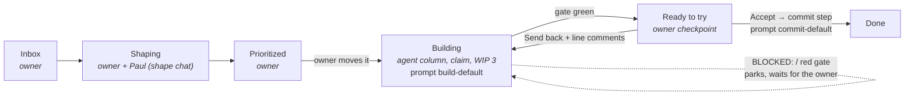
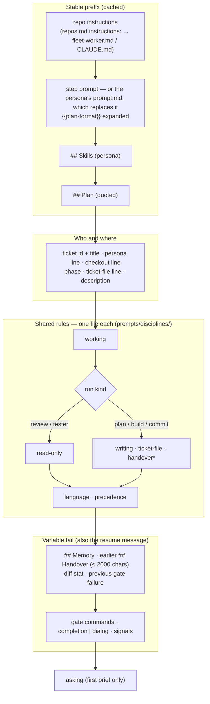
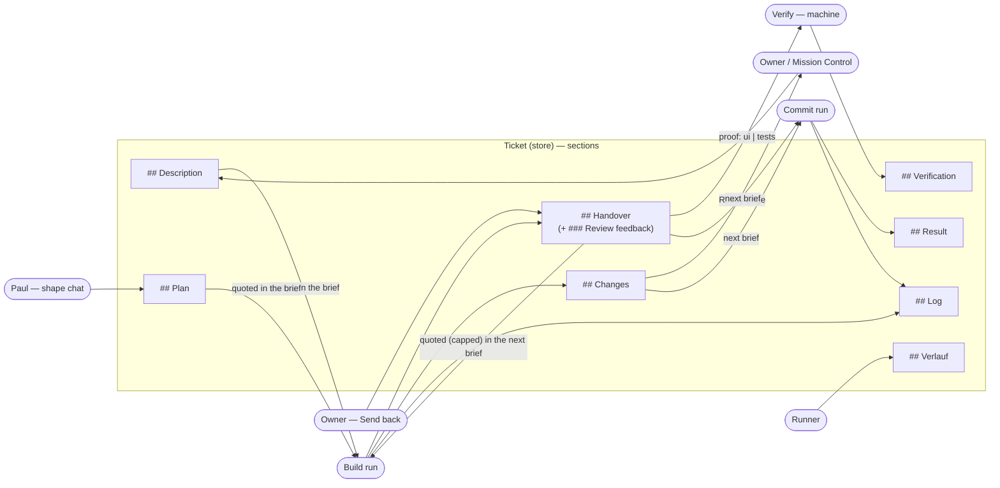

# The ticket run — what is handed over where, in the default flow

How one ticket travels through the default pipeline, and at each step what
is passed on, by whom, in which form. The diagrams are Mermaid (they render
on GitHub and in VS Code); the same overview as an editable draw.io diagram
is [ticket-run-flow.drawio](ticket-run-flow.drawio). State of the code: req-280
(ADR-0097). The binding texts are the prompt files and
[specs/classifier-spec.md](../../specs/classifier-spec.md); this page is the
map.

## 1. The default pipeline

`DEFAULT_PIPELINE_TEXT` (`packages/tickets-engine/src/core/pipeline-states.ts`)
seeds six states. Only **Building** is an agent column; Ready to try is the
owner's checkpoint, and Accept there starts the commit step.



| State | Who acts | What it produces |
|---|---|---|
| Inbox | owner, Mission Control (`createTicket`) | the ticket: frontmatter + `## Description` |
| Shaping | owner with Paul (crew prompt `shape.md`) | `## Plan` in the plan format (`{{plan-format}}`) |
| Prioritized | owner (`setPriority`, order) | priority, place in the queue |
| Building | dispatcher → runner → worker (`build-default`, or the persona's `prompt.md`) | commits on `t/<id>`, `## Changes`, `## Handover`, one `## Log` line |
| (verify) | `services/verify-service.ts`, a machine step, no LLM | `## Verification` + screenshots (only for `proof: ui`) |
| Ready to try | owner | Accept, or Send back with `### Review feedback` |
| commit step | worker (`commit-default`) | merge + push, `## Result` |
| Done | — | — |

## 2. One agent run, end to end

What happens between "the dispatcher picks the ticket" and "the ticket
moves on". Names are classes / files in `packages/tickets-engine/src/`.

```mermaid
sequenceDiagram
  autonumber
  participant Store as Ticket store (dk)
  participant Disp as TicketDispatch
  participant Src as PromptSource
  participant Comp as composeRunRequest<br/>+ composeInstruction
  participant Run as Runner (RunStarter,<br/>worktree, ticket copy)
  participant W as Worker (Claude Code /<br/>opencode / Kimi / Copilot)
  participant Done as RunCompletion
  participant Gate as GateRunner
  participant Close as ClosingRound

  Disp->>Store: claim the ticket (lease)
  Disp->>Src: promptFor(column, persona)
  Src-->>Disp: persona prompt.md, else the vault's<br/>tickets/_meta/prompts/build-default.md
  Disp->>Comp: card, ticket text, repo, persona,<br/>disciplines, diff stat, gate failure
  Comp-->>Disp: RunRequest: instruction (the brief),<br/>acceptance commands, gate kind, worktree
  Disp->>Run: start(request)
  Run->>Run: worktree _worktrees/T-x on t/T-x,<br/>ticket copy _workcopy/T-x.ticket.md
  Run->>W: the brief (first turn)
  W->>W: code + commits in the worktree,<br/>sections in the ticket copy
  W-->>Run: final message (markers at line start)
  alt QUESTION:
    Run->>Store: needs-decision comment, run waits
    Store-->>W: the owner's answer (same session)
  else BLOCKED:
    Run->>Done: blocked
    Done->>Close: closing round (FRICTION → journal)
    Done->>Store: blocked comment, park; no gate, no move
  else no marker = done
    Run->>Done: agentDone
    Done->>Gate: acceptance commands in the worktree
    alt red
      Gate-->>Done: failure tail
      Done->>Close: closing round
      Done->>Store: failed comment, ticket stays
    else green
      Done->>Close: closing round (only when a signal fired)
      Done->>Store: merge the ticket copy back,<br/>Verlauf line, done comment, move to next column
    end
  end
```

The **ticket copy** is the only ticket file a worker writes: when the turn
ends the runner merges every changed `## ` section back into the store
(`core/ticket-chapters.ts` `mergeWorkerChapters`: a changed section replaces
the store's, `## Log` takes only new lines, frontmatter and `## Verlauf` are
the runner's). No step commits a ticket file.

## 3. The brief: how it is put together

`fleet/instruction.ts` composes the brief in a fixed order — stable parts
first, so the provider's prompt cache survives. Which shared rules ride
depends on the run kind (`ruleParts`).



`*` handover is left out in a dialog. A scout brief has its own composer
(`scout-instruction.ts`): working, language, precedence, the report shape,
the scout discipline, signals, asking — no writing rules.

**The signals** are the only thing the runner reads from the worker's last
message (`harness/event-text.ts`):

| Marker | Effect |
|---|---|
| none | done: the gate runs; green moves the ticket |
| `BLOCKED: <reason>` | no gate, no move; a keyed `blocked:` comment; the ticket waits for the owner (a review FAIL ends this way) |
| `QUESTION:` | the run waits; the owner's answer comes back into the same session |
| `FRICTION: <what was missing>` | kept on the run; the closing round writes it into the persona's journal |

## 4. What each step passes on



Besides the ticket, a run leaves:

- **Store comments** (`core/status-comment.ts`) — the runner's and the
  board's status verbs (`done:`, `failed:`, `blocked: [key]`,
  `needs-decision: [key]`, `resolved: key`, `paused:`); the owner's Needs-you
  list reads them. Agents write none.
- **The run record** `runs/<id>/run.json` — state, timestamps, tokens, cost,
  the final message, the gate result; the run stream in the Thread.
- **The persona's journal** `tickets/_meta/personas/<id>/reviews.md` — one
  entry per closing round (signals, FRICTION, the finding); at most one
  lesson line in `memory.md`.
- **Improvement proposals** `improvements.md` — from the closing round or
  the aggregator (every 3 frictions); prompt changes arrive as exact edits
  against the current `prompt.md`, stored as the resulting text, and only
  the owner's Accept writes them.

## 5. The default run, step by step

1. **Capture.** The owner tells Mission Control (crew prompt `mission.md`) —
   it proposes `createTicket`; the owner confirms the card. Store: a ticket
   in Inbox with `## Description`.
2. **Shape.** The owner shapes it with Paul (`shape.md`): Paul may `read`
   repo files, asks one `question` at a time, and writes the whole `## Plan`
   body in the plan format — Goal, Decisions, Out of scope, Acceptance
   criteria as `` - [ ] `command` `` lines (the only lines the gate runs),
   Parts when it splits. `split` offers "Keep as one / Split into N".
3. **Prioritize.** The owner orders it and moves it into Building.
4. **Dispatch.** `TicketDispatch` claims it, `PromptSource` picks the
   instruction base (the persona's `prompt.md`, else the vault's
   `build-default.md`), `composeRunRequest` builds the brief (section 3) and
   the acceptance list; the runner prepares the worktree on `t/<id>` and the
   ticket copy.
5. **Build.** The worker orients, takes a baseline of the acceptance
   commands, builds, commits, writes `## Changes` and `## Handover` (with
   `proof: ui|tests`) and one Log line, and ends without a marker — or with
   `BLOCKED:` / `QUESTION:`. A ticket that arrives without acceptance
   criteria gets a plan in the plan format first (the structural gate
   demands one command).
6. **Gate.** The runner runs the acceptance commands in the worktree. Red:
   the run fails, the ticket stays, the next run gets the failure tail
   ("fix this first"). Green: the closing round (if a signal fired), the
   ticket copy merged back, a Verlauf line, the move to Ready to try.
7. **Verify** (machine, when configured): drives the app along the criteria,
   writes `## Verification` with screenshots for `proof: ui`.
8. **Ready to try.** The owner reads `## Changes`, tries it, and either
   **Accepts** — the commit step starts — or **sends back** with line
   comments, which land as `### Review feedback` at the end of `## Handover`
   and are the next build's requirements.
9. **Commit.** The commit worker (`commit-default`) checks the work branch,
   merges into the integration branch in its own worktree (protected branch:
   pushes `t/<id>` and ends `BLOCKED:` for the owner's pull request), proves
   the push from a fresh fetch, writes `## Result`. Green gate → **Done**.

The default pipeline has no review or test column. A review run happens on
a board whose flow has one — a `review` column, or a gate whose persona has
the role `reviewer` (`fleet/review-run.ts` `isReviewRun`) — and a tester's
run on a gate whose persona has the role `tester`. Both run read-only and
report in their final message; a review FAIL and a failed criterion end with
`BLOCKED:`, which parks the ticket for the owner.
