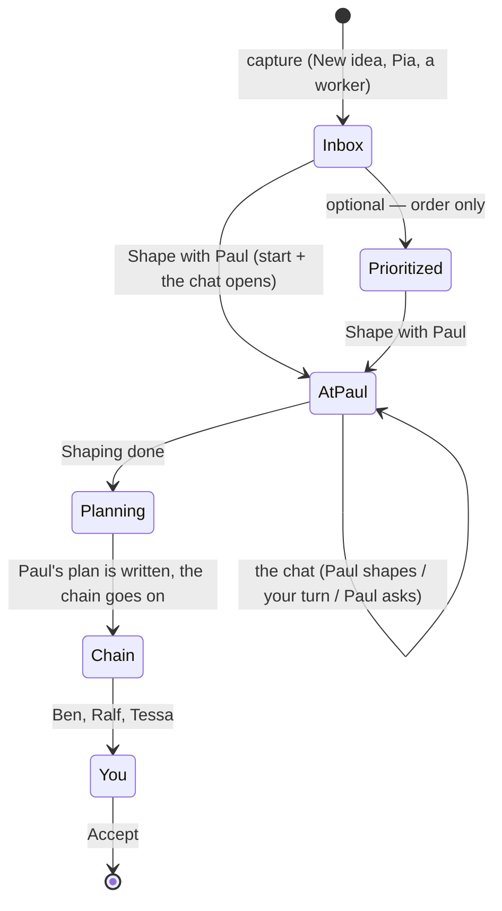

# From an idea to Paul's plan — the concept of the design round of 2026-11-16

Status: **proposed — awaiting the owner's decision.** Nothing is built. The boards are
7y – 7ab ([boards/README.md](boards/README.md)); the build items are the proposed rows
req-318 – req-325 of **step 5 of the finish line** (§11). The decisions that are the
owner's are in §10; each has a recommendation.

The owner's finding (2026-11-16, paraphrased): bringing a ticket to Paul is already hard —
it must first be moved to *Prioritized*, and then it seems it can only be moved to Paul by
dragging on the **board**. After that nothing happens; the ticket only says *shape with
Paul*. "The workflow is not coherent." He wants the concept and the design of how it can
work.

## 0. What is there today (read from code, manual and specs — not guessed)

**How a ticket gets to a persona.** A ticket is created in *Inbox* with the standard flow
copied into its chain (`paul:shape; ben; ralf; tessa; you`, cursor `x-at: 1`). A move to a
persona is the engine's `start` (`services/persona-board-moves.ts`, `startOf`): stage
`active`, the dropped-on persona takes the entry at the cursor — **from Inbox or from
Prioritized** (line 59). Nothing but the owner makes it:

| Way | Where | Works from |
|---|---|---|
| Drag the card onto a persona's column | Board (`persona-board-drop.ts`) | Inbox, Prioritized |
| The card's context menu *Start with Paul* (right click, `Shift+F10`, the menu key) | Board (`persona-board-actions.ts:106`) | Inbox, Prioritized |
| The ticket pane's *Start with Paul* (asks once) | Ticket document (`start-model.ts:22`) | **Prioritized only**, and only when the entry's persona is in the crew |
| The Tickets panel's row menu | `index.ts:2547` *Move to* | lifecycle columns only — no persona |
| Mission Control (phone, iPad, web) | `router.ts:590` | **no start at all** — only `POST …/hand`, which the engine refuses for a ticket without a holder (*"start it from Inbox or Prioritized"*, `persona-board-moves.ts:71`) |
| Pia | `chat-intents.ts` | no `start` intent (she has `transition`, `setChain`, …) |

So Prioritized is **not** a gate in the engine — the owner's *"it must first be moved to
Prioritized"* is what the surfaces teach: the one button a ticket has appears only there,
the Tickets panel's menu offers no persona at all, and the drag and the menu key are
invisible until known.

**What *Prioritized* means.** The manual says it is *"the queue the fleet pulls from"* and
that the Autopilot *"picks up tickets from Prioritized in order"* (`manual.md` 1027, 1439;
`FLEET.md` 941; the req-309 changelog entry). **The code never does.** `ownerColumnRefusal`
(`fleet/runner/request-refusals.ts:10`) says it outright — *"the board's edge columns … are
the owner's: nothing is run out of them"* — and the holder pass plans only tickets that
already have a holder (stage `active` / `running`). The only writer into `active` is the
owner's `start` move. A ticket parked in Prioritized waits for nobody.

**What *shape with Paul* is.** The entry `paul:shape` is *interactive*: Paul holds the
ticket, but **no run is dispatched for it** — `holder-pass.ts:76` (not a candidate) and
`:132` (the wait line *"waits at position 1 of 5 for the Shape chat with paul"*, which only
reaches `runner.log`). The owner's turn is to talk to Paul in the Shape chat — the
Assistant's Mission Control target, bound to the ticket document in the editor — and to
end it with *Shaping done* (the Accept the engine reads at a `:shape` entry; Paul's plan run
then starts at the same position). The label the owner reads is
`board.status.shaping` — *"shaping with you"* (`persona-card-view.ts:58`, catalog
`en.json:1236`); the ticket pane's Holder row draws Paul's picture; Mission Control's
ticket screen has a button *Shape with Paul* (`libs/mission-ui/src/ticket/view.html:508`,
a literal, "Paul" not read from the crew). Which of these the owner saw I cannot tell.

**Why "nothing happens" — three causes, in order of weight.**

1. **At Paul there is no control that begins.** The card in Paul's column says *shaping
   with you* and carries one button: **Shaping done** (`persona-card-view.ts:115`, shown
   whenever `hold.mode === 'shape'`). It is the *exit* of a conversation that has not
   begun — enabled before a single message was sent, and pressing it makes Paul plan from
   the bare idea. Nothing on the card or in the ticket pane opens the chat. The system is
   waiting for the owner and does not say what to do.
2. **The chat refuses the ticket once it is started.** The Shape chat attaches only to a
   ticket in the *first* column: `shapeTargetOf` returns null unless `card.phase ===
   pipeline[0].id` (`ticket-document/shape.ts:36`) — Inbox. After *Start* the ticket is
   `active`, so the Assistant stops being "about" it, and Mission Control's *Shape with
   Paul* (`libs/mission-ui/src/ticket/view.ts:1413`, `canShape`: phase index ≤ 1) vanishes
   as well. The two halves of the flow disagree: the persona board puts the shaping at
   Paul's column, the chat binding still lives in Inbox. (The engine itself does not
   refuse: a shape turn takes any ticket id, `chat-service.ts` `shapeContext`.)
3. **The wait is invisible.** A ticket at a Shape entry sits in the Tickets panel's
   **Running** group (`work-groups.ts:163–167`: "a Shape entry is held by its persona and
   runs as Running") although it waits for the owner; *Needs you* does not list it. The
   card's amber dot and *shaping with you* are the only hint.

A fourth leaves the flow after shaping unclear: *Keep as one* / *Split* in the chat are the
older end of shaping (`chat-service.ts` `shapeDecide` moves the ticket by `transition` to the
next pipeline phase), beside the new *Shaping done* (the cursor's Accept). Two ends for one
thing; the first was written for the phase board and is **not traced** to the end on an
`active` ticket (its target is computed from the pipeline's phases, which on a lifecycle
board lack the active column).

**"The default flow shows Paul twice" (finding of 2026-11-14).** Fixed in milestone 280
(req-305): the standard flow reads `paul:shape; ben; ralf; tessa; you` — one Paul, shaping
and planning in one entry; the board's Settings page shows *Paul (shape) → Ben → …*. The
fix does not migrate (nothing released): a ticket or a board whose chain was copied earlier
keeps two Pauls until its flow is changed, and **leftovers read as if it were still so**:
manual lines 1056, 1368, 2463 (and `public/manual`), the comment of
`ticket-document/hold-card.ts`, and the boards 7e v2 / `DeskWorkV2`, which draw `PA PA`.
Still **not verified by the owner** (the entry's own marker).

## 1. The job

> When I have an idea, I want to hand it to Paul and end with a plan I can accept — without
> learning stages, drags, hidden menus or which pane the conversation is in.

What matters to the owner, in his own words from the earlier rounds: *an Inbox and a place
the work is taken from* (req-309); *one clear next thing*; and he reads on a phone as often
as at the desk.

## 2. The flow, and who acts at each step

| State | Who acts | What the owner sees | The one next action |
|---|---|---|---|
| **Idea** — Inbox or Prioritized | You | the card in its lifecycle column | **Shape with Paul** (or *Start with Ben* when the chain's first step is not a Shape step) |
| **At Paul, nothing said yet** | You | amber dot, *waiting for you* | **Shape with Paul** (opens the chat) |
| **Paul is shaping** | Paul | green dot, *Paul is shaping · 40 s*; the document is locked | none (the chat shows the turn; *Stop* is in the chat) |
| **Your turn in the chat** | You | amber, *shaping with you* | **Shaping done** (and *Open chat*) |
| **Paul asks** | You | amber, *Paul asks · 1 question* | **Answer** (opens the decision card) |
| **Shaping done → waiting** | the Crew | *queued · waits for a B slot* (pool words), or *Autopilot is off* | none — or the fix (*Turn on*) |
| **Paul plans** | Paul | *running · 2 min* | none; *Open thread* |
| **Ben … Tessa** | the Crew | as today (position, `running`, `waits for Ben`) | none |
| **At You** | You | as today (*Accept*, *Send back…*) | **Accept** |

Rules behind the table:

- **One next action per state, no state without one when the owner is the one waited
  for.** Every row in which the owner acts has a control; every row in which somebody else
  acts says who and offers nothing to press.
- **A ticket waits under *Needs you* whenever it is the owner's turn** — including a Shape
  entry that Paul is not working on. While Paul's turn runs, it is *Running*.
- **The label is built from the entry, not typed in:** *Shape with {name}* uses the persona
  at the `:shape` entry (renaming Paul to Paula changes it; today's literal does not);
  *Start with {name}* is the existing `board.menu.start`.

## 3. Is *Prioritized* a gate? — no

Prioritized stays as an **optional, ordered "up next" lane**. It is not required, no
surface requires it, and the button works from Inbox. Reasons: the engine already allows
it (`startOf`); with the default flow the first entry is a Shape step the owner must be
present for, so there is nothing for an automatic pull to do from Prioritized; and a required
step with no information in it is the opposite of *recognition over recall*.

Because the docs promise more than the code does, there are two ways to make the two agree
(decision D1, §10): **correct the docs** (recommended — the truthful, smallest option), or
**build the pull** (the Autopilot starts a Prioritized ticket whose first entry *runs*,
i.e. is not a Shape or a You entry, in priority order; a Shape ticket stays and shows its
button). The pull matters only for custom flows that begin with an agent.

## 4. The action, wherever the ticket is

One verb, one label, every surface — *Shape with {name}* / *Start with {name}* /
*Shaping done* / *Answer* — with the same enabled/disabled rule from **one pure function**
(`nextActionOf`, §11 req-318), so the card, the pane, the row, the phone and the menu never
disagree.

- **The board card** (board 7y). In the states where *the owner* is waited for the button
  is **on the card**, always visible (the existing decision-button style: 26 px, accent,
  12 px). On an Inbox or Prioritized card — many of them — it is an **icon button beside
  the ⋯**, shown on hover and on focus; the ⋯ is always visible (a click opens the menu;
  today's menu is reachable only by right click or `Shift+F10`). Icon-only, with `title`
  and `aria-label` (ADR-0057).
- **The card's menu** lists the primary action **first**, then *Start with …* /
  *Hand to …*, then the lifecycle moves.
- **While a card is dragged**, the column heads say what a drop does (*Drop to shape with
  Paul*, *Drop to start with Ben*); drag stays as the direct way to hand a ticket on.
- **The ticket pane** (board 7y): the primary action is the one accent button at the right
  of the card's action row, beside *Thread* and *Change*; the state pill carries the words
  of §2 (*Idea*, *Waiting for you*, *Paul is shaping*, *Shaping with you*).
- **The Tickets panel row**: the same icon button beside the ⋯ on Inbox and Prioritized
  rows; a ticket at a Shape step lists under *Needs you*; the grey line reads
  `T-0141 · Paul · 1/5 · waiting for you`.
- **Keyboard and command palette.** The command palette gets *Shape with Paul…* and *Start
  with …* for the ticket in focus (a card, a row or the open ticket); they carry no default
  chord — the keybindings system lets the owner bind one (nothing here departs from a
  Windows or UI norm; `Shift+F10`, the menu key and `Enter` keep their meaning).
- **Mission Control (phone, iPad)** (board 7ab): the same words, and — new — the ability to
  start (§0); the ticket screen's primary
  button is full width and 44 px; *Shaping done* gets a button there too (milestone 280
  left it out on purpose until the flow was clear).
- **Pia** can start a ticket *(optional row req-324)*: *"Shape T-0141 with Paul"* becomes a
  confirmed card — `start`/`hand` intents beside `transition`.

## 5. What a click does

*Shape with Paul* on an idea:

1. **If the ticket has no holder yet**, the engine's `start` runs — one write, the status
   line `started at position 1 of 5 with paul`; the card moves to Paul's column.
2. **The ticket opens in the editor**, and the Assistant's Mission Control target attaches
   it (`T-0141.md attached`) — the binding now also accepts a ticket that stands at a
   Shape step (§11 req-319), not only one in Inbox.
3. **The composer takes focus.** The first message is the first turn.
4. **A toast reads *Started T-0141 with Paul · Undo*.** Undo is the existing `park` (back
   to where it came from, the cursor kept); it is offered while nothing holds a claim.
   Opening a chat is cheap and reversible, so there is **no confirmation**; *Start with
   Ben* — which spends money — keeps today's in-place *Start T-0017 with Ben? Cancel ·
   Start*.

If step 1 fails, nothing opens: the engine's sentence stays visible beside the control (§8).
*Shape with Paul* on a ticket already at Paul skips step 1 and only opens and focuses the
chat. Board 7z shows the result: ticket open, chat attached, *Paul is shaping · 40 s* in
the Assistant's status line, the meta bar *Paul is editing · Stop*, the Tickets row under
*Running*, the toast.

*Shaping done* asks in place (*Paul plans it next · Cancel · Done*, the pattern of *Start*),
and is **disabled until a message exists** (error prevention: today it can end a shaping
that never began). The chat's *Keep as one* and *Split* end the shaping through the same
Accept (req-321) — one end, not two.

## 6. Status words

The system always says where the ticket is and who is expected to act. New kinds in the
card's status (`HoldStatus`), next to today's:

| Kind | Words (catalog, lower case like the neighbours) | Dot |
|---|---|---|
| `shape-wait` | *waiting for you* | amber, glowing |
| `shape-turn` | *{name} is shaping · {duration}* | green |
| `shaping` (exists) | *shaping with you* | amber |
| `asks` (exists) | *{name} asks · {n} questions* | amber |
| `autopilot-off` | *Autopilot is off* | hollow |
| `queued` (exists) | *queued · waits for a B slot* | hollow |

The engine adds the two facts the card cannot know today: whether the ticket's Shape chat
has begun (a shape session exists) and whether a turn is live — a small `shape` field on
`TicketHold` (req-318), so every client reads the same state.

## 7. Missing preconditions — the control explains and offers the fix (board 7aa)

A control whose precondition is missing is **disabled, not removed, and says why next to
itself** (the tooltip repeats it; it is never the only place), with the **fix as a button
under it**. A disabled control is still focusable (`aria-disabled`), so the reason reaches a
keyboard and a screen reader.

| Missing | The control | The fix |
|---|---|---|
| The Assistant has no model (the Shape chat answers with its settings) | *Shape with Paul* disabled, *The Assistant has no model* | **Set up model** — opens Settings → Assistant |
| Drey Service is not running | disabled, *Drey Service is not running* | **Start Drey Service** (the plugin's `ensureService`); the button enables itself |
| The step names no persona | the primary becomes **Assign…** | the picker lists the crew (the Crew tab's list) |
| Shaping done, the Autopilot Off | status *Autopilot is off*, never a bare *waiting* | **Turn on** — the existing switch |
| A run holds the ticket | *Hand to …* and *Move to …* disabled, *a run holds it* | **Stop run** stays enabled |
| The move was refused | the engine's sentence under the card (*changed meanwhile — look again and retry*) | **Retry** |
| A read-only device | no control, one quiet line | none — the state is only readable |

**Empty and first-use states.** An empty board draws one primary, *New idea*. After a
capture a toast reads *T-0001 created* with **Shape with Paul** in it, so the owner does not
have to find the button (req-320).

## 8. Errors and undo

- **Errors stay.** A refused move shows the engine's own sentence on the card until the
  next action, with *Retry* (today `deps.mutate` reports and moves on). No error is only a
  toast that disappears.
- **Undo** after *Shape with Paul* (park), the existing *Move to Prioritized / Inbox* menu
  after any move, *Stop* in the chat. Undo is not offered once a run holds a claim.
- **Not undoable, therefore confirmed:** *Shaping done* (the persona's plan run starts) and
  *Start with {agent}* (the run spends money).

## 9. The Nielsen heuristics, and where each is met

| Heuristic | Where |
|---|---|
| Visibility of system status | §6 words for every state; *Needs you* membership; the toast; *Autopilot is off* instead of *waiting*; the drag-over words; board 7z |
| Match with the real world | *Shape with Paul* / *Start with Ben* in the persona's own name from the crew; no *stage*, *holder* or *cursor* on a button; Prioritized not required |
| User control and freedom | Undo after the start, *Cancel* on *Shaping done*, Park and Hand in the menu, *Stop*, drag stays |
| Consistency and standards | one verb pattern on every surface; the in-place confirm pattern of *Start*; the context menu key and `Shift+F10` unchanged |
| Error prevention | *Shaping done* disabled until a message; hand and park disabled while a run holds the ticket; a control with a missing precondition is disabled with its reason |
| Recognition over recall | the owner's turn has its button on the card; the menu's first row is the primary action; the palette names it; no drag or hidden menu to know |
| Flexibility and efficiency | drag, menu, icon button, palette, a bindable chord; Pia *(optional)* |
| Aesthetic and minimal design | one primary per state; the icon button only on hover; no taglines or hint paragraphs |
| Help recover from errors | the engine's sentence kept, *Retry*, the fix button in §7 |
| Help and documentation | the manual's *Shape a ticket in the editor* is rewritten around the button; the docs say what the Autopilot does |

## 10. Decisions for the owner

1. **D1 — What Prioritized is.** (a) **Optional "up next" lane, docs corrected**
   *(recommended)*. (b) The Autopilot also pulls from it, for a ticket whose first entry
   runs *(optional row req-325)*. (c) A required gate — rejected here: a step with no
   information, against the engine, against his finding.
2. **D2 — What the click does.** (a) **Moves the ticket to Paul at once and opens the chat,
   with Undo** *(recommended)*: the board shows who has it, the engine's Shape hold is
   used as designed. (b) Opens the chat only; the ticket moves to Paul on the first
   message: nothing "dangles" at Paul, but the work is invisible on the board until it
   starts, and the chat binding stays tied to Inbox.
3. **D3 — Many ideas.** Add **Shape next** at the head of the Inbox: it takes the first
   idea to Paul and opens the chat, so a queue of ideas is worked like a mailbox. Not in
   this round *(recommended: later, after the first is verified)*.
4. **D4 — Pia starts tickets** (*"Shape T-0141 with Paul"*): row req-324, optional.
5. **D5 — Where the chat lives.** The Assistant's Mission Control target, as built
   *(recommended)*; a chat inside the ticket pane is a second surface for the same
   conversation (`specs/decisions.md`: *Shape as a held harness session* and the
   one-conversation-partner rule).

## 11. The build items (proposed roadmap rows, step 5 of the finish line)

In this order; each small enough for one Sonnet run, a pause after each:

- **req-318 — The ticket's next action: one pure model and the status words** (§2, §4,
  §6). `nextActionOf(card, snapshot, live, readiness)` in `plugins/tickets/renderer/`,
  used by the card, the ticket pane, the Tickets row and (later) Mission Control; the
  `shape` field on `TicketHold`; the catalog keys; the new `HoldStatus` kinds.
- **req-319 — The Shape chat binds to a ticket at its Shape step** (§5, cause 2): the
  desktop binding and Mission Control's `canShape` accept an Inbox, a Prioritized and an
  *active ticket at a `:shape` entry*, no run live; *Shape with {name}* reads the persona
  from the entry; the one *Start and open the chat* action; **a `start` route for Mission
  Control** (`POST /api/tickets/<id>/start {persona}` beside `…/hand`, one more
  `RemoteDrey` method over the same `personaBoardMove`) — today a phone cannot start a
  ticket at all.
- **req-320 — The action on the card, the pane and the row** (boards 7y, 7z, 7ab): the
  card button and icon button, the menu's first row, the drag-over words, the ticket pane's
  primary and pill, the Tickets row's icon, the palette commands, the toast after *New
  idea*, the phone's full-width button.
- **req-321 — A Shape step waits under Needs you, and has one end** (§2, §5): the Tickets
  panel and Mission Control list it; *Shaping done* asks in place and waits for a message;
  *Keep as one* / *Split* end through the same Accept.
- **req-322 — A missing precondition explains and offers the fix** (§7, board 7aa): the
  disabled-with-reason control, the five fixes, *Autopilot is off*, the refusal line with
  *Retry*.
- **req-323 — The docs say what the code does** (§0, D1): the manual's *Prioritized* and
  *Autopilot* wording (1027, 1439), `FLEET.md` 941, the two-Paul leftovers (manual 1056,
  1368, 2463, `hold-card.ts`'s comment), *Shape a ticket in the editor*, `public/manual`.
- **req-324 — Pia starts and hands a ticket** *(optional, D4)*.
- **req-325 — The Autopilot pulls from Prioritized** *(optional, D1 b; engine, larger)*.

Specs and docs ride the rows: the manual, the catalog (`en.json`; a literal *Shape with
Paul* leaves `view.html`), `specs/classifier-spec.md` unchanged (no prompt changes),
`specs/ticket-schema.md` (the `shape` hold field), docs/05, docs/06, an ADR only if D1 (b)
or D2 (b) is chosen (the Autopilot's boundary or the start rule changes).

## 12. The boards

| Board | File | What it shows |
|---|---|---|
| 7y · Shape with Paul: the card and the ticket action, state by state | `ShapeStart` | the card in Inbox, Prioritized and at Paul (five states) and after; the card menu; the drag-over heads; the ticket pane's primary per state; the Tickets row |
| 7z · The first shaping: ticket open, chat attached, *Paul is shaping* | `ShapeFirst` | the desk, Work view: *Running* row, the pane, the locked document, the Assistant's status line, the toast |
| 7aa · When something is missing: the control explains and offers the fix | `ShapeBlocked` | the nine states of §7 and the empty board |
| 7ab · Shape with Paul on the phone | `MPhoneShapeStart` | Work with *Needs you*, the idea's ticket with the full-width button, the ticket in the chat with *Shaping done* |

## 13. What I could not verify

- I did **not run the app**: "nothing happens" is read from code, manual and specs; which of
  the labels (*shaping with you*, the Holder picture, Mission Control's button) the owner
  saw is not known.
- **No SDK call selects the Assistant's target.** The binding follows the open document
  while the Assistant stands on Mission Control (the Work view's preset, board 7q); a
  case where the Assistant is on *Model* may need `conversations.select(targetId)`.
- **Whether a live shape turn is observable in the snapshot** (§6): the engine runs the
  turn, so it knows; the field is proposed, not traced.
- *Keep as one* on an `active` ticket (§0, fourth point), and **how the owner starts one
  step by hand with the Autopilot Off** (the manual says "you start every step"; the
  control is not located) — so the fix for *Autopilot is off* uses the existing switch only.
- The new elements' measures (icon button, toast, pill) are drawn after the existing card
  and strip, not measured against a build.
